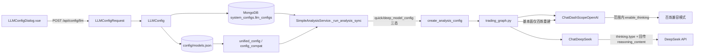

# 单股分析思考模式开关 开发方案

- 版本：v2.2（关键需求改按 `bugs/2026-11-03-单股分析思考模式开关实施方案.md`）
- 日期：2026-11-04
- 状态：待实现
- 关联问题：单股分析里千问 3 默认开思考，耗时长；配置页没有开关能按模型关掉或打开。DeepSeek 厂家目前在适配器里写死关闭思考。

> 相对 v1.1 的需求修正（v1.1 的两期拆分不再执行）：
> 1. **不做**「第一期对所有 DashScope 请求默认下发 `enable_thinking=false`」。思考参数引起的失败只去掉思考参数再请求一次，不因为 `InvalidParameter` 剥掉整个 `extra_body`。
> 2. **不做** `thinking_budget`。缺预算导致的失败按重发处理，不临时加预算字段。
> 3. **不**在引擎里把快速模型强制写成 `enable_thinking=False`。快速、深度各读自己选中的那条配置。
> 4. 思考参数是三态：范围内打开 / 范围内关闭 / 范围外不出现该字段。后两种不要都写成 `false`。
> 5. DeepSeek **厂家**下的模型，开关本期生效。百炼和 DeepSeek 都只回传「还没写完的那一轮工具调用」的 `reasoning_content`。配在百炼下的 DeepSeek 模型仍走 `enable_thinking`。
> 6. `LLMConfig` 和 `LLMConfigRequest` 都要加字段。只改前者时，`POST /api/config/llm` 会把前端传来的开关丢掉。
> 7. 带思考参数的请求成功就继续分析。思考参数引起的失败按实施方案表格重发一次（百炼非流式失败发 `false`，不能只去掉字段）；重发只改这一次请求，之后把实例上的思考参数写回。第二次成功则报告与现在相同。两次都失败才把分析标为失败。报告里不出现思考开关、重试、`reasoning_content`。

产品规则以实施方案为准。本文沿用 v1.1 已核对过的接线位置（主路径、裸实例、JSON 中间层），把改法写成可落地的步骤。

---

## 1. 背景与问题

### 1.1 现象

- 快速模型 `qwen3.8-flash` + 深度模型 `qwen3.8-max`（阿里百炼）组合下，单股分析耗时远超同流程的 deepseek-v4（适配器强制关思考时约 178 秒）。
- 千问 3 是混合推理模型。请求里不带 `enable_thinking` 时，平台默认开思考，单次调用把隐藏推理时间算进去。
- 配置页没有「思考模式」开关。模型能力里的 `reasoning` 特性只是标签，不会发给接口。

### 1.2 根因

1. **百炼适配器未传思考参数**。`ChatDashScopeOpenAI.__init__` 只设了地址、密钥、模型名、温度和 `max_tokens`：

   ```74:78:tradingagents/llm_adapters/dashscope_openai_adapter.py
        kwargs.setdefault("base_url", "https://dashscope.aliyuncs.com/compatible-mode/v1")
        kwargs["api_key"] = api_key_from_kwargs
        kwargs.setdefault("model", "qwen-turbo")
        kwargs.setdefault("temperature", 0.1)
        kwargs.setdefault("max_tokens", 2000)
   ```

2. **DeepSeek 适配器把思考写死为关闭**，用来避开 `reasoning_content` 回传 400。开关即使存进数据库，这里也不会读：

   ```125:132:tradingagents/llm_adapters/deepseek_adapter.py
        # 关闭 DeepSeek V4 系列的思考模式（thinking mode），避免 reasoning_content
        extra_body = kwargs.pop("extra_body", None) or {}
        extra_body.setdefault("thinking", {"type": "disabled"})
        kwargs["extra_body"] = extra_body
   ```

3. **主路径没有把模型配置传进建图**。`SimpleAnalysisService._run_analysis_sync`（约 L1396）调用 `create_analysis_config` 时不传 `quick_model_config` / `deep_model_config`。`create_analysis_config` 本身是整字典透传，函数签名不用改。

4. **保存请求模型没有该字段**。`POST /api/config/llm` 的体是 `LLMConfigRequest`（`app/models/config.py:356`），再 `LLMConfig(**data)` 入库（`app/routers/config.py:637`）。字段只加在 `LLMConfig` 上时，请求体会被丢掉，库里永远是默认关。

5. 放大因素不在本方案解决：分析图 20+ 次串行 LLM 调用、数据工具抓取。不改图结构，也不把分析改成流式。

### 1.3 目标

| 项 | 内容 |
|---|---|
| 配置 | 范围内模型在「高级设置 / 启用模型」下方出现「思考模式」，默认关。缺字段视为关，不迁移数据 |
| 百炼 | 范围内按开关发 `enable_thinking` true/false；范围外请求体不出现该字段。打开后按未结束的工具轮回传 `reasoning_content` |
| DeepSeek 厂家 | 该厂家全部模型按开关发 `thinking.type` enabled/disabled；打开后按同一条规则回传 `reasoning_content` |
| 失败重发 | 思考参数引起的失败去掉该参数，按现有方式再请求一次。第二次成功则报告正常；两次都失败才标分析失败 |
| 两个模型位 | 快速分析模型、深度决策模型各用自己那条配置。引擎不强制关快速侧 |
| 入口 | 单股、批量、H5 都走 `_run_analysis_sync`。主路径改对后一起生效，不改分析页 |

非目标：`thinking_budget`、全量 DashScope 默认关思考、因 `InvalidParameter` 剥掉整个 `extra_body`、快速模型引擎层强制关、图并行化、流式改造、厂家级测试接口带上思考参数、改 `get_provider_and_url_by_model_sync` 的 URL/Key 回退（那是另一份问题单）。

---

## 2. 现有配置管道

### 2.1 真实调用链

- **单股 / 批量 / H5 主路径**：`app/routers/analysis.py` 的 `/single`、`/batch` 进 `SimpleAnalysisService._run_analysis_sync`（`simple_analysis_service.py:1246` 起，建配置在约 L1396）。
- **旧 worker**：`analysis_service.py` 里 3 处组装 `quick_model_config` / `deep_model_config`（同步单股、同步批量、异步）。不是主流量，字段要和主路径一致。
- `TradingAgentsGraph.__init__` 开头读取 `quick_config` / `deep_config`（`trading_graph.py:223-224`）。百炼单厂家分支（L429 起）、DeepSeek 单厂家分支（L501 起）、混合模式 `create_llm_by_provider`（L41）都从这里取值。

### 2.2 数据流



### 2.3 关键结论

1. 堵点在 `_run_analysis_sync` 没把两份 model config 传进去。不补上，开关在主流量不生效。
2. 字典里的思考开关是三态。范围内写 `true`/`false`；范围外**不要写这个键**，或显式 `None`。创建客户端时不要把 `None` 当成 `False` 传给百炼适配器。
3. 查找必须同时对上厂家和模型名，并且只使用启用厂家下的启用模型。同一个模型名挂在两个厂家下时，不能取 `llm_configs` 里的第一条。不要为了开关去改 `get_provider_and_url_by_model_sync`（L100）「按 model_name 取第一条、再猜 URL」的旧行为。
4. `create_llm_by_provider` 现为固定 7 参（L41），混合模式要加可选参数才能把开关传进适配器。它的百炼判断目前只有 `provider.lower() == "dashscope"`（L79），和单厂家分支（L429-432：`dashscope` / `alibaba` / 名称含 `dashscope` / 名称含「阿里百炼」）不一致，混合模式要改成同一套判断。

---

## 3. 哪些模型发思考参数

前后端各写一份判断，规则必须相同。前端决定显不显示，后端决定发不发参数。

### 3.1 百炼

厂家标识是 `dashscope`、`alibaba`，名称转小写后包含 `dashscope`，或名称里带「阿里百炼」。与 `trading_graph.py:429-432` 的单厂家分支对齐。显示名「阿里云百炼」不含连续子串「阿里百炼」，判断要用厂家 id，不要只用显示名。

模型名先转小写，符合任一条即在范围内：

1. 匹配 `^qwen(\d+)`，且数字 `>= 3`。覆盖 `qwen3.8-max`、`qwen3-235b-a22b`、以后的 `qwen4-plus`。
2. 以 `qwen-plus`、`qwen-turbo`、`qwen-flash` 开头，包括 `-latest` 和日期快照。

名字里带 `instruct` 的不在范围内。`qwen-max`、`qwen-long`、`qwen2` 两条都不中，请求里不要出现 `enable_thinking`。

不要维护「只能开、不能关」的黑名单。范围内照开关发送。若返回 `The value of the enable_thinking parameter is restricted to True`，按 §7.3 去掉思考参数再请求一次，不改配置里的开关。

百炼请求只发 `enable_thinking`，不发 DeepSeek 的 `thinking` 字段。配在百炼下的 `deepseek-v4-pro` 也走 `enable_thinking`。

### 3.2 DeepSeek 厂家

厂家标识是 `deepseek`（不要用名字里有没有 `v4` 判断）。该厂家下的模型都在范围内。`api_base` 为空时用厂家默认地址，不要求页面填了 `api.deepseek.com`。

参数是 `thinking: {"type": "enabled"}` 或 `{"type": "disabled"}`，不发 `enable_thinking`。

### 3.3 三态

| 情况 | 传给适配器 | 请求体 |
|---|---|---|
| 范围内，开关打开 | `True` | 百炼 `"enable_thinking": true`；DeepSeek 厂家 `"thinking": {"type": "enabled"}` |
| 范围内，开关关闭 | `False` | 百炼 `"enable_thinking": false`（千问 3 不传会按平台默认去思考）；DeepSeek 厂家 `"thinking": {"type": "disabled"}` |
| 范围外，例如 `qwen-max` | 不传，或 `None` | 请求里没有 `enable_thinking`。传 `false` 也会 400 |

DeepSeek 适配器在调用方没传开关时仍发 `disabled`，保持还没改到的旧入口。这和百炼「没传就不出现该字段」不同。单股分析对范围内模型会显式传入 `true` 或 `false`。

---

## 4. 配置字段与配置页

### 4.1 后端模型 `app/models/config.py`

`LLMConfig`（L186）和 `LLMConfigRequest`（L356）**都增加**：

```python
enable_thinking: bool = Field(
    default=False,
    description="单股分析是否开启思考模式。仅对范围内的百炼千问和 DeepSeek 生效"
)
```

存量文档无该字段：Pydantic 默认 `False`，读取侧范围内缺字段当关。不做数据迁移，不加 `thinking_budget`。

`app/routers/config.py` 的新增 / 更新若先 `request.model_dump()` 再 `LLMConfig(**data)`，两处都有字段后开关才能入库。只改 `LLMConfig` 的实现视为失败。

### 4.2 JSON 中间层

| 位置 | 现状 | 修正 |
|---|---|---|
| `app/core/unified_config.py` `get_llm_configs` | 从 JSON 构造 `LLMConfig` 时未回填思考开关 | 带上 `enable_thinking`，缺省 `False` |
| 同文件 `save_llm_config` | 落盘字段不含该开关 | 补写，避免 JSON 镜像丢掉后读出来永远是关 |
| `app/core/config_compat.py` 模型读写 | 只透传 max_tokens/temperature/enabled 一类字段 | 补 `enable_thinking` |

顺手把已有的 `timeout` / `retry_times` 一并回填可以，但本需求不依赖 `retry_times`（DashScope `_generate` 并不按它重试）。

### 4.3 前端

类型落在 `frontend/src/api/config.ts` 的 `LLMConfig`（`LLMConfigDialog.vue` 实际引用的是这份，不是 `types/config.ts`）：

```ts
enable_thinking?: boolean
```

`DEFAULT_LLM_CONFIG` 补 `enable_thinking: false`。

`frontend/src/views/Settings/components/LLMConfigDialog.vue`：

- `defaultFormData` 增加 `enable_thinking: false`。编辑已有模型时，缺字段用 `?? false`。
- 开关放在「高级设置」分隔线下面、「启用模型」的下一项。标签写「思考模式」，不要写「启用思考」。「启用模型」表示这条配置能不能被选中。
- 只有第 3 节范围内的模型才渲染。切换厂家或模型名后若离开范围，隐藏开关，保存时提交 `enable_thinking: false`，避免上一次打开的值留在范围外模型上。
- 说明（百炼和 DeepSeek 同一句）：关闭时单股分析不思考；打开后更慢、更费 token。
- 不要放进「模型参数」，也不要放进「模型能力配置」。不要复用 `features` 里的 `reasoning`。
- 对话框是单模型编辑，没有快速 / 深度维度。两个分析位各选哪条模型，由分析页决定；后端按那条模型的开关下发，前端不用、也不能在这里把「快速」强制关掉。

---

## 5. 主路径把开关带进建图

### 5.1 `_run_analysis_sync`（必改）

在 `create_analysis_config(...)`（约 L1396）之前，用**已经解析出的** `quick_provider` + `quick_model`、`deep_provider` + `deep_model` 各查一条配置。查询条件：`provider` 与 `model_name` 同时相等，`enabled == True`，且该厂家在 `llm_providers` 里 `is_active`。命中多条时取第一条满足条件的，不要取「模型名相同但厂家未启用」的那条。

```python
quick_model_config = _build_llm_model_config_sync(quick_provider, quick_model)
deep_model_config = _build_llm_model_config_sync(deep_provider, deep_model)

config = create_analysis_config(
    ...
    quick_model_config=quick_model_config,
    deep_model_config=deep_model_config,
)
```

`max_tokens` / `temperature` / `timeout` 仍按现有默认值组装。思考开关单独处理，**不要**在默认字典里写死 `"enable_thinking": False`：

```python
def _build_llm_model_config_sync(provider: str, model_name: str) -> dict:
    config = {"max_tokens": 4000, "temperature": 0.7, "timeout": 180}
    row = _find_enabled_llm_config(provider, model_name)  # 厂家+模型名+启用
    if not row:
        return config
    config["max_tokens"] = row.get("max_tokens", 4000)
    config["temperature"] = row.get("temperature", 0.7)
    config["timeout"] = row.get("timeout", 180)
    if _thinking_in_scope(provider, model_name):
        config["enable_thinking"] = bool(row.get("enable_thinking", False))
    # 范围外：不写 enable_thinking
    return config
```

### 5.2 旧 worker 三处

`app/services/analysis_service.py` 组装这两份 dict 的三处同样加上，并遵守三态：范围内 `llm_config.get("enable_thinking", False)` 或 `getattr(..., False)`；范围外不要把键写成 `False`。

---

## 6. 引擎注入 `tradingagents/graph/trading_graph.py`

初始化日志补打思考开关取值。快速侧**不要**写成常量 `False`。

从 dict 取出要传给构造函数的参数。键不存在或值为 `None` 时，百炼不传这个关键字参数：

```python
def _thinking_kw(model_config: dict) -> dict:
    if "enable_thinking" not in model_config:
        return {}
    value = model_config.get("enable_thinking")
    if value is None:
        return {}
    return {"enable_thinking": bool(value)}
```

1. **百炼单厂家分支**（L429-499）：创建 `deep_thinking_llm` 与 `quick_thinking_llm` 时都 `**_thinking_kw(...)`。两个都传，快速侧用 `quick_config`，深度侧用 `deep_config`。

2. **DeepSeek 单厂家分支**（L501-545）：该厂家模型都在范围内，两个 `ChatDeepSeek` 都传入 `enable_thinking=bool(...)`。缺键当 `False`。不要传 `None`，也不要把快速模型写成强制 `False` 而忽略配置。

3. **`create_llm_by_provider`**（L41）：增加 `enable_thinking: bool | None = None`。
   - 百炼分支（判断改为与 L429-432 相同，不能只判断 `== "dashscope"`）把该参数传给 `ChatDashScopeOpenAI`。`None` 时不传。
   - DeepSeek 分支传给 `ChatDeepSeek`。`None` 时适配器仍发 `thinking.type = disabled`。
   - 混合模式调用点用已有的 `quick_config` / `deep_config` 取值。

### 6.1 基本面裸实例

`tradingagents/agents/analysts/fundamentals_analyst.py:256-271` 在类名含 `DashScope` 时会 `new` 一个 `ChatDashScopeOpenAI`，目前只复制模型名、密钥、地址、温度、`max_tokens`。这个节点用的是快速模型。`ChatOpenAI` 不保证把自定义参数存成 `llm.enable_thinking`，所以不要 `getattr(llm, "enable_thinking", False)`。

新建时按这个顺序抄：

1. `getattr(llm, "extra_body", None)`
2. 没有则看 `getattr(llm, "model_kwargs", {})` 里的 `extra_body`
3. 仍没有就不传，不要假定属性一定叫 `extra_body`

把抄到的 `enable_thinking`（True/False）传给新实例。没有该键就不传。否则快速模型打开思考后，只有基本面这一段仍是关闭。

类名不含 `DashScope` 时（含 DeepSeek）继续用原来的 `llm`，不用再抄。

---

## 7. 适配器

### 7.1 百炼 `ChatDashScopeOpenAI.__init__`

在 `super().__init__(**kwargs)` **之前**：

```python
enable_thinking = kwargs.pop("enable_thinking", None)
kwargs.pop("thinking_budget", None)  # 误传入也不发送

extra_body = kwargs.pop("extra_body", None) or {}
if enable_thinking is True or enable_thinking is False:
    extra_body["enable_thinking"] = bool(enable_thinking)
# None 或没传：不要写入 enable_thinking，更不要 setdefault False

if extra_body:
    kwargs["extra_body"] = extra_body
```

约束：

- 不发 `thinking` 字段。
- 不对所有百炼请求默认写 `false`。
- 思考参数引起的失败按 §7.3 重发，只去掉 `enable_thinking`。不要因为 `InvalidParameter` 剥掉整个 `extra_body`。token 超限、模型名错误不重发。
- 响应里的 `reasoning_content` 与 DeepSeek 使用同一条回传规则（§7.2 第 3 点）。基本面新建的客户端走适配器里的这段逻辑。
- 单股分析是非流式。部分开源千问只允许流式思考。出现这类失败时按 §7.3 重发，不把分析改成流式。

`bind_tools()` 若在运行时再传 `extra_body`，可能盖掉 `__init__` 里的值。基本面节点改为显式把思考参数传进新实例（§6.1），不要依赖「父实例上的 setdefault 一定会留到 bind 之后」。

### 7.2 DeepSeek `ChatDeepSeek`

1. `__init__` 在 `super().__init__` 之前 `kwargs.pop("enable_thinking", None)`，存到实例上。不要传给 `ChatOpenAI`。
2. `_generate` 不再固定 `disabled`：

```python
extra_body = kwargs.pop("extra_body", None) or {}
if getattr(self, "enable_thinking", None) is True:
    extra_body["thinking"] = {"type": "enabled"}
else:
    # False，或旧入口没传：保持现状
    extra_body["thinking"] = {"type": "disabled"}
kwargs["extra_body"] = extra_body
```

3. **回传 `reasoning_content`**。打开思考后，助手消息会带这个字段。`ChatOpenAI` 组请求时会丢掉它。百炼适配器同样保存并按本条规则送回。

   - 收到响应后写入 `AIMessage.additional_kwargs["reasoning_content"]`。父类若已丢掉，从原始响应的 `reasoning_content` 或 `model_extra` 取。先打日志确认落点，再固定读取位置。当前锁定的 `langchain-openai` 是 0.3.33，组请求的方法是 `_get_request_payload`，建消息可覆盖 `_create_chat_result`。
   - 只回传还没写完的工具轮：助手消息有 `tool_calls`，且后面还没有另一条不带 `tool_calls` 的助手消息。市场分析师第二次请求（工具助手消息 + 工具结果 + 新的用户问题）要送回。下一节点历史里已经有最终回答的旧消息去掉该字段，保留正文和 `tool_calls`。没有该字段不要补空字符串。
   - 不写进 `content`，不写进分析报告。
   - 只改适配器。`AgentState`（`MessagesState`）会把前面节点的消息累积给下一个分析师，不能假定下一节点是新对话。
   - 深度决策是一次 `invoke`、不调工具：开关打开会思考，没有下一轮要回传。
   - 没送回而失败时，先补原文再请求一次。仍然失败则进入 §7.3，DeepSeek 改发 `thinking.type = disabled`。

### 7.3 思考参数失败后按现有方式重发

带上思考参数的请求成功，就按这次结果继续。思考正文不进报告。

只有错误原文命中思考参数时才重发：`enable_thinking`、`NotSupportEnableThinking`、`restricted to True`、`must be set to false for non-streaming`、`thinking_budget`、同时出现 `reasoning_content` 与 thinking。密钥、模型不存在、内容审核、token 超限、纯 `InvalidParameter` 不重发。

| 失败 | 第一次补救 | 百炼这一次 | DeepSeek 这一次 |
|---|---|---|---|
| 模型不支持该参数 | 无 | 去掉 `enable_thinking` | `thinking.type = disabled`，去掉消息里的 `reasoning_content` |
| 只允许打开、不能关闭 | 无 | 去掉 `enable_thinking` | 同上 |
| 非流式不允许思考 | 无 | 发 `enable_thinking: false`（不传则千问 3 仍默认思考）。不改成流式 | 同上 |
| 缺少 `thinking_budget` | 无 | 发 `enable_thinking: false`，不加预算 | 同上 |
| 未回传 `reasoning_content` | 先把已收到的原文送回 | 仍失败则发 `false`，并去掉消息里的 `reasoning_content` | 仍失败则 `disabled`，并去掉该字段 |

重发只用本次请求的副本。成功或失败后把实例上原来的思考参数写回去，后面的分析师仍按配置发。第二次成功时分析师只看到这次回复，报告字段和正文与现在相同，不增加思考开关、重试、`reasoning_content`。这些过程只写 `logs/tradingagents.log`（适配器现有 `agents` logger，INFO，前缀 `🧠 [思考模式]`）。两次都失败，才按现有大模型失败流程结束，不要生成带「已重试」字样的报告。

`bind_tools` 若覆盖 `extra_body`，以实际发出去的请求为准，基本面新建客户端时把思考参数抄过去。范围外不发参数在组 `quick/deep_model_config` 时完成，适配器不按模型名再挡。

---

## 8. 测试接口 `app/services/config_service.py`

- **单个模型测试**（`test_llm_config` → `_test_dashscope_api` / `_test_deepseek_api`）：读这条 `LLMConfig.enable_thinking`，遵守三态。百炼范围内才带 `enable_thinking`，范围外不带。DeepSeek 厂家按开关发 `enabled` / `disabled`。测试只有一轮，不需要回传。现状 `_test_dashscope_api` 不带该字段，`_test_deepseek_api` 写死 `disabled`，两处都要改成读配置。
- **厂家测试** `test_provider_api`：不对应某一条模型的开关，不要改成带上思考参数。

不要参照 `retry_times` 把测试接口一律写成关闭。那会让「打开思考后再点单个模型测试」和真实分析不一致。

---

## 9. 兼容性与风险

| 风险 | 说明 | 对策 |
|---|---|---|
| 只改 `LLMConfig` | `LLMConfigRequest` 会丢字段，库里永远关 | 两处一起加；测试断言 POST 后 MongoDB 为 `true` |
| 范围外误发 `false` | `qwen-max` / `qwen-long` / `instruct` 传 `enable_thinking` 会 400 | 三态：范围外不出现该字段；适配器对 `None` 不写 |
| 千问 3 关闭时漏发 `false` | 不传则平台默认开思考，耗时下不来 | 范围内关闭必须发 `false` |
| 快速模型被引擎写死关 | v1.1 §4.3 会让分析师节点忽略开关 | 快速、深度各读自己的配置 |
| 基本面重建丢参数 | 只复制 5 个字段时，快速侧打开后这一段仍关 | 从 `extra_body` 或 `model_kwargs["extra_body"]` 抄 |
| 同名模型取错行 | `get_provider_and_url_by_model_sync` 按模型名取第一条 | 开关查找单独按厂家+模型名+启用 |
| 混合模式认不出百炼 | `create_llm_by_provider` 只判断 `dashscope` | 与 L429-432 使用同一套厂家判断 |
| 思考参数 400 | 不支持、只能开、非流式、缺预算、未回传 `reasoning_content` | §7.3 分情况重发；非流式发 `false`。重发后写回实例上的思考参数。报告不出现重试痕迹 |
| 非思考类 400 | 密钥、模型不存在、内容审核、token 超限 | 不重发，沿用现有失败流程 |
| 分析师吞掉异常 | 市场/基本面节点会把模型异常写成「分析生成失败」并继续 | 重发放在适配器 `_generate`，成功时分析师看不到这次异常 |
| 运行时 `extra_body` 覆盖 | `bind_tools` 可能盖掉构造时写入的值 | 基本面显式传入；其他节点用同一客户端实例 |
| JSON 镜像丢字段 | `unified_config` / `config_compat` 不读写新字段 | §4.2 |
| 其他厂家 | openai / google / 智谱等 | 不发 `enable_thinking`，也不发 `thinking` |

---

## 10. 测试计划

1. **保存**：`POST /api/config/llm` 带 `enable_thinking: true` 后，MongoDB 该条为 `true`。只改 `LLMConfig`、不改 `LLMConfigRequest` 视为失败。JSON 侧 `get_llm_configs()` 能读回该字段，缺字段为 `false`。
2. **百炼适配器**
   - 范围内关闭 → 请求体 `"enable_thinking": false`；打开 → `true`。
   - 不传 / `None` → 请求体没有该字段。禁止对所有请求 `setdefault False`。
   - `qwen-max`、`qwen-long`、名字带 `instruct`：即使调用方误传 `true`/`false` 也不发送（范围判断在组 config 时完成；适配器本身只尊重传入的三态）。
   - `ChatDashScopeOpenAI(..., enable_thinking=False)` 能初始化。
3. **DeepSeek 适配器**
   - `enable_thinking=True` → `thinking.type = enabled`；`False` 或没传 → `disabled`。
   - `ChatDeepSeek(..., enable_thinking=True)` 能初始化。
   - `[助手(tool_calls + reasoning_content), 工具结果, 用户问题]` 的请求含原文。该助手消息后已有不带 `tool_calls` 的最终回答时，下一节点请求不含 `reasoning_content`。
   - 思考参数失败：未回传先补原文；仍失败或属于另外四种时，百炼第二次无 `enable_thinking`，DeepSeek 第二次为 `disabled`。第二次成功不把分析标为失败。密钥错误、模型不存在、内容审核、token 超限不重发。
4. **查找**：同一模型名配在两个厂家下，读到的是本次厂家那一条开关。
5. **基本面**：快速模型打开思考时，新建的百炼客户端请求里仍是 `enable_thinking: true`。DeepSeek 不经过这次新建。
6. **测试接口**：单个模型测试遵守三态；厂家测试请求体不新增思考参数。
7. **手工**
   - 范围内百炼模型或 DeepSeek 厂家模型：高级设置里「启用模型」下方出现「思考模式」，默认关。保存、刷新后值还在。`qwen-max` 或 GPT 不出现开关。
   - 关闭后跑 1 级单股分析，快速、深度都是关。同一模型只打开并选为快速模型时，只有快速侧开；改选为深度模型时，只有深度侧开。百炼看 `enable_thinking`，DeepSeek 看 `thinking.type`。
   - `qwen-max` 或 `qwen-long` 跑一次，请求体没有 `enable_thinking`，不因该参数 400。
   - DeepSeek 或百炼打开并选为快速模型，跑一次会调工具的分析。第二轮请求带上一轮 `reasoning_content`。若仍因思考参数失败，日志中有一次按现有方式的重发，报告里没有「分析失败」，任务不是失败。两次都失败才标失败。只选为深度模型时，深度侧按开关发送，快速侧仍按快速模型自己的开关。
   - 批量或 H5 选同一套模型，行为与 PC 单股分析一致。

不把「单节点 10–25 秒、总耗时 ≤ 4 分钟、下降 ≥ 50%」列为验收。关闭范围内千问的思考后耗时应下降，但是本方案的完成标准是开关按三态生效。

---

## 11. 实施步骤与工作量

| 步骤 | 内容 | 文件 | 估时 |
|---|---|---|---|
| 1 | `LLMConfig` 与 `LLMConfigRequest` 增加字段 | `app/models/config.py` | 0.25h |
| 2 | JSON 读写带上字段 | `unified_config.py`、`config_compat.py` | 0.5h |
| 3 | 范围判断（前后端各一份）+ 配置页开关 | `LLMConfigDialog.vue`、`api/config.ts`，后端可放适配器或 config 侧共用 | 1h |
| 4 | 主路径按厂家+模型名组装三态，并传入 `create_analysis_config`；旧 worker 三处对齐 | `simple_analysis_service.py`、`analysis_service.py` | 1h |
| 5 | 百炼 / DeepSeek 单厂家分支与 `create_llm_by_provider` 传入开关；百炼厂家判断与 L429 对齐；快速侧不强制关 | `trading_graph.py` | 1h |
| 6 | 基本面从 `extra_body` 抄思考参数 | `fundamentals_analyst.py` | 0.5h |
| 7 | 百炼适配器三态写入，并按 §7.3 重发；回传未结束工具轮的 `reasoning_content` | `dashscope_openai_adapter.py` | 1h |
| 8 | DeepSeek 按开关发送，回传未结束工具轮的 `reasoning_content`，并按 §7.3 重发 | `deepseek_adapter.py` | 1.5h |
| 9 | 单个模型测试按三态；厂家测试不改 | `config_service.py` | 0.5h |
| 10 | 单测与一条真实分析（百炼开关、DeepSeek 工具轮回传） | - | 1.5h |

合计约 8h。没有可独立上线的「先默认全关」一期：范围外默认发 `false` 会让 `qwen-max` 400，和本需求相反。

---

## 12. 验收标准

1. 范围内模型可在「启用模型」下方开关思考；范围外不显示。保存进 MongoDB，刷新仍在。只改 `LLMConfig` 视为未完成。
2. 百炼范围内关闭发 `enable_thinking: false`，打开发 `true`。`qwen-max`、`qwen-long`、带 `instruct` 的模型请求体没有该字段。未传参的百炼调用也不要被适配器默认写成 `false`。
3. 快速、深度各看自己的开关。快速模型打开时，分析师节点（含基本面新建的客户端）请求里为打开。
4. DeepSeek 厂家打开后发 `thinking.type = enabled`，工具调用的下一轮请求含上一轮 `reasoning_content` 原文。关闭或旧入口没传时为 `disabled`。思考正文不进报告。
5. 配在百炼下的 DeepSeek 模型走 `enable_thinking`，不发 `thinking`。其他厂家两种字段都不出现。
6. 单个模型测试与分析使用同一套三态。厂家测试不带思考参数。
7. 批量与 H5 单股分析与 PC 单股分析一致。思考参数引起的失败先按 §7.3 重发，第二次成功则报告字段和正文与现在相同，任务不失败；两次都失败才把分析标为失败。不改成流式，也不改已保存的开关。密钥错误、模型不存在、内容审核、token 超限不走这次重发。报告里没有思考开关、重试、`reasoning_content`。
