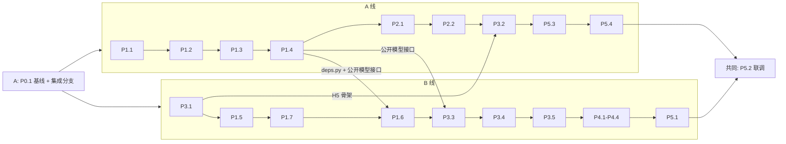
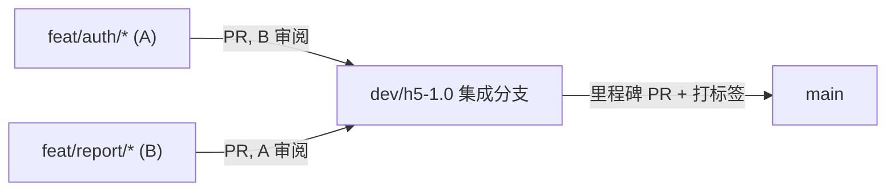

# TradingAgents-CN H5 / Web 1.0 — AI 自动开发计划

> **文档用途**：两名非技术人员（**A**、**B**）使用 **Cursor Agent** 并行进行 AI 辅助自动开发。
> 本文档是本次开发的唯一操作手册，按开发单元逐个指导每个环节该做什么、怎么做、怎么验收。
>
> **分工**：**A 负责用户权限体系与短信验证**，**B 负责单股分析与分析报告**；详见 [一、项目背景 · 两人分工](#两人分工)。
>
> **编码仓库根目录（Cursor 工作区）**：`D:\coding\TradingAgents-CN`（两人各自在本机 D 盘克隆同一仓库）
> **需求 / 技术 / 原型图资料**：`D:\coding\TradingAgents-CN\doc`（**纳入 Git**，两人通过仓库同步需求、方案、本计划与交接文档）。
> **磁盘硬性约束**见 [2.1 磁盘与路径硬性约束](#21-磁盘与路径硬性约束禁止占用-c-盘)。
>
> **本次范围**：H5（新建 `mobile/`）+ PC 前端（`frontend/`）同步 + 支撑它们的后端（`app/`）改造。
> **不在本次范围**：微信公众号菜单挂接；项目整体改名为 HunterAgent（本次仍沿用 TradingAgents-CN 名称，改名将来作为整体任务单独进行）。

### 开发单元验收进度

> 进度表按负责人拆成两张：**A 只改 A 线表，B 只改 B 线表**，共同单元由最后合入 PR 的人更新，避免两人同时改同一行产生 Git 冲突。

#### A 线进度（用户权限体系 + 短信验证）

| 单元 | 负责人 | 状态 | 验收日期 | PR | 备注 |
|------|--------|------|----------|----|------|
| P0.1 环境核验 + 磁盘约束 + `.gitignore` + 基线提交 + 集成分支 | A | 待启动 | — | — | B 在此之后克隆仓库 |
| P1.1 用户手机号字段与索引迁移 | A | 待启动 | — | — | — |
| P1.2 短信通道（mock）+ SpecCaptcha + 验证码 + 限流 | A | 待启动 | — | — | — |
| P1.3 注册（含密码）/ 手机号登录 / 验证码登录 / 忘记密码 | A | 待启动 | — | — | — |
| P1.4 管理员接口收紧 + 公开模型接口 | A | 待启动 | — | — | B 的 P1.6、P3.3 依赖本单元 |
| P2.1 PC 登录 / 注册 / 忘记密码 / 协议页 | A | 待启动 | — | — | — |
| P2.2 PC 菜单权限 + 路由守卫 + 用户手机号 | A | 待启动 | — | — | — |
| P3.2 H5 账号页面 | A | 待启动 | — | — | 依赖 B 的 P3.1 |
| P5.3 真实短信通道接入（腾讯云） | A | 待启动 | — | — | 签名 / 模板 ID 预留，审核通过后填入 |
| P5.4 协议正文替换 + 上线检查清单 | A | 待启动 | — | — | 完成后生成交接文档 `Deploy-Runbook.md` |

#### B 线进度（单股分析 + 分析报告）

| 单元 | 负责人 | 状态 | 验收日期 | PR | 备注 |
|------|--------|------|----------|----|------|
| P3.1 H5 工程骨架（`mobile/`） | B | 待启动 | — | — | B 的第一个单元；A 的 P3.2 依赖本单元 |
| P1.5 报告按用户隔离 + 历史回填 | B | 待验收 | 2026-10-23 | 分支已推送，待网页开 PR | 报告写入 user_id + 回填脚本 + 归属校验 + seed_test_users；pytest 29 通过；本地验收通过；模型 Composer；`feat/report/P1.5-report-isolation` |
| P1.7 分享 30 天 + 公开字段 + 免登录导出 | B | 待启动 | — | — | 完成后生成交接文档 `Backend-API-Report.md` |
| P1.6 分析任务归属校验 | B | 待启动 | — | — | 依赖 A 的 P1.4（`require_admin`） |
| P3.3 H5 单股分析表单 | B | 待启动 | — | — | 依赖 A 的 P1.4（公开模型接口） |
| P3.4 H5 分析进度 + 跳转报告 | B | 待启动 | — | — | — |
| P3.5 H5 我的报告列表 | B | 待启动 | — | — | 完成后生成交接文档 `H5-Architecture.md` |
| P4.1 分享页组件拆分 + 部门 / 岗位两级页签 | B | 待启动 | — | — | — |
| P4.2 岗位结论卡 + 长文折叠 | B | 待启动 | — | — | — |
| P4.3 分享页图表化（置信度 / 风险 / 决策链 / 多空对比） | B | 待启动 | — | — | — |
| P4.4 分享页导出 + 微信内引导 | B | 待启动 | — | — | 完成后生成交接文档 `SharePage-Components.md` |
| P5.1 Nginx `/m/` + Docker 构建 | B | 待启动 | — | — | — |

#### 共同单元

| 单元 | 负责人 | 状态 | 验收日期 | PR | 备注 |
|------|--------|------|----------|----|------|
| P5.2 全链路联调 + 权限巡检 + 自动化测试 | A + B | 待启动 | — | — | 两人各自验收本线需求条目，汇总成一张对照表 |

> 状态取值：待启动 / 进行中 / 待验收 / 已通过 / 阻塞。每个单元的 PR 合入 `dev/h5-1.0` 后，由 AI 更新本人那张表（状态、日期、PR 链接，备注写明关键产出与所用模型）。

---

## 目录

- [开发单元验收进度](#开发单元验收进度)
- [一、项目背景](#一项目背景)
- [二、前置准备清单](#二前置准备清单)
  - [2.1 磁盘与路径硬性约束](#21-磁盘与路径硬性约束禁止占用-c-盘)
- [三、通用执行流程（每个单元都适用）](#三通用执行流程每个单元都适用)
- [四、模型切换策略](#四模型切换策略)
- [五、上下文继承机制](#五上下文继承机制)
- [六、权限说明总表](#六权限说明总表)
- [七、分阶段开发单元详解](#七分阶段开发单元详解)
  - [P0 准备（1h）](#p0-准备1h)
  - [P1 后端认证与权限（25h）](#p1-后端认证与权限25h)
  - [P2 PC 前端同步（8h）](#p2-pc-前端同步8h)
  - [P3 H5 工程 mobile（18h）](#p3-h5-工程-mobile18h)
  - [P4 分享页增强（12h）](#p4-分享页增强12h)
  - [P5 集成与上线准备（10h）](#p5-集成与上线准备10h)
- [八、工时汇总与排期建议](#八工时汇总与排期建议)
- [九、风险与应急处理](#九风险与应急处理)
- [附录 A：快速启动口令](#附录-a快速启动口令)
- [附录 B：术语速查表](#附录-b术语速查表)

---

## 一、项目背景

### 我是谁

我们是两名项目成员（**A**、**B**），**都不懂编程和技术细节**。每个人在自己负责的单元里承担：

- **产品经理** — 定义需求（见 `doc/requirement.md`）
- **验收员** — 每个 AI 开发单元完成后检查结果是否可用
- **决策者** — 在关键节点做选择（如确认需求细节、批准方案、**批准修改已有文件**）
- **审阅人** — 审阅对方在 GitHub 上提交的 PR（按测试标准看截图、本地拉下来试一遍）

### 两人分工

按业务功能划分为两条并行主线，每人在自己的电脑、自己的 Cursor 中独立开发，通过 GitHub PR 合并成果。

| 主线 | 负责人 | 业务范围 | 单元 | 工时 |
|------|--------|----------|------|------|
| A 线 | A | 用户权限体系 + 短信验证：手机号注册登录、图形验证码、短信、忘记密码、管理员权限收紧、PC 菜单与路由守卫、H5 账号页、腾讯云短信、协议页 | P0.1、P1.1、P1.2、P1.3、P1.4、P2.1、P2.2、P3.2、P5.3、P5.4 | 约 33h |
| B 线 | B | 单股分析 + 分析报告：报告与任务按用户隔离、分享链接与导出、H5 工程骨架、H5 单股分析 / 进度 / 我的报告、分享页增强、部署 | P3.1、P1.5、P1.7、P1.6、P3.3、P3.4、P3.5、P4.1~P4.4、P5.1 | 约 37h |
| 共同 | A + B | 全链路联调与验收对照 | P5.2 | 4h |



#### 两条线之间的接口约定（避免互相等待）

| 约定 | 提供方 | 使用方 | 规则 |
|------|--------|--------|------|
| `app/core/deps.py`（`require_admin`） | A（P1.4） | B（P1.6） | B 的 P1.6 排在 A 的 P1.4 合入 `dev/h5-1.0` 之后 |
| `GET /api/config/public/models` | A（P1.4） | B（P3.3） | A 未合入时，B 先用写死的模型列表占位，合入后再切换 |
| 普通测试账号 | B（P1.5） | A、B | B 新增 `scripts/dev/seed_test_users.py`，直接在 MongoDB 创建 `test_user_a` / `test_user_b`，不等 A 的注册功能 |
| H5 骨架与临时登录页 | B（P3.1） | A（P3.2） | B 在骨架中放最简用户名 + 密码登录页（调用现有 `/api/auth/login`），A 在 P3.2 替换为正式页面 |
| H5 页面清单 `pages.json` | B（P3.1） | A | B 一次性登记全部页面（含 A 的 auth / mine / legal 占位），A 只填内容不改清单 |

#### 怎么看到各自的成果

| 方式 | 说明 |
|------|------|
| GitHub PR 列表 | 按标签 `track:auth`（A）/ `track:report`（B）或按作者筛选，即可看到各自所有已合入与进行中的 PR |
| GitHub 里程碑 | M1～M4 页面显示每个阶段的完成比例 |
| 进度表 | 本文档顶部 A 线 / B 线两张表，含 PR 链接 |
| A 独立演示 | 在自己分支本地跑完整系统：取图形码后注册、密码登录与验证码登录、忘记密码、普通用户访问管理接口返回 403、PC 普通账号看不到系统管理菜单 |
| B 独立演示 | 在自己分支本地跑完整系统：用 `admin` 或种子账号登录，H5 发起分析、查看进度、打开分享页、切换页签、导出；`test_user_b` 看不到 `test_user_a` 的报告 |
| 联合演示 | 每个里程碑在 `dev/h5-1.0` 上一起走一遍完整流程（M2 起用 A 的注册账号跑 B 的分析流程） |

### 什么是 Cursor Agent

**Cursor Agent** 是 Cursor 编辑器里的 AI 编程助手。我用中文告诉它要做什么，它会创建 / 修改代码、运行命令（安装依赖、启动服务、跑测试）、回答技术问题。

| 模式 | 能做什么 | 什么时候用 |
|------|----------|------------|
| **Agent** | 改文件、跑命令 | **每个开发单元必须用 Agent 模式** |
| Ask | 只回答问题，不改文件 | 想问问题、让 AI 解释时 |
| Plan | 先出方案、我确认后再执行 | 单元范围不清楚、想先看方案时 |

### 开发模式

```
┌─────────────────────────────────────────────────────┐
│  我（非技术人员）                                     │
│    │ 用中文说："开始 P1.3，实现手机号注册和登录"        │
│    ▼                                                │
│  Cursor Agent                                        │
│    ├─ 读取需求 / 技术方案 / 交接文档                  │
│    ├─ 列出「要新建的文件」和「要修改的已有文件」        │
│    │      └─ 已有文件修改：等我批准                    │
│    ├─ 生成 / 修改代码                                 │
│    ├─ 运行命令验证（启动、测试）                       │
│    └─ 告诉我完成了，请我验收                           │
│    ▼                                                │
│  我（审查 + 测试 + 反馈）                              │
│    └─ 有问题就说 → AI 修正 → 再验收 → 通过后提交 Git   │
└─────────────────────────────────────────────────────┘
```

### 关键认知

| 事实 | 说明 |
|------|------|
| 我不需要写代码 | 全部由 AI 生成 |
| 我不需要懂技术术语 | 用中文描述现象即可，术语见附录 B |
| 但我必须参与 | 批准文件清单、审查结果、按测试标准操作验收 |
| AI 不是全自动 | 它像一个能干的实习生，需要指导和验收 |
| 这是在已有项目上改造 | 不同于从零开发，**改已有文件可能影响现有功能**，所以每次都要我批准 |

### 已有文档

| 文档 | 路径 | 内容 |
|------|------|------|
| 需求说明书 | `doc/requirement.md` | 功能需求、验收标准、已确认决策 |
| 技术与合规纪要 | `doc/tech.md` | 移动端路线、许可风险 |
| 技术方案 | `doc/tech_solution.md` | H5 / PC / 后端设计、接口契约、数据变更、测试方案（v0.4） |
| 原型图 | `doc/images/` | H5 单股分析、进度、我的报告、分享页各页签示意 |
| **本开发计划** | `doc/codingplan.md` | **本文档 — 操作指引** |
| 交接文档（开发中生成） | `doc/handoff/` | 见第五章 |

> `doc/` 整个目录纳入 Git：任一方修改文档都走 PR，对方合入后 `git pull` 即可看到最新版本。

---

## 二、前置准备清单

### 必须在 Day 1 完成（否则 P0 无法启动）

| # | 准备项 | 怎么做 | 验证方法 |
|---|--------|--------|----------|
| 1 | 切换到 Agent 模式 | Cursor 聊天面板选择 **Agent** | Agent 能创建文件、运行命令 |
| 2 | 确认工作区 | A：沿用现有 `D:\coding\TradingAgents-CN`；B：等 A 完成 P0.1 后，在 D 盘执行 `git clone https://github.com/zhangjun2046/TradingAgents-CN-PLUS.git D:\coding\TradingAgents-CN` 并 `git checkout dev/h5-1.0`；两人都在 Cursor「文件 → 打开文件夹」打开该目录 | AI 执行 `git remote -v` 显示 `TradingAgents-CN-PLUS.git`，`git branch` 显示当前在 `dev/h5-1.0` 或功能分支 |
| 2a | GitHub 账号与权限 | B 注册 GitHub 账号并把用户名告诉 A；A 在仓库 Settings → Collaborators 邀请 B；两人本机安装并登录 GitHub CLI（`gh auth login`） | `gh auth status` 显示已登录；B 能看到仓库并接受邀请 |
| 3 | 完成 2.1 磁盘约束 | 按下节设置环境变量与 Docker 磁盘位置 | 下节验证命令全部通过 |
| 4 | 数据库可用 | 打开 Docker Desktop，在仓库根执行 `.\start.ps1`（会启动 MongoDB 与 Redis 容器） | AI 确认 `localhost:27017`、`localhost:6379` 可连接 |
| 5 | 现有系统能跑 | `.\start.ps1` 启动后端与 PC 前端 | 浏览器打开 `http://localhost:3000` 能用 `admin` 登录 |

### 必须在 P5 开始前完成

| # | 准备项 | 说明 |
|---|--------|------|
| 6 | 腾讯云短信 | 已确定腾讯云；开通短信服务，申请**签名**和**验证码模板**（人工审核，通常数个工作日）；通过后将 `SMS_SIGN_NAME`、`SMS_TEMPLATE_ID` 等写入 `.env` |
| 7 | 域名 + HTTPS 证书 | 正式访问地址；仅内测可暂用 IP |
| 8 | 协议文案 | 《用户协议》《隐私政策》正文（开发期用占位模板） |
| 9 | 手机真机 | iPhone（Safari + 微信）与 Android（Chrome + 微信）各一台，用于真机验收 |

> 第 6-9 项不需要现在准备，先把第 1-5 项搞定就可以开工。

### 2.1 磁盘与路径硬性约束（禁止占用 C 盘）

以下约束为**每个开发单元启动前**的硬性要求；口令见附录 A「约束后缀」。

| # | 约束项 | 强制规则 | 验证方法 |
|---|--------|----------|----------|
| 1 | npm 缓存 | 使用 `D:\npm-cache`（本机已配置） | `npm config get cache` → `D:\npm-cache` |
| 2 | node_modules | 只允许出现在 `D:\coding\TradingAgents-CN\frontend\` 与 `D:\coding\TradingAgents-CN\mobile\` 内；禁止全局安装（`npm i -g`） | C 盘用户目录不出现本项目 `node_modules` |
| 3 | Python 依赖 | 只装入仓库内 `D:\coding\TradingAgents-CN\venv\`；禁止 `pip install --user` 或装入系统 Python | `venv\Scripts\python -c "import sys;print(sys.prefix)"` 输出在 D 盘 |
| 4 | pip 缓存 | `PIP_CACHE_DIR=D:\pip-cache` | `venv\Scripts\pip cache dir` → `D:\pip-cache` |
| 5 | 临时目录 | `TEMP` / `TMP` = `D:\temp` | `echo $env:TEMP` → `D:\temp` |
| 6 | AI / 工具日志 | 写入 `D:\coding\TradingAgents-CN\.cursor-logs\`（P0 加入 `.gitignore`）；后端运行日志沿用仓库 `logs\` | 目录存在且可写 |
| 7 | 浏览器自动化 | Playwright 浏览器装到 `PLAYWRIGHT_BROWSERS_PATH=D:\ms-playwright` | 该目录存在浏览器文件 |
| 8 | Docker 数据 | Docker Desktop → Settings → Resources → **Disk image location** 改到 `D:\docker-data` | 设置页显示 D 盘路径 |

#### 环境变量（Windows 用户级设置一次）

「系统属性 → 环境变量 → 用户变量」中新增或修改：

| 变量名 | 值 |
|--------|-----|
| `NPM_CONFIG_CACHE` | `D:\npm-cache` |
| `PIP_CACHE_DIR` | `D:\pip-cache` |
| `TEMP` | `D:\temp` |
| `TMP` | `D:\temp` |
| `PLAYWRIGHT_BROWSERS_PATH` | `D:\ms-playwright` |

设置后**重启 Cursor**，再让 AI 执行上表验证命令。

#### 日志目录结构（建议）

```
D:\coding\TradingAgents-CN\.cursor-logs\
├── agent\       # 单元验收备注、AI 会话要点（可选）
├── terminal\    # 重要终端输出备份（可选）
└── test\        # 测试报告、截图
```

#### 定期清理（必做）

| 频率 | 操作 |
|------|------|
| 每周 | 删除 `.cursor-logs` 下超过 14 天的文件；清空 `D:\temp` 超过 7 天的文件；检查仓库 `logs\`（如 `error.log` 已达数 MB，可归档或删除旧文件） |
| 每月 | 检查 `D:\npm-cache`、`D:\pip-cache` 体积，必要时 `npm cache clean --force` / `pip cache purge` |
| C 盘紧张时 | 立即清理上述目录；检查是否误在 C 盘装了依赖或 Docker 镜像 |

> **给 Cursor Agent 的固定要求**：执行 `npm install` 前先 `cd` 到 `frontend\` 或 `mobile\`；执行 `pip install` 前先激活仓库 `venv`；不得全局安装；不得把日志、缓存、临时文件写到 C 盘。

---

## 三、通用执行流程（每个单元都适用）

```
┌──────────────────────────────────────────────────────────┐
│ 第一步：启动                                               │
│   我对 AI 说："开始 [单元编号]（A/B），[一句话描述]"         │
│   并 @ 引用 doc/codingplan.md 与最近的交接文档               │
│   AI 先 git pull 最新 dev/h5-1.0，再新建本单元功能分支       │
├──────────────────────────────────────────────────────────┤
│ 第二步：文件清单审批（本项目特有，必做）                    │
│   AI 先列出两张清单，不动手：                               │
│   A. 新建目录 / 新建文件 —— 自动进行，仅告知                 │
│   B. 修改已有文件 —— 每个文件写明「改什么、为什么、影响什么」 │
│   我回复"批准"（或"第 3 个先不改"）后 AI 才开始              │
│   ★ 执行中如发现还需改清单外的已有文件，AI 必须停下再问我     │
├──────────────────────────────────────────────────────────┤
│ 第三步：AI 执行                                            │
│   读文档 → 写代码 → 跑命令验证 → 汇报完成                    │
│   ★ 我等待即可，约 5-20 分钟                                │
├──────────────────────────────────────────────────────────┤
│ 第四步：审查                                               │
│   ① 看 AI 列出的「实际改动文件」是否与批准清单一致            │
│   ② 有没有明显遗漏（对照本单元「测试标准」）                  │
│   ③ 有问题直接用中文说，AI 修复                              │
├──────────────────────────────────────────────────────────┤
│ 第五步：测试验收（必做）                                    │
│   按本单元「测试标准」实际操作一遍：                          │
│   - 后端接口 → 浏览器打开 http://localhost:8000/docs 点一下  │
│   - PC 页面 → 浏览器 http://localhost:3000                  │
│   - H5 页面 → 浏览器手机模式 http://localhost:3100/m/        │
│   - 真机 → 手机浏览器 / 微信打开（P5 阶段）                   │
│   ★ 不通过 → 描述现象 → AI 修复 → 重新测试                   │
├──────────────────────────────────────────────────────────┤
│ 第六步：提交与 PR                                          │
│   我说"验收通过"→ AI git commit → 合并最新 dev/h5-1.0        │
│   → git push 功能分支 → 用 gh 向 dev/h5-1.0 提 PR            │
├──────────────────────────────────────────────────────────┤
│ 第七步：对方审阅与合入                                      │
│   对方按 PR 描述试一遍 → 批准 → Squash and merge             │
│   合入后 AI 更新本人那张进度表（状态、日期、PR 链接）         │
└──────────────────────────────────────────────────────────┘
```

### 我在每个环节的具体动作

| 环节 | 我做什么 | 花多少时间 |
|------|----------|------------|
| 启动 | 复制附录 A 口令发送 | 1 分钟 |
| 文件清单审批 | 读清单，回复"批准"或提出调整 | 3-10 分钟 |
| AI 执行 | 等待 | 5-20 分钟 |
| 审查 | 看改动列表、提问题 | 10-20 分钟 |
| 测试验收 | 按测试标准操作 | 15-45 分钟 |
| 提交 | 说"验收通过"，确认 AI 生成的 PR 描述 | 3 分钟 |
| 审阅对方 PR | 看 PR 描述与截图，必要时本地切到对方分支试一遍，回复"批准"或提问题 | 10-30 分钟 |

### 文件清单审批的判断要点（给不懂代码的我）

| 看到这种情况 | 我该怎么做 |
|--------------|------------|
| 清单里的文件和本单元目标对得上 | 批准 |
| 清单里出现本单元不相关的模块（例如做登录却要改分析引擎 `tradingagents/`） | 问 AI「为什么要改它，不改行不行」 |
| 要删除已有文件或大段删除代码 | 要求 AI 先说明删除后的影响，再决定 |
| 要改 `.env`、`docker-compose*.yml`、`requirements*.txt`、`package.json` 依赖版本 | 要求说明影响范围；涉及密钥的只能我自己填 |
| 看不懂 | 让 AI「用一句大白话解释每个文件改了什么」 |

### Git 协作规则（两人并行）

#### 分支结构



| 项 | 规则 |
|----|------|
| 远程 | `origin` → `github.com/zhangjun2046/TradingAgents-CN-PLUS` |
| 集成分支 | `dev/h5-1.0`：两人所有单元的成果先合到这里；**禁止直接 push**，只能通过 PR 合入 |
| 主分支 | `main`：只在里程碑节点由 `dev/h5-1.0` 通过 PR 合入；**禁止直接 push** |
| 功能分支 | 每个单元一个，从最新 `dev/h5-1.0` 拉出；A 用 `feat/auth/P{编号}-{英文短名}`，B 用 `feat/report/P{编号}-{英文短名}`；共享文件小改动用 `chore/shared-{短名}` |
| commit 信息 | `feat(P1.3): 手机号注册与登录`、`fix(P1.3): ...`（修复类）、`docs(P1.3): ...`（仅文档） |
| 同步最新代码 | 每次开工前、每次 push 前，AI 执行 `git fetch origin` + `git merge origin/dev/h5-1.0`（**用 merge，不用 rebase**，因为禁止强制推送） |
| 不提交的内容 | `.cursor-logs/`、`.env`、`node_modules/`、`venv/`、构建产物（`doc/` **需要提交**） |
| 禁止 | `git push --force`、改写已推送历史、直接 push 到 `dev/h5-1.0` 或 `main`；未经本人同意不得 `git reset --hard` |

#### 一次性准备（A 在 P0.1 中完成）

1. `.gitignore` 只增加 `.cursor-logs/`，`doc/` 正常提交；
2. 在 `main` 上做基线提交并 push；
3. 从 `main` 创建 `dev/h5-1.0` 并 push：`git checkout -b dev/h5-1.0` → `git push -u origin dev/h5-1.0`；
4. GitHub 仓库 Settings 中：邀请 B 为 Collaborator；为 `main` 与 `dev/h5-1.0` 添加分支保护规则（Require a pull request before merging、Require approvals = 1、禁止 force push 与删除）；
5. 创建标签（Labels）：`track:auth`（A）、`track:report`（B）、`track:shared`（共享文件）；
6. 创建里程碑（Milestones）：`M1 后端完成`、`M2 PC 与 H5 主流程`、`M3 分享页增强`、`M4 可内测`。

#### 每个单元的 PR 流程（AI 执行，本人确认）

| 步骤 | 操作 |
|------|------|
| 1. 开分支 | `git checkout dev/h5-1.0` → `git pull` → `git checkout -b feat/report/P1.5-report-isolation` |
| 2. 开发与本地提交 | 按第三章流程开发、验收；验收通过后 `git commit` |
| 3. 合并最新集成分支 | `git fetch origin` → `git merge origin/dev/h5-1.0`；有冲突时 AI 先用大白话说明冲突内容，**涉及对方文件的冲突必须先问对方** |
| 4. 推送 | `git push -u origin <功能分支>` |
| 5. 提 PR | `gh pr create --base dev/h5-1.0`，标题 `[A] P1.2 图形验证码与短信发送` / `[B] P1.5 报告按用户隔离`；描述包含：本单元目标、改动文件清单、测试标准逐条勾选结果、截图；加标签 `track:auth` 或 `track:report`，选择对应里程碑，指定对方为 Reviewer |
| 6. 对方审阅 | 对方阅读 PR 描述与截图；涉及页面或接口时，本地 `gh pr checkout <编号>` 试一遍；提出问题或点 Approve |
| 7. 合入 | 审阅通过后在 GitHub 选择 **Squash and merge**（一个单元在 `dev/h5-1.0` 上对应一个提交），并删除功能分支 |
| 8. 更新进度 | 合入后本人 `git checkout dev/h5-1.0` → `git pull`，AI 更新本人那张进度表（状态、日期、PR 链接），以 `docs(P1.5): 更新进度` 走一个小 PR，或并入下一单元 PR |

#### 里程碑合入 `main`

| 里程碑 | 触发条件 | 操作 |
|--------|----------|------|
| M1 后端完成 | P1.1～P1.7 全部合入 `dev/h5-1.0` | 从 `dev/h5-1.0` 向 `main` 提 PR，两人各自本地回归 `admin` 登录与单股分析，双方批准后合入，打标签 `v1.0.0-m1` 并 push 标签 |
| M2 PC 与 H5 主流程 | P2、P3 全部合入 | 同上，标签 `v1.0.0-m2` |
| M3 分享页增强 | P4 全部合入 | 同上，标签 `v1.0.0-m3` |
| M4 可内测 | P5 全部合入 | 同上，标签 `v1.0.0-m4` |

> 里程碑合入 `main` 使用 **Create a merge commit**（保留 `dev/h5-1.0` 上每个单元的提交）。

### 文件归属与冲突规则

两人同时改同一个文件是 Git 冲突的主要来源。以下规则写入每个单元的「文件清单审批」：**AI 列清单时必须标出每个已有文件的归属，改对方的文件必须先问对方**。

| 归属 | 文件 / 目录 |
|------|-------------|
| **只归 A** | `app/routers/auth_db.py`、`app/core/config.py`、`app/core/deps.py`、`app/services/captcha_service.py`、`app/services/sms/*`、`app/services/sms_code_service.py`、`app/services/user_service.py`、`app/services/auth_service.py`、`app/models/user.py`、`app/routers/public_config.py`、各管理类路由（`config.py`、`database.py`、`logs.py`、`operation_logs.py`、`system_config.py`、`scheduler.py`、`sync.py` 等同步路由、`usage_statistics.py`）、`frontend/src/views/Auth/*`、`frontend/src/views/Legal/*`、`frontend/src/components/Auth/*`、`frontend/src/api/auth.ts`、`frontend/src/types/auth.ts`、`frontend/src/stores/auth.ts`、`frontend/src/router/index.ts`、`frontend/src/types/router.d.ts`、`frontend/src/components/Layout/SidebarMenu.vue`、用户管理页；H5 的 `pages/auth/*`、`pages/mine/*`、`pages/legal/*`、`stores/auth.ts`、`utils/guard.ts`、`api/auth.ts`、`components/CaptchaImage.vue`、`components/SmsCodeButton.vue`、`components/AgreementCheck.vue` |
| **只归 B** | `app/routers/reports.py`、`app/routers/analysis.py`、`app/services/simple_analysis_service.py`、`app/services/report_share_service.py`、`app/utils/report_exporter.py`、`scripts/migrations/*`、`scripts/dev/*`、`frontend/src/views/Reports/*`、`frontend/src/utils/reportConclusion.ts`、`nginx/*`、`Dockerfile.frontend`、`docker-compose*.yml`；H5 的 `pages/analysis/*`、`pages/reports/*`、`stores/analysis.ts`、`api/analysis.ts`、`api/reports.ts`、`api/config.ts`、`components/AnalysisProgress.vue`、`constants/*` |
| **共享** | `app/main.py`（注册路由）、`requirements.txt`、`.env.example`、`frontend/package.json`、`mobile/package.json`、`mobile/src/pages.json`、`mobile/src/manifest.json`、`mobile/src/api/request.ts`、`mobile/src/utils/storage.ts`、`mobile/src/styles/*`、`frontend/src/api/config.ts`、`frontend/src/views/Analysis/SingleAnalysis.vue`（仅 A 的 P2.2 改一处默认模型调用） |
| **文档** | `doc/codingplan.md` 进度表各改各的；`doc/tech_solution.md` 设计变更必须走 PR 并由对方审阅；交接文档由产出方编写 |

| 共享文件改动规则 | 说明 |
|------------------|------|
| 先打招呼 | 改共享文件前在群里或对方 PR 下留言说明改什么 |
| 改动最小 | 只追加，不重排、不格式化整文件（例如 `requirements.txt` 只在末尾追加一行、`app/main.py` 只追加一行路由注册） |
| 尽快合入 | 共享文件改动尽量单独开 `chore/shared-*` 小 PR，当天审阅合入，减少对方冲突窗口 |
| 冲突处理 | 出现冲突时 AI 先说明双方各改了什么，保留双方改动；拿不准时联系对方一起确认 |

---

## 四、模型切换策略

在 Cursor 聊天面板顶部的**模型下拉框**中选择：

| 档位 | 推荐选择 | 特点 | 适用场景 |
|------|----------|------|----------|
| 默认 / 快速 | Auto 或 Composer | 响应快、成本低 | 环境核验、脚手架、静态页、配置文件、文档整理 |
| 强模型 | Claude Opus / Claude Sonnet 最新版，或 GPT 高档 | 复杂逻辑更稳、更少遗漏 | 认证与安全、权限隔离、数据迁移、分享页重构、联调排错 |

### 分配规则

```
┌────────────────────────────────────────────────────────┐
│  单元            工时   模型档位      切换时机            │
│────────────────────────────────────────────────────────│
│  P0.1            1h     默认/快速     不需切换            │
│  P1.1 ~ P1.7     25h    强模型        ← 进入 P1.1 时切换  │
│  P2.1 ~ P2.2     8h     强模型        继续使用            │
│  P3.1            3h     默认/快速     ← 可切回            │
│  P3.2 ~ P3.5     15h    强模型        ← 进入 P3.2 时切换  │
│  P4.1 ~ P4.4     12h    强模型        继续使用            │
│  P5.1、P5.4      4h     默认/快速     ← 可切回            │
│  P5.2、P5.3      6h     强模型        联调与真实短信      │
└────────────────────────────────────────────────────────┘
```

| 规则 | 说明 |
|------|------|
| 拿不准时 | 用强模型，成本略高但返工少 |
| 同一单元修复多轮仍不对 | 换强模型，或开新对话按第五章接上下文 |
| 切换模型后 | **建议开新对话**，并按第五章「新对话启动模板」接上下文 |
| 记录 | 进度表备注写明本单元所用模型 |

---

## 五、上下文继承机制

### 为什么需要这个

AI 的单个对话记忆有限：换模型、开新对话、隔天继续时，新对话看不到之前的聊天。就像换了一个新助手，它不知道之前做过什么。两人并行时还多一层：**A 的 AI 看不到 B 的对话**，反之亦然，双方只能通过 Git 中的 `doc/`（进度表、交接文档）和代码互通信息。AI 不一定会主动"想起" `doc/` 下的文件，**必须用 @ 显式引用**。

### 三层继承机制

| 层 | 载体 | 内容 | 谁维护 |
|----|------|------|--------|
| 1. 进度事实 | 本文档顶部「A 线进度」「B 线进度」表 | 每单元状态、日期、PR、关键产出、所用模型、遗留问题 | 各自的 AI 每单元通过后只更新**本线**的表，随本单元 PR 提交 |
| 2. 阶段交接 | `doc/handoff/*.md` | 本阶段产出的接口、文件结构、关键约定、已知问题 | 负责该单元的一方的 AI 在节点自动生成，随 PR 提交，对方 merge 后即可 @ 引用 |
| 3. 设计变更 | `doc/tech_solution.md` 修订记录 + 第 13 节「评审决策记录」 | 开发中对方案的任何偏离或新决策 | AI 发现偏离时提出，我批准后写入 |

### 自动生成交接文档的节点

| 节点 | 负责人 | 生成文档 | 内容 | 主要读者 |
|------|--------|----------|------|----------|
| P1.4 通过 | A | `doc/handoff/Backend-API-Auth.md` | 认证 / 短信 / 权限全部接口（路径、参数、返回、错误码）、图形验证码用法、`platform` 取值、冷却三元组、`CAPTCHA_*` / `PLATFORM_INVALID`、mock 短信码用法、`require_admin` 用法、公开模型接口、手机号迁移脚本用法 | A（P2、P3.2）、B（P1.6、P3.3） |
| P1.7 通过 | B | `doc/handoff/Backend-API-Report.md` | 报告 / 任务 / 分享 / 导出接口、归属校验规则、回填脚本与种子账号脚本用法 | B（P3、P4）、A（P5.2 联调） |
| P3.5 通过 | B | `doc/handoff/H5-Architecture.md` | `mobile/` 目录结构、页面清单（含 A 的账号页）、store、请求封装、登录态共享方式、启动与构建命令 | B（P4）、A（P5.2） |
| P4.4 通过 | B | `doc/handoff/SharePage-Components.md` | 分享页组件结构、部门岗位映射、结论提取规则、URL 定位参数 | B（P5.1）、A（P5.2） |
| P5.4 通过 | A | `doc/handoff/Deploy-Runbook.md` | 部署步骤、Nginx 配置（引用 B 的 P5.1）、迁移执行顺序、回滚方式、上线检查清单 | A、B |

**这些文档我不需要自己写**，AI 到节点时会提示并生成，我只需确认。交接文档的 PR 合入后，生成方在 PR 评论或聊天中通知对方 `git merge origin/dev/h5-1.0` 拉取。

### 开发中产生新技术文档时的规则

1. **统一位置**：所有新技术文档放 `doc/handoff/`（交接类）或 `doc/`（方案类），不散落在代码目录；
2. **必须登记**：新文档生成后，AI 在本文档第一章「已有文档」表中登记一行（名称、路径、内容）；
3. **单一事实来源**：同一件事只在一个文档里写详细内容，其他文档引用它，避免多处不一致；
4. **偏离方案要回写**：开发中如果实际做法与 `tech_solution.md` 不同（例如接口改名、字段增减），AI 必须先向我说明，批准后同步更新 `tech_solution.md` 修订记录与第 13 节；
5. **版本标注**：交接文档开头写明「生成单元、日期、对应 Git commit 号」，便于对照代码；
6. **随 PR 提交**：`doc/` 已进 Git，文档改动与代码改动放在同一个单元 PR 中；只改本线负责的文档（见第三章「文件归属与冲突规则」），修改共享文档（`tech_solution.md`、本文档第一至第五章）须在 PR 中 @ 对方审阅；
7. **备份**：Git 已提供版本历史；P5.4 时另外把 `doc/` 复制一份到 `D:\coding\TradingAgents-CN-doc-backup\{日期}\` 作为上线前快照。

### 新对话启动模板

每次开新对话（换模型、隔天继续、上下文太长）时，第一句话这样写：

```
@doc/codingplan.md @doc/tech_solution.md @doc/handoff/（本线最近一份交接文档 + 对方提供给我的交接文档）
我是 [A / B]，继续开发 [A 线 / B 线]。请先执行 git fetch 并合并 origin/dev/h5-1.0，
再阅读 [A 线 / B 线] 进度表，告诉我：已完成到哪个单元、下一个单元是什么、
依赖对方的单元是否已合入、有无遗留问题。然后按 codingplan 第三章流程开始 [单元编号]。
```

---

## 六、权限说明总表

### AI（Cursor Agent）已有的能力

| 能力 | 状态 | 说明 |
|------|------|------|
| 读写项目文件 | 已有 | 新建自动进行；修改已有文件需我批准 |
| 运行终端命令 | 已有（Agent 模式） | npm、pip、git、python、docker 命令 |
| Node.js | 已有 | v24（本机已核实） |
| Python | 已有 | 仓库 `venv\` |
| 浏览器自动化 | 已有 | Cursor 内置浏览器，可打开页面截图验证 |
| Git 推送 | 已有 | 使用本机已配置的 GitHub 凭据 |

### 需要我提供的资源

| 资源 | 何时需要 | 怎么给 AI | 安全注意事项 |
|------|----------|-----------|--------------|
| Docker Desktop 运行 | P0 起 | 我打开 Docker Desktop | — |
| GitHub 推送权限 | P1 结束 push 时 | 本机已配置凭据即可；失效时我在浏览器重新登录授权 | **不在任何文档、聊天中粘贴 Token** |
| 腾讯云短信密钥与预留项（`SMS_SECRET_ID` / `SMS_SECRET_KEY` / `SMS_SDK_APP_ID` / `SMS_SIGN_NAME` / `SMS_TEMPLATE_ID`） | P5.3 | 我自己写入 `.env`，或在对话中告诉 AI 由其写入 `.env` | 只进 `.env`，不进 Git、不写入文档 |
| 大模型 API Key | 已有（现网 `.env`） | 不需要重新提供 | 冒烟测试用便宜模型，控制费用 |
| 域名与证书 | P5.1 | 告诉 AI 域名；证书文件放服务器 | 证书私钥不进 Git |

### AI 做不到的事

| 事项 | 原因 | 替代方案 |
|------|------|----------|
| 登录腾讯云控制台、申请短信签名与验证码模板 | 需要实名账号与人工审核 | 我操作，完成后把签名、模板 ID、SdkAppId 告诉 AI 写入 `.env` |
| 手机真机测试 | 需要真人操作手机 | 我用手机打开 AI 给的地址测试，截图反馈 |
| 接收真实短信验证码 | 验证码发到我的手机 | 开发期用 mock 固定验证码；P5.3 我自己收短信测试 |
| 判断协议文案合规 | 法务事项 | 业务 / 法务提供文案 |

---

## 七、分阶段开发单元详解

> 每个单元的「待批准修改的已有文件」为预估清单，AI 在单元开始时会给出最终清单供我批准。
>
> 每个单元标题后的 **（A）/（B）/（A + B）** 表示负责人；**分支**为该单元建议的功能分支名。单元顺序按各自主线执行（见第一章「两人分工」），而不是按编号顺序。
>
> 测试标准中的"通过后方可进入 Px.y"指**本线**的下一个单元；每个单元通过后都按第三章「每个单元的 PR 流程」合入 `dev/h5-1.0`，阶段合入 `main` 按「里程碑合入 `main`」执行。

### P0 准备（1h）

**目标**：确认环境、磁盘约束到位，建立干净的 Git 基线。

---

#### P0.1 环境核验 + 磁盘约束 + `.gitignore` + 基线提交 + 集成分支（1h）（A）

**分支**：直接在 `main` 上完成基线提交（这是唯一一次直接提交 `main`，之后开启分支保护）

**干什么**：检查电脑环境是否满足开发要求，把当前未提交的改动（含 `doc/`）保存为"起点版本"；建立两人共用的集成分支和 GitHub 协作设置。

**AI 干什么**
- 执行 2.1 节全部验证命令，报告结果
- 检查 MongoDB、Redis、后端、PC 前端能否启动
- 在 `.gitignore` 增加 `.cursor-logs/`（**`doc/` 不忽略**，随仓库提交）
- 创建 `.cursor-logs\` 目录结构
- 列出当前所有未提交改动（含 `doc/`），作为「基线」一次提交（`chore(P0.1): 基线提交`）并 push 到 `main`
- 创建并推送集成分支 `dev/h5-1.0`
- 用 `gh` 创建标签 `track:auth`、`track:report`、`track:shared` 与里程碑 M1～M4
- 指导 A 在 GitHub 网页上完成：邀请 B 为协作者、为 `main` 和 `dev/h5-1.0` 开启分支保护（见第三章「一次性准备」）

**待批准修改的已有文件**：`.gitignore`

**人工干什么**
- A：完成 2.1 环境变量与 Docker 磁盘设置（AI 会提示哪项未通过）；批准 `.gitignore` 修改；在 GitHub 网页上邀请 B、设置分支保护
- A：浏览器打开 `http://localhost:3000` 用 `admin` 登录，确认现有系统可用
- B：接受邀请，按第二章第 2 项克隆仓库并切到 `dev/h5-1.0`，完成自己电脑上的 2.1 磁盘约束与第 4、5 项环境准备

**使用模型**：默认 / 快速

**测试标准 — 通过后 A 进入 P1.1，B 进入 P3.1**
1. A、B 两台电脑的 2.1 节 8 项验证全部通过
2. `http://localhost:8000/docs` 能打开接口文档页；`http://localhost:3000` 能用 `admin` 登录（两台电脑都验证）
3. `git status` 显示干净；GitHub 上能看到 `doc/` 目录和 `dev/h5-1.0` 分支
4. 尝试直接 push 到 `dev/h5-1.0` 被 GitHub 拒绝（分支保护生效）

---

### P1 后端认证与权限（25h）

**目标**：让后端支持手机号注册登录，并把系统管理接口、报告、分析任务按用户隔离。这是 H5 和 PC 改造的基础。

> **分工**：P1.1～P1.4 由 **A** 完成（认证、短信、权限）；P1.5～P1.7 由 **B** 完成（报告、任务、分享）。B 的顺序为 P1.5 → P1.7 → P1.6（P1.6 等 A 的 P1.4 合入后再做）。P1 全部合入后触发里程碑 M1。

> **注意**：从 P1.1 开始切换到**强模型**。本阶段改动集中在 `app/`，会影响现有登录与权限，每个单元都要回归验证 `admin` 账号仍可正常使用。

---

#### P1.1 用户手机号字段与索引迁移（3h）（A）

**分支**：`feat/auth/P1.1-phone-field`

**干什么**：给用户资料增加"手机号"，并保证一个手机号只能注册一次；修复现有"邮箱唯一"规则会导致多个无邮箱用户冲突的问题。

**AI 干什么**
- 用户模型增加 `phone`、`phone_verified_at`、`agreed_terms_at`
- 应用启动时自动创建手机号唯一索引、报告按用户查询的索引、任务 `task_id` 索引
- 新建迁移脚本 `scripts/migrations/fix_users_email_index.py`（邮箱唯一索引改为只约束有值邮箱，支持 `--dry-run`）
- 编写单元测试

**待批准修改的已有文件**：`app/models/user.py`、`app/main.py`（启动建索引）、`app/services/user_service.py`

**人工干什么**：批准清单；看 AI 演示 dry-run 输出与正式执行结果

**使用模型**：强模型

**测试标准 — 通过后方可进入 P1.2**
1. 迁移脚本 dry-run 列出将要变更的索引，正式执行后无报错
2. AI 演示：插入两个无邮箱用户不冲突；同一手机号插入第二次被拒绝
3. `admin` 账号仍可在 PC 登录

---

#### P1.2 短信通道（mock）+ SpecCaptcha + 验证码 + 限流（5h）（A）

**分支**：`feat/auth/P1.2-captcha-sms`

**干什么**：建立图形验证码 +「发短信验证码」能力。开发期不真发短信，用固定短信码（如 `123456`）并写入日志，方便测试；发短信前必须先过 SpecCaptcha；同时按端 / 场景 / 手机号冷却并防刷。

**AI 干什么**
- 新建 `app/services/captcha_service.py`：`easy-captcha-python` 的 SpecCaptcha（130×48、长度 4）；答案哈希存 Redis；一次性、TTL 300s
- 接口 `GET /api/auth/captcha` → `{ captcha_id, image_base64 }`
- 新建 `app/services/sms/`（通道抽象、mock 实现、腾讯云 `tencent_provider` 骨架；配置项含 `SMS_SIGN_NAME` / `SMS_TEMPLATE_ID` 预留）
- 新建 `app/services/sms_code_service.py`：短信码生成、哈希存储、5 分钟有效、一次性、错误 5 次作废；冷却维度 `(platform, scene, phone)`
- 接口 `POST /api/auth/sms/send`：必填 `phone`、`scene`、`platform`（`h5`/`pc`）、`captcha_id`、`captcha_code`
- 校验顺序：`platform` 枚举 → 核销图形码 → 冷却三元组 60 秒 → 日上限（按手机号）→ IP 限流 → 发送
- Redis：`captcha:{id}`；`sms:cooldown:{platform}:{scene}:{phone}`；日计数与 IP 限流键按 tech_solution 7.2.3
- Mock **不豁免**图形验证（仅跳过真实短信通道）
- 依赖增加 `easy-captcha-python`；配置项（含 `CAPTCHA_TTL_SECONDS`、`CAPTCHA_LENGTH`）加入设置类与 `.env.example`
- 编写 `tests/test_auth_sms.py`（覆盖 captcha 与冷却三元组）

**待批准修改的已有文件**：`app/core/config.py`、`app/routers/auth_db.py`、`.env.example`、`requirements.txt`（或等价依赖文件，说明影响）

**人工干什么**：在接口文档页先调 `/api/auth/captcha` 取图，再带 captcha 调 `/api/auth/sms/send`，观察返回与日志

**使用模型**：强模型

**测试标准 — 通过后方可进入 P1.3**
1. 先取图形码，再调用 `/api/auth/sms/send` 成功，后端日志可见 mock 短信码（无图形码明文）
2. 无 captcha / 错误 captcha / 过期 captcha 时不发短信，返回明确错误
3. 同 `(platform, scene, phone)` 60 秒内再次发送返回"发送太频繁"；换 `platform` 或换 `scene` 可再发
4. `tests/test_auth_sms.py` 全部通过

---

#### P1.3 注册（含密码）/ 手机号登录 / 验证码登录 / 忘记密码（4h）（A）

**分支**：`feat/auth/P1.3-register-login`

**干什么**：实现手机号 + 验证码 + 密码一次完成注册；支持手机号 + 密码登录、手机号 + 验证码登录；忘记密码时用验证码重置。

**AI 干什么**
- 接口：`POST /api/auth/register`、`POST /api/auth/login/sms`、`POST /api/auth/password/reset-by-sms`；`POST /api/auth/login` 支持手机号
- 规则：未同意协议拒绝；手机号已注册拒绝；密码 6-64 位；密码不合规时不消耗验证码
- `GET /api/auth/me` 返回脱敏手机号
- 关键日志埋点（手机号脱敏）
- 编写 `tests/test_auth_register_login.py`

**待批准修改的已有文件**：`app/routers/auth_db.py`、`app/services/user_service.py`、`app/services/auth_service.py`（如需）

**人工干什么**：在接口文档页走一遍「取图形码 → 发短信 → 注册 → 登录 → 忘记密码」（发短信须先过图形码，沿用 P1.2）

**使用模型**：强模型

**测试标准 — 通过后方可进入 P1.4**
1. 用 mock 短信码注册新手机号成功，返回登录凭证（发短信前须先过图形码）
2. 用手机号 + 密码登录成功；用手机号 + 短信验证码登录成功
3. 忘记密码重置后，新密码可登录、旧密码失效
4. 未勾选协议、重复注册、密码过短均返回明确错误
5. `admin` 用户名登录不受影响；测试全部通过

---

#### P1.4 管理员接口收紧 + 公开模型接口（4h）（A）

**分支**：`feat/auth/P1.4-admin-guard`

**干什么**：普通注册用户不能再访问系统配置、API Key、数据库备份、日志、同步、定时任务、用量统计等管理功能；同时给普通用户提供一个"只看模型名称"的安全接口。

**AI 干什么**
- 新建 `app/core/deps.py`：`require_admin` 统一校验
- 套用到需求 5.4.2 全部路由 + `usage_statistics`（`app/routers/analysis.py` 中 `GET /api/analysis/tasks/all` 与僵尸任务接口**移交 B 的 P1.6**，本单元不改 `analysis.py`）
- 新建 `app/routers/public_config.py`：`GET /api/config/public/models`（只含默认模型与可选模型名称，不含任何密钥）
- 编写 `tests/test_admin_guard.py`
- **生成交接文档** `doc/handoff/Backend-API-Auth.md`（A 线全部后端接口、错误码、`require_admin` 用法、公开模型接口返回格式），合入后通知 B

**待批准修改的已有文件**：`app/routers/config.py`、`database.py`、`logs.py`、`operation_logs.py`、`system_config.py`、`scheduler.py`、`sync.py`、`multi_source_sync.py`、`multi_period_sync.py`、`stock_sync.py`、`*_init.py`、`usage_statistics.py`、`app/main.py`（共享文件，仅追加一行注册新路由）

**人工干什么**：批准清单（本单元改动文件较多，属正常）；用 P1.3 注册的普通账号和 `admin` 分别测试

**使用模型**：强模型

**测试标准 — 通过后 A 进入 P2.1**
1. 普通用户访问配置、数据库、日志、用量统计等接口返回 403
2. `admin` 访问上述接口正常
3. 普通用户访问 `/api/config/public/models` 正常，返回内容不含 key / secret
4. 测试全部通过；交接文档 `Backend-API-Auth.md` 已生成；PR 合入 `dev/h5-1.0` 后已通知 B（B 的 P1.6、P3.3 可以开始使用）

---

#### P1.5 报告按用户隔离 + 历史回填（4h）（B）

**分支**：`feat/report/P1.5-report-isolation`

**干什么**：每份分析报告记录"属于谁"；普通用户只能看自己的报告，看别人的报告提示"不存在"；把历史报告补上归属，补不上的只有管理员能看。

**AI 干什么**
- 报告写入时记录 `user_id`
- 新建回填脚本 `scripts/migrations/backfill_report_user_id.py`（支持 `--dry-run`，输出统计）
- 报告列表、详情、模块内容、下载、删除、分享创建 / 查询 / 撤销增加归属校验
- 新建种子账号脚本 `scripts/dev/seed_test_users.py`：直接在 MongoDB 创建普通用户 `test_user_a`、`test_user_b`（用户名 + 密码登录，幂等，仅开发环境使用），使 B 不必等 A 的注册功能即可测试隔离
- 编写 `tests/test_report_isolation.py`、`tests/test_backfill_script.py`

**待批准修改的已有文件**：`app/services/simple_analysis_service.py`、`app/routers/reports.py`、`app/services/report_share_service.py`

**人工干什么**：查看回填 dry-run 统计（总数 / 成功 / 无法回填），确认后让 AI 正式执行

**使用模型**：强模型

**测试标准 — 通过后 B 进入 P1.7**
1. 回填脚本正式执行完成，统计与 dry-run 一致
2. 种子账号 `test_user_a` 发起一次分析，`test_user_a` 的报告列表能看到，`test_user_b` 看不到
3. `test_user_b` 直接访问 `test_user_a` 的报告地址返回"不存在"
4. `admin` 能看到全部报告（含无法回填的历史报告）
5. 已有分享链接（`/s/xxx`）免登录仍能打开

---

#### P1.6 分析任务归属校验（2h）（B）

**分支**：`feat/report/P1.6-task-access`

**前置**：A 的 P1.4 已合入 `dev/h5-1.0`（需要 `app/core/deps.py` 中的 `require_admin`）；开工前先 `git merge origin/dev/h5-1.0`

**干什么**：防止别人猜到任务编号就能查看他人的分析进度和结果；全量任务列表只给管理员看。

**AI 干什么**
- 新增任务归属校验，套用到任务进度、结果、取消、删除等按任务编号操作的接口
- `GET /api/analysis/tasks/all` 与僵尸任务管理接口改用 `require_admin`（替换现有 `username == "admin"` 判断；从 A 的 P1.4 移交过来）
- 确认提交分析后任务记录先落库再返回编号（避免首次查询误报"不存在"）
- 编写 `tests/test_task_access.py`

**待批准修改的已有文件**：`app/routers/analysis.py`、`app/services/simple_analysis_service.py`（如需调整落库顺序）

**人工干什么**：看 AI 演示 `test_user_b` 查询 `test_user_a` 的任务被拒绝

**使用模型**：强模型

**测试标准 — 通过后 B 进入 P3.3**
1. 本人查询自己任务的进度与结果正常
2. 他人任务编号返回"不存在"；普通用户访问 `GET /api/analysis/tasks/all` 返回 403
3. `admin` 可查任意任务；PC 端现有单股分析进度条显示正常
4. 测试全部通过

---

#### P1.7 分享 30 天 + 公开字段 + 免登录导出（3h）（B）

**分支**：`feat/report/P1.7-share-export`

**干什么**：分享链接默认有效 30 天；分享页能拿到画图和决策链需要的数据；不登录也能通过分享链接导出 Markdown / PDF / Word。

**AI 干什么**
- 默认有效期改为 30 天；过期后再次分享自动新建
- 公开数据补充 `analysts`、`research_depth`、`decision`（白名单字段）、`expires_at`
- 新接口 `GET /api/reports/share/{token}/download?format=markdown|pdf|docx`，含限流
- 检查 PDF 中文字体，缺失时给出安装方案（需我批准）
- 编写 `tests/test_share_download.py`
- **生成交接文档** `doc/handoff/Backend-API-Report.md`（B 线全部后端接口：报告、任务、分享、导出、种子账号与迁移脚本用法）

**待批准修改的已有文件**：`app/services/report_share_service.py`、`app/routers/reports.py`、`app/utils/report_exporter.py`（如需）

**人工干什么**：浏览器直接打开导出地址，下载三种格式并打开查看中文是否正常

**使用模型**：强模型

**测试标准 — 通过后 B 进入 P1.6**
1. 新建分享的有效期为 30 天
2. 浏览器（未登录）访问导出地址，三种格式都能下载并正常打开，中文无乱码
3. 过期或撤销的链接导出返回"不存在"
4. 测试全部通过；交接文档已生成并登记
5. 本单元 PR 合入 `dev/h5-1.0`；当 P1.1～P1.7 全部合入后，由后合入的一方发起里程碑 M1 合入 `main`

---

### P2 PC 前端同步（8h）

**目标**：PC 管理端支持手机号注册登录，普通用户看不到、进不去系统管理页面。

> **负责人：A**。启动时 @ 引用 `doc/handoff/Backend-API-Auth.md`。

---

#### P2.1 PC 登录 / 注册 / 忘记密码 / 协议页（5h）（A）

**分支**：`feat/auth/P2.1-pc-auth-pages`

**干什么**：PC 登录页增加"验证码登录"、"注册"、"忘记密码"入口；新增注册页、忘记密码页、协议页；发短信前表单内联 SpecCaptcha。

**AI 干什么**
- 新建 `views/Auth/Register.vue`、`views/Auth/ForgotPassword.vue`、`views/Legal/Agreement.vue`、`views/Legal/Privacy.vue`、`components/Auth/CaptchaImage.vue`、`components/Auth/SmsCodeButton.vue`、`public/legal/*.md`（占位文案）
- 注册 / 验证码登录 / 忘记密码页：手机号下方**常驻**图形验证码图 + 输入框（见 tech_solution 4.3.0）；发短信时带 `platform: 'pc'`、`captcha_id`、`captcha_code`
- 登录页分「密码登录 / 验证码登录」，保留 `admin` 用户名登录；密码登录无需图形码
- 修正 `api/auth.ts` 中与后端不匹配的重置密码调用；新增 `getCaptcha`、`sendSmsCode`（含 captcha / platform）、注册、验证码登录、短信重置等接口调用
- 登录后的角色以后端返回为准（去掉写死的管理员角色）

**待批准修改的已有文件**：`frontend/src/views/Auth/Login.vue`、`frontend/src/api/auth.ts`、`frontend/src/types/auth.ts`、`frontend/src/stores/auth.ts`、`frontend/src/router/index.ts`（新增公开路由）

**人工干什么**：浏览器走一遍 PC 注册、两种登录、忘记密码（含图形码）

**使用模型**：强模型

**测试标准 — 通过后方可进入 P2.2**
1. PC 注册页：手机号 + 内联图形码 + 短信码（mock）+ 密码 + 协议勾选可注册；取消勾选无法注册；未填/错填图形码无法发短信
2. 密码登录、验证码登录都可用；`admin` 登录正常
3. 忘记密码可重置并用新密码登录
4. 协议页可打开查看

---

#### P2.2 PC 菜单权限 + 路由守卫 + 用户手机号（3h）（A）

**分支**：`feat/auth/P2.2-pc-menu-guard`

**干什么**：普通用户登录 PC 后看不到"系统管理"等菜单，手动输入地址也进不去；管理员的用户列表显示手机号；单股分析页改用安全的模型接口。

**AI 干什么**
- 路由增加"仅管理员"标记与拦截
- 侧边栏菜单按管理员身份显示
- 用户管理列表增加手机号列（脱敏）
- 单股分析页默认模型改调 `/api/config/public/models`
- 用普通账号巡检 PC 所有可见页面，确认没有因接口收紧出现 403 报错

**待批准修改的已有文件**：`frontend/src/router/index.ts`、`frontend/src/types/router.d.ts`、`frontend/src/components/Layout/SidebarMenu.vue`、用户管理页面文件、`frontend/src/views/Analysis/SingleAnalysis.vue`、`frontend/src/api/config.ts`

**人工干什么**：分别用普通账号和 `admin` 登录 PC 对比

**使用模型**：强模型

**测试标准 — P2 阶段完成（A 进入 P3.2）**
1. 普通账号看不到系统管理 / 设置类菜单；直接输入这些页面地址被拦截回首页并提示
2. 普通账号可正常使用单股分析、报告、自选等业务页，无 403 弹窗
3. `admin` 所有菜单与功能不受影响；用户列表可见手机号
4. 本单元 PR 合入 `dev/h5-1.0`；P2、P3 全部合入后发起里程碑 M2

---

### P3 H5 工程 mobile（18h）

**目标**：新建手机端 H5 工程，完成"登录注册 → 单股分析 → 看进度 → 打开报告"和"我的报告"闭环。

> `mobile/` 为**新建目录**，其中文件均自动创建，无需逐个审批。启动时 @ 引用 `doc/handoff/Backend-API-Auth.md`（A 线页面）或 `doc/handoff/Backend-API-Report.md`（B 线页面）与原型图 `doc/images/`。
>
> **分工**：P3.1、P3.3～P3.5 由 **B** 完成；P3.2 账号页面由 **A** 完成。P3.1 必须最先合入，A 的 P3.2 在其基础上开发。

---

#### P3.1 H5 工程骨架（3h）（B）

**分支**：`feat/report/P3.1-h5-skeleton`

**干什么**：搭建手机端项目框架：底部三个标签（AI分析 / 分析报告 / 我的），能在浏览器手机模式打开；附带一个最简登录页，让 B 在 A 的账号页面完成前也能登录测试。

**AI 干什么**
- 用 Uniapp（Vue3 + TypeScript + Vite）初始化 `mobile/`，只编译 H5
- 配置访问路径 `/m/`、hash 路由、开发端口 3100、`/api` 代理到后端 8000
- 请求封装（自动带登录凭证、过期自动刷新）、登录态存储（与 PC 共用）
- 主题色与 PC 一致（`#409EFF`）
- **最简登录页** `pages/auth/login`：仅用户名 + 密码（调用现有登录接口，可用 `admin` 或种子账号），A 的 P3.2 会整体替换该页面
- **`pages.json` 一次登记全部页面**（含 A 的 `auth/*`、`mine/index`、`legal/*` 的空壳页面），之后两人都不再改 `pages.json` 的页面列表，避免冲突
- 在 `mobile\` 内执行 `npm install`（遵守磁盘约束）

**待批准修改的已有文件**：无（如需在根 `.gitignore` 增加 `mobile` 构建产物忽略，单独询问）

**人工干什么**：浏览器打开 `http://localhost:3100/m/`，按 F12 切换手机模式查看；PR 合入后通知 A 开始 P3.2

**使用模型**：默认 / 快速

**测试标准 — 通过后 B 进入 P1.5**
1. H5 启动成功，底部三个标签可切换（内容可为空）
2. 最简登录页能用 `admin` 登录；登录后按 `redirect` 回跳，无 `redirect` 时进入 AI分析（首页）
3. `pages.json` 中已登记需求涉及的全部页面路径
4. `mobile\node_modules` 在 D 盘仓库内；`npm run build:h5` 成功

---

#### P3.2 H5 账号页面（5h）（A）

**分支**：`feat/auth/P3.2-h5-auth-pages`

**前置**：B 的 P3.1 已合入 `dev/h5-1.0`；开工前先 `git merge origin/dev/h5-1.0`

**干什么**：手机端登录（密码 / 验证码）、注册（一次填完密码）、忘记密码、修改密码、"我的"页、协议页；发短信前表单内联 SpecCaptcha。

**AI 干什么**
- 页面：`auth/login`（替换 P3.1 的最简登录页）、`auth/register`、`auth/forgot`、`auth/change-password`、`mine/index`、`legal/agreement`、`legal/privacy`（均已在 `pages.json` 登记，只填充页面内容）
- 组件：`CaptchaImage.vue`（拉取 / 展示 / 点击刷新）、`SmsCodeButton.vue`（60 秒倒计时；发短信携带 `platform: 'h5'`、`captcha_id`、`captcha_code`）
- 注册 / 验证码登录 / 忘记密码：手机号下方常驻图形码（tech_solution 4.3.0）；协议默认勾选、表单校验
- 未登录访问需登录页面时跳登录页，登录后回跳
- "我的"页显示脱敏手机号、修改密码、退出登录、来源与许可说明

**待批准修改的已有文件**：无（协议文案若与 PC 共用 `frontend/public/legal/*.md`，读取方式会在清单中说明）

**人工干什么**：手机模式下走一遍注册 → 退出 → 密码登录 → 验证码登录 → 忘记密码 → 修改密码（发短信须先过图形码）

**使用模型**：强模型

**测试标准 — 通过后 A 进入 P5.3（腾讯云签名 / 模板未审核通过时先做 P5.4，审核通过后再做 P5.3）**
1. 注册、两种登录、忘记密码、修改密码全部可用；未过图形码无法发短信
2. H5 登录后，同一浏览器打开 PC `http://localhost:3000` 同样处于登录状态（同域时）
3. 页面风格（颜色、文案）与 PC 对应页面基本一致

---

#### P3.3 H5 单股分析表单（4h）（B）

**分支**：`feat/report/P3.3-h5-analysis-form`

**干什么**：手机端"AI分析"页：按顺序填股票代码、市场、日期、深度、分析师、模型，默认值与需求一致；情绪分析、风险评估、语言三项不显示，按默认值提交。

**AI 干什么**
- 表单字段与默认值：A股、今天、标准（3 级）、市场 + 基本面 + 新闻分析师、系统默认模型
- A 股不可选社媒分析师；不可选未来日期；股票代码按市场校验
- 模型选项来自公开模型接口（A 的 P1.4 未合入前先用写死的模型列表，合入后切换为接口调用）
- 对照原型图 `doc/images/h5-single-analysis-main-v3.png`

**待批准修改的已有文件**：无

**人工干什么**：手机模式下检查字段顺序、默认值、校验提示

**使用模型**：强模型

**测试标准 — 通过后方可进入 P3.4**
1. 字段顺序与默认值符合需求 5.1.1；页面上看不到情绪 / 风险 / 语言选项
2. 切到 A 股时社媒分析师不可选；输入错误代码有提示
3. 未登录点「开始智能分析」跳转登录页

---

#### P3.4 H5 分析进度 + 跳转报告（3h）（B）

**分支**：`feat/report/P3.4-h5-progress`

**干什么**：点"开始智能分析"后显示进度条（百分比、当前步骤、耗时），完成后提示"可以查看分析报告"，点击打开分享页。

**AI 干什么**
- 提交分析、每 3 秒查询进度，页面切到后台时暂停
- 刷新页面能恢复进行中的任务
- 完成后生成 / 复用分享链接并跳转 `/s/{token}`；失败显示原因与"重新分析"
- 对照原型图 `doc/images/h5-single-analysis-progress-complete.png`

**待批准修改的已有文件**：无

**人工干什么**：用便宜模型 + 快速深度实际跑一次分析，看进度与跳转

**使用模型**：强模型

**测试标准 — 通过后方可进入 P3.5**
1. 进度条随分析推进变化，显示当前步骤与耗时
2. 完成后出现「可以查看分析报告」，点击打开有效分享页
3. 分析过程中刷新页面，进度可恢复

---

#### P3.5 H5 我的报告列表（3h）（B）

**分支**：`feat/report/P3.5-h5-report-list`

**干什么**：手机端"分析报告"页显示我的报告列表，点一条打开报告。

**AI 干什么**
- 分页列表、下拉刷新、上拉加载、空状态引导
- 点击自动获取或重建有效分享链接后跳转
- 对照原型图 `doc/images/h5-reports-my-list.png`
- **生成交接文档** `doc/handoff/H5-Architecture.md`

**待批准修改的已有文件**：无

**人工干什么**：确认列表只有自己的报告，点击可打开

**使用模型**：强模型

**测试标准 — 通过后 B 进入 P4.1**
1. 列表仅显示本人报告，信息含股票、日期、状态、创建时间
2. 点击报告打开有效分享页；分享过期的报告点击后也能打开（自动重建）
3. 未登录访问列表跳转登录
4. 交接文档已生成并登记
5. 本单元 PR 合入 `dev/h5-1.0`；P2、P3 全部合入（含 A 的 P3.2）后发起里程碑 M2，两人联合演示"A 的注册账号 → B 的分析流程"

---

### P4 分享页增强（12h）

**目标**：让分享页在手机上更好读：按"部门 - 岗位"分页签、每个岗位一张结论卡、图表化、可导出。

> **负责人：B**。改造对象是 PC 前端里的分享页 `frontend/src/views/Reports/ReportShare.vue`（H5 也跳转到这里）。新组件放在新建目录 `frontend/src/views/Reports/share/`，自动创建。启动时 @ 引用 `doc/handoff/H5-Architecture.md` 与原型图。

---

#### P4.1 分享页组件拆分 + 部门 / 岗位两级页签（4h）（B）

**分支**：`feat/report/P4.1-share-tabs`

**干什么**：把分享页按"概览、分析师团队、研究部、交易部、风控部、投资决策"分一级页签，部门下按岗位分二级页签；没内容的岗位和部门不显示。

**AI 干什么**
- 新建 `share/shareConfig.ts`（部门岗位映射）、`useShareReport.ts`、`DeptTabs.vue`、`RolePanel.vue`、`MarkdownBody.vue`、`ShareHeader.vue`
- 页签吸顶、切换回顶、地址栏参数定位（如 `?tab=research&role=bull`）
- 编写映射与显示规则的单元测试
- 对照原型图 `doc/images/h5-report-share-department-role.png`

**待批准修改的已有文件**：`frontend/src/views/Reports/ReportShare.vue`；如需引入前端单测工具，`frontend/package.json`（说明新增依赖）

**人工干什么**：手机模式打开一份完整报告与一份只选了部分分析师的报告对比

**使用模型**：强模型

**测试标准 — 通过后方可进入 P4.2**
1. 一级页签按部门、二级按岗位；空岗位、空部门不显示；部门只有一个岗位时不显示二级页签
2. 带参数的地址能直接定位到指定岗位
3. 表格可左右滑动；单元测试通过

---

#### P4.2 岗位结论卡 + 长文折叠（3h）（B）

**分支**：`feat/report/P4.2-conclusion-card`

**干什么**：每个岗位顶部显示结论卡（看多 / 看空 / 中性 / 未识别 + 一句话结论），正文太长时默认折叠。

**AI 干什么**
- 新建 `frontend/src/utils/reportConclusion.ts`（关键词识别观点、取首句、60 字截断）与 `RoleConclusionCard.vue`
- 正文超过一屏多时折叠，可展开 / 收起
- 编写结论提取单元测试

**待批准修改的已有文件**：无（仅新建文件；如需调整 P4.1 已改的 `ReportShare.vue` 会说明）

**人工干什么**：抽查 3-5 个岗位，看观点标签与一句话结论是否合理

**使用模型**：强模型

**测试标准 — 通过后方可进入 P4.3**
1. 每个岗位都有结论卡；识别不到观点时显示「未识别」且不显示一句话结论
2. 长正文默认折叠，可展开
3. 单元测试通过

---

#### P4.3 分享页图表化（3h）（B）

**分支**：`feat/report/P4.3-share-charts`

**干什么**：概览页增加置信度仪表盘、风险等级色块、投资建议结论卡、决策链（各岗位观点串成一条，可点击跳转）、多空对比卡。

**AI 干什么**
- 新建 `OverviewPanel.vue`、`ConfidenceGauge.vue`、`RiskBadge.vue`、`DecisionChain.vue`、`BullBearCompare.vue`
- 图表按需加载，不拖慢首屏
- 对照原型图 `doc/images/h5-report-share-overview.png`、`h5-report-share-research-compare.png`

**待批准修改的已有文件**：无（仅新建；集成到 `ReportShare.vue` 的改动会在清单中说明）

**人工干什么**：手机模式查看概览页，点击决策链标签确认跳转

**使用模型**：强模型

**测试标准 — 通过后方可进入 P4.4**
1. 概览页可见置信度图与风险等级
2. 决策链按部门顺序显示，点击跳到对应岗位
3. 研究部可见多空对比卡

---

#### P4.4 分享页导出 + 微信内引导（2h）（B）

**分支**：`feat/report/P4.4-export-wechat`

**干什么**：分享页底部加"导出 Markdown / PDF / Word"按钮；在微信里打开时，提示"在浏览器中打开"或复制链接。

**AI 干什么**
- 新建 `ExportBar.vue`、`WechatGuide.vue`
- 调用 P1.7 的免登录导出接口；微信内识别后显示引导；复制链接兼容非 HTTPS 环境
- 链接失效时显示"请返回报告列表重新打开"
- 对照原型图 `doc/images/h5-report-share-export-wx-guide.png`
- **生成交接文档** `doc/handoff/SharePage-Components.md`

**待批准修改的已有文件**：`frontend/src/views/Reports/ReportShare.vue`（集成导出栏）

**人工干什么**：电脑浏览器导出三种格式；手机微信中打开分享页看引导

**使用模型**：强模型

**测试标准 — P4 阶段完成**
1. 系统浏览器中三种格式都能导出并打开
2. 微信内打开显示引导遮罩，复制链接可用
3. PC 宽屏下分享页布局正常
4. 交接文档已生成并登记
5. 本单元 PR 合入 `dev/h5-1.0`；发起里程碑 M3（P4 全部合入），B 进入 P5.1

---

### P5 集成与上线准备（10h）

**目标**：完成部署配置与全链路验证，具备内测条件。

> **分工**：P5.1 由 **B** 完成；P5.2 由 **A + B** 共同完成；P5.3、P5.4 由 **A** 完成。

---

#### P5.1 Nginx `/m/` + Docker 构建（3h）（B）

**分支**：`chore/shared-P5.1-nginx-docker`（改动共享部署文件，PR 须 A 审阅）

**干什么**：让 H5 和 PC 在同一个网址下访问（PC 在根路径，H5 在 `/m/`），并支持 Docker 一键构建。

**AI 干什么**
- Nginx 增加 `/m/` 配置、透传真实 IP（短信限流需要）
- Docker 构建增加 H5 编译步骤
- 本机用 Docker 构建验证（镜像数据在 D 盘）

**待批准修改的已有文件**：`nginx/nginx.conf`、`nginx/nginx.render.conf`、`Dockerfile.frontend`、`docker-compose*.yml`（如需）

**人工干什么**：浏览器访问构建后的地址：根路径是 PC，`/m/` 是 H5

**使用模型**：默认 / 快速

**测试标准 — 通过后 B 等待 A 的 P5.4 合入，再共同进入 P5.2**
1. Docker 构建成功
2. 同一地址下 `/` 打开 PC、`/m/` 打开 H5、`/s/xxx` 打开分享页、`/api` 正常

---

#### P5.2 全链路联调 + 权限巡检 + 自动化测试（4h）（A + B）

**分支**：问题修复按归属分别开 `fix/auth/P5.2-*`（A）或 `fix/report/P5.2-*`（B），每个修复一个小 PR

**干什么**：从头到尾把所有功能完整走一遍，修复发现的问题；对照需求验收清单逐项打勾。A 负责 5.3.6（账号 / 短信）、5.4.5（权限）验收；B 负责 5.1.5（单股分析）、5.2.4（报告 / 分享）验收。

**AI 干什么**
- 运行全部后端测试
- Playwright 手机视口自动跑：注册 → 分析 → 进度 → 分享页 → 切页签 → 导出（截图存 `.cursor-logs\test\`）
- 普通账号 / 管理员账号权限巡检
- 输出需求 5.1.5、5.2.4、5.3.6、5.4.5 验收对照表（「公众号进入」类条目以直接访问 H5 地址替代；**5.3.6 须覆盖图形验证码与冷却三元组相关项**）

**待批准修改的已有文件**：视发现的问题而定，修复前逐项询问

**人工干什么**：A、B 各用一台手机（iPhone / Android，各自的浏览器 + 微信）走一遍主流程，截图反馈问题；问题按文件归属分给对应负责人修复

**使用模型**：强模型

**测试标准 — P5 阶段完成（1.0 可内测）**
1. 后端测试、前端单测、自动化流程全部通过
2. 真机四种环境（iOS Safari、iOS 微信、Android Chrome、Android 微信）主流程可用
3. 验收对照表无未通过项（或已记录为已知问题并经双方同意）
4. 全部修复 PR 合入 `dev/h5-1.0`；发起里程碑 M4 合入 `main`，打标签 `v1.0.0-m4`

---

#### P5.3 真实短信通道接入（腾讯云）（2h）（A）

**分支**：`feat/auth/P5.3-tencent-sms`

**干什么**：把 mock 换成腾讯云真实短信。**前提**：腾讯云签名与验证码模板已审核通过，我已准备好 SecretId / SecretKey、SdkAppId、签名、模板 ID。

**AI 干什么**
- 完成 / 接通 `app/services/sms/tencent_provider.py`（腾讯云 `SendSms`）
- 确认配置项：`SMS_PROVIDER=tencent`、`SMS_SECRET_ID`、`SMS_SECRET_KEY`、`SMS_SDK_APP_ID`、`SMS_SIGN_NAME`（预留填入）、`SMS_TEMPLATE_ID`（预留填入）、`SMS_REGION`
- 生产环境若仍是 mock 则启动告警；签名 / 模板为空时发送失败有明确提示
- 如有偏差，同步回写 `doc/tech_solution.md` 修订记录

**待批准修改的已有文件**：`app/services/sms/tencent_provider.py`、`app/core/config.py`、`.env.example`、`requirements.txt`（腾讯云 SDK，说明影响）

**人工干什么**：在 `.env` 中填入密钥、签名、模板 ID（或告诉 AI 写入）；用自己手机号测试收短信

**使用模型**：强模型

**测试标准 — 通过后 A 进入 P5.4**
1. 自己手机能收到腾讯云验证码短信并完成注册 / 登录（发短信前仍须过图形码）
2. 冷却与日上限 / IP 限流仍生效；生产日志无图形码明文、无短信码明文

---

#### P5.4 协议正文替换 + 上线检查清单（1h）（A）

**分支**：`chore/shared-P5.4-release-check`（上线检查清单须 B 共同确认）

**干什么**：替换正式协议文案，按清单逐项确认可以内测。

**AI 干什么**
- 替换《用户协议》《隐私政策》正文
- 检查：HTTPS、`DEBUG=false`（接口文档页关闭）、mock 短信已关闭、`admin` 默认密码已修改、迁移脚本已执行、来源与许可说明保留
- **生成交接文档** `doc/handoff/Deploy-Runbook.md`
- 备份 `doc/` 到 `D:\coding\TradingAgents-CN-doc-backup\{日期}\`

**待批准修改的已有文件**：`frontend/public/legal/*.md`（P2.1 新建的占位文件）

**人工干什么**：A 逐项确认检查清单，B 确认部署相关项（Nginx、Docker、真实 IP 透传）

**使用模型**：默认 / 快速

**测试标准 — 通过后 A、B 共同进入 P5.2**
1. 协议页显示正式文案
2. 上线检查清单全部打勾（mock 短信关闭一项须 P5.3 已完成）
3. 交接文档已生成并登记；`doc/` 已备份
4. 本单元 PR 合入 `dev/h5-1.0`

---

## 八、工时汇总与排期建议

### 总览

| 阶段 | 单元数 | 工时 | 模型 | 占比 |
|------|--------|------|------|------|
| P0 准备 | 1 | 1h | 默认 / 快速 | 1.4% |
| P1 后端认证与权限 | 7 | 25h | 强模型 | 33.8% |
| P2 PC 前端同步 | 2 | 8h | 强模型 | 10.8% |
| P3 H5 工程 | 5 | 18h | 默认 + 强模型 | 24.3% |
| P4 分享页增强 | 4 | 12h | 强模型 | 16.2% |
| P5 集成与上线准备 | 4 | 10h | 默认 + 强模型 | 13.5% |
| **合计** | **23** | **74h** | — | **100%** |

> 工时为「AI 执行 + 我审查 + 我测试」的总投入估算；P5.3 受短信审核周期影响，日历时间另计。

### 按人汇总

| 负责人 | 单元 | 独立工时 | 共同工时（P5.2） | 合计 | 另需投入 |
|--------|------|----------|------------------|------|----------|
| A | P0.1、P1.1～P1.4、P2.1、P2.2、P3.2、P5.3、P5.4 | 33h | 4h | 37h | 审阅 B 的 PR（每个约 10～20 分钟） |
| B | P3.1、P1.5、P1.7、P1.6、P3.3～P3.5、P4.1～P4.4、P5.1 | 37h | 4h | 41h | 审阅 A 的 PR（每个约 10～20 分钟） |

> 两人并行后，总日历时间取决于较长的 B 线（约 41h），而不是 74h 总和。A 线较早空出的时间可用于：尽早跟进腾讯云签名 / 模板审核、审阅 B 的 PR、提前准备 P5.2 的验收对照表。

### 排期建议（两人并行）

| 方案 | 每人每天工时 | 预计工作日（按 B 线） | 预计日历天数 |
|------|--------------|------------------------|--------------|
| 轻松节奏 | 4h | ~11 天 | 约 2.5 周 |
| 正常节奏 | 6h | ~7 天 | 约 1.5 周 |
| 加快节奏 | 8h | ~6 天 | 约 1 周多 |

> 以上未计 PR 审阅与等待对方合入的时间，实际建议预留 20% 余量。

### 两线排期（正常节奏，每人每天 6h）

| 时间 | A 线 | B 线 | 同步点 |
|------|------|------|--------|
| 第 1 天 | P0.1 → P1.1 → P1.2 | （等 P0.1）→ P3.1 | A 的 P0.1 完成后 B 克隆仓库；B 的 P3.1 先用最简登录页 |
| 第 2 天 | P1.3 → P1.4 | P1.5 → P1.7 | A 的 P1.4 合入 → 通知 B（`deps.py`、公开模型接口可用） |
| 第 3 天 | P2.1 | P1.6 → P3.3 | P1 全部合入 → **M1**（标签 `v1.0.0-m1`） |
| 第 4 天 | P2.2 → P3.2 | P3.4 → P3.5 | — |
| 第 5 天 | P5.3（审核通过时）或 P5.4 | P4.1 → P4.2 | P2、P3 全部合入 → **M2**（标签 `v1.0.0-m2`），联合演示 |
| 第 6 天 | P5.3 / P5.4 收尾，审阅 B 的 PR | P4.3 → P4.4 | P4 全部合入 → **M3**（标签 `v1.0.0-m3`） |
| 第 7 天 | P5.2（A + B） | P5.1 → P5.2（A + B） | P5 全部合入 → **M4**（标签 `v1.0.0-m4`），可内测 |

> 供应商已定为**腾讯云**；A 应在 P0.1 后**立即**提交签名与模板审核，使其与开发并行，避免 P5.3 卡住。审核未通过前，P5.2 可先用 mock 联调，P5.3 完成后再补测真实短信。

---

## 九、风险与应急处理

### 主要风险及应对

| 风险 | 影响 | 概率 | 应对措施 |
|------|------|------|----------|
| 改已有文件影响现有功能 | 现有 PC 功能出错 | 中 | 每单元审批清单；每单元回归 `admin` 登录与单股分析；出问题按 Git 回滚 |
| 权限收紧误伤 PC 普通用户页面 | 页面弹 403 | 中 | P2.2 用普通账号全量巡检；改走公开只读接口 |
| 腾讯云签名 / 模板审核慢 | P5.3 延迟上线 | 高 | 开发期 mock；配置已预留；尽早提交审核 |
| PDF 中文字体缺失 | 导出乱码 | 中 | P1.7 检查字体，Docker 镜像安装中文字体 |
| Uniapp 存储格式与 PC 不同 | H5 / PC 登录态不互通 | 低 | 方案已规定 H5 直接用浏览器原生存储 |
| 分析耗费大模型 Token | 测试费用 | 中 | 测试用便宜模型 + 快速深度；关注用量统计 |
| 专有许可（`app/`、`frontend/`） | 合规风险 | — | 遵循 `doc/tech.md`：不收费、保留来源说明 |
| AI 单元产出不达标 | 返工 | 低 | 严格按测试标准验收；不通过不进入下一单元 |
| B 等待 A 的 P1.4（`deps.py`、公开模型接口） | B 的 P1.6、P3.3 卡住 | 中 | B 先做 P3.1、P1.5、P1.7；P3.3 先用写死的模型列表；A 优先完成并合入 P1.4 |
| A 等待 B 的 P3.1（H5 骨架） | A 的 P3.2 卡住 | 低 | B 把 P3.1 放在第一个；A 在此期间做 P2.1、P2.2 |
| 共享文件合并冲突（`app/main.py`、`pages.json`、`.env.example`、`requirements.txt`、`doc/` 共享章节） | PR 无法合入或互相覆盖 | 中 | 按第三章「文件归属与冲突规则」：共享文件只追加不重排；`pages.json` 由 P3.1 一次登记；每个单元开工前与提 PR 前各合并一次 `origin/dev/h5-1.0` |
| 一方改动破坏另一方功能 | 对方本地回归失败 | 中 | PR 须对方审阅；双方每次合并 `dev/h5-1.0` 后回归 `admin` 登录与单股分析；出问题对该 PR 执行 `git revert` |
| 两人进度表互相覆盖 | 进度信息丢失 | 低 | 每人只改本线进度表；共同单元 P5.2 的那一行由后合入的一方更新 |
| 两台电脑环境不一致（`.env`、数据库数据） | "我这能跑，你那不行" | 中 | 以 `.env.example` 为准，新增配置必须同步写入；测试数据用种子账号脚本与迁移脚本生成，不手工造数据 |
| 误操作推送或改写历史 | 对方代码丢失 | 低 | `main` 与 `dev/h5-1.0` 开启分支保护；禁止 `git push --force` 与改写已推送历史 |

### 出问题了怎么办

```
┌─────────────────────────────────────────────────────┐
│  ① 用中文描述现象（越具体越好，可附截图）              │
│     "H5 点开始分析后一直转圈"                          │
│     "普通账号打开报告页弹出 403"                        │
│  ② AI 定位并修复（如需改清单外的已有文件，会先问我）    │
│  ③ 修复后重新按测试标准验证                            │
│  ④ 还不行：                                           │
│     → 让 AI 用大白话解释问题原因                        │
│     → 换强模型 / 开新对话（按第五章接上下文）            │
│     → 回滚到上一个单元的版本                            │
│     → 无依赖时先跳过，做本线后面的单元                   │
│  ⑤ 问题出在对方负责的文件：                            │
│     → 不直接改，在对方 PR 或 GitHub Issue 中描述现象   │
│       （打 track:auth / track:report 标签），由对方修复 │
└─────────────────────────────────────────────────────┘
```

### Git 安全网

- **每个单元在自己的功能分支上开发**，验收通过后 commit 并提 PR；未合入前不影响对方；
- commit 信息由 AI 生成，我确认即可；
- 回滚口令：「撤销本单元未提交的改动」「回滚功能分支到上一次 commit」；
- 已合入 `dev/h5-1.0` 的 PR 如需撤销：在 GitHub PR 页面点「Revert」生成撤销 PR，或让 AI 执行 `git revert`，**不改写历史**；
- 里程碑标签 `v1.0.0-m1`～`v1.0.0-m4` 是 `main` 上的稳定点，严重问题时可从对应标签对比定位。

---

## 附录 A：快速启动口令

开始每个单元时，在 **Cursor Agent** 中 @ 引用 `doc/codingplan.md`（及最近交接文档），复制**本线**对应口令，并在末尾追加三条约束后缀。

### 约束后缀（每条口令末尾必须追加）

```
【磁盘约束】工作区 D:\coding\TradingAgents-CN；Agent 模式。npm 缓存 D:\npm-cache，pip 缓存 D:\pip-cache，临时目录 D:\temp；npm install 只在 frontend\ 或 mobile\ 内执行，pip 只装入仓库 venv\；日志写 .cursor-logs\；禁止在 C 盘安装依赖或写日志。
【审批约束】开始前先列出「新建文件（自动）」与「修改已有文件（待批准）」两张清单，等我批准后再改；执行中需改清单外已有文件须先问我；完成后按测试标准自测，验收通过后更新本线进度表并 commit。
【分支约束】我是 [A / B]。开工前 git fetch 并从最新 origin/dev/h5-1.0 创建下表的功能分支；只改本线负责的文件，共享文件只追加；完成后合并 origin/dev/h5-1.0、push 功能分支，并用 gh pr create 向 dev/h5-1.0 提 PR（打本线标签与里程碑），禁止 push --force 与直接 push 到 dev/h5-1.0 或 main。
```

> 也可简化为：「我是 [A / B]，遵守 codingplan 2.1 磁盘约束、第三章审批流程与 Git 协作规则。」

### A 线口令

| 单元 | 分支 | 启动口令 |
|------|------|----------|
| P0.1 | `main`（基线） | "开始 P0.1：核验 2.1 磁盘约束与运行环境，.gitignore 增加 .cursor-logs/（doc/ 不忽略），把当前未提交改动（含 doc/）做一次基线提交并 push 到 main；创建并推送 dev/h5-1.0，用 gh 创建 track:* 标签与 M1～M4 里程碑，并指导我设置协作者与分支保护" |
| P1.1 | `feat/auth/P1.1-phone-field` | "开始 P1.1：按 tech_solution 7.1，用户增加手机号字段与索引，编写邮箱索引迁移脚本" |
| P1.2 | `feat/auth/P1.2-captcha-sms` | "开始 P1.2：按 tech_solution 7.2，实现 SpecCaptcha（GET /captcha）+ 短信通道抽象 + mock + 冷却 (platform, scene, phone) + /api/auth/sms/send" |
| P1.3 | `feat/auth/P1.3-register-login` | "开始 P1.3：按 tech_solution 7.2.1，实现注册（含密码）、手机号登录、验证码登录、短信重置密码" |
| P1.4 | `feat/auth/P1.4-admin-guard` | "开始 P1.4：按 tech_solution 7.3，新增 require_admin 并收紧管理接口（含 usage_statistics，不改 analysis.py），新增 /api/config/public/models，并生成交接文档 Backend-API-Auth.md" |
| P2.1 | `feat/auth/P2.1-pc-auth-pages` | "开始 P2.1：按 tech_solution 第 6 节与 4.3.0，PC 增加注册、验证码登录、忘记密码、协议页与内联 SpecCaptcha，修正 auth.ts" |
| P2.2 | `feat/auth/P2.2-pc-menu-guard` | "开始 P2.2：按 tech_solution 第 6 节，PC 菜单按管理员显示、路由守卫拦截、用户列表显示手机号、单股分析改用公开模型接口，并用普通账号巡检" |
| P3.2 | `feat/auth/P3.2-h5-auth-pages` | "开始 P3.2：先合并 origin/dev/h5-1.0（含 B 的 P3.1 骨架），按 tech_solution 4.3 / 4.3.0 / 4.4，填充已在 pages.json 登记的 H5 登录（替换最简登录页）、注册、忘记密码（含内联 SpecCaptcha，platform=h5）、修改密码、我的、协议页" |
| P5.3 | `feat/auth/P5.3-tencent-sms` | "开始 P5.3：使用腾讯云短信，SMS_SIGN_NAME=[...]、SMS_TEMPLATE_ID=[...]、SMS_SDK_APP_ID=[...]，接入真实通道并写入 .env" |
| P5.4 | `chore/shared-P5.4-release-check` | "开始 P5.4：替换协议正文，执行上线检查清单（部署项请 B 确认），生成 Deploy-Runbook.md 并备份 doc/" |

### B 线口令

| 单元 | 分支 | 启动口令 |
|------|------|----------|
| P3.1 | `feat/report/P3.1-h5-skeleton` | "开始 P3.1：按 tech_solution 第 3 节，新建 mobile/ Uniapp H5 工程骨架（/m/、hash 路由、端口 3100、三个 tab、请求封装、登录态存储），附最简用户名密码登录页，并在 pages.json 一次登记全部页面（含 A 线页面空壳）" |
| P1.5 | `feat/report/P1.5-report-isolation` | "开始 P1.5：按 tech_solution 7.4，报告写入 user_id，编写回填脚本，报告接口增加归属校验，并新建种子账号脚本 scripts/dev/seed_test_users.py（test_user_a / test_user_b）" |
| P1.7 | `feat/report/P1.7-share-export` | "开始 P1.7：按 tech_solution 7.6，分享有效期 30 天、公开字段补充、免登录导出接口，并生成交接文档 Backend-API-Report.md" |
| P1.6 | `feat/report/P1.6-task-access` | "开始 P1.6：先合并 origin/dev/h5-1.0（含 A 的 P1.4 deps.py），按 tech_solution 7.5，分析任务进度 / 结果等接口增加归属校验，/api/analysis/tasks/all 与僵尸任务接口改用 require_admin" |
| P3.3 | `feat/report/P3.3-h5-analysis-form` | "开始 P3.3：按 tech_solution 4.1.1 / 4.1.2，实现 H5 单股分析表单，模型选项调用 /api/config/public/models（P1.4 未合入时先写死），对照原型图 h5-single-analysis-main-v3.png" |
| P3.4 | `feat/report/P3.4-h5-progress` | "开始 P3.4：按 tech_solution 4.1.3 / 4.1.4，实现 H5 分析进度轮询与完成后跳转分享页" |
| P3.5 | `feat/report/P3.5-h5-report-list` | "开始 P3.5：按 tech_solution 4.2，实现 H5 我的报告列表，并生成交接文档 H5-Architecture.md" |
| P4.1 | `feat/report/P4.1-share-tabs` | "开始 P4.1：按 tech_solution 5.1 / 5.2 / 5.4，分享页组件拆分与部门 - 岗位两级页签" |
| P4.2 | `feat/report/P4.2-conclusion-card` | "开始 P4.2：按 tech_solution 5.3，实现岗位结论提取、结论卡与长文折叠" |
| P4.3 | `feat/report/P4.3-share-charts` | "开始 P4.3：按 tech_solution 5.5，实现置信度、风险、决策链、多空对比图表化" |
| P4.4 | `feat/report/P4.4-export-wechat` | "开始 P4.4：按 tech_solution 5.6，实现导出栏与微信内引导，并生成交接文档 SharePage-Components.md" |
| P5.1 | `chore/shared-P5.1-nginx-docker` | "开始 P5.1：按 tech_solution 2.2，配置 Nginx /m/（透传真实 IP）与 Docker 构建，PR 请 A 审阅" |

### 共同口令

| 单元 | 分支 | 启动口令 |
|------|------|----------|
| P5.2 | `fix/auth/P5.2-*` 或 `fix/report/P5.2-*` | "开始 P5.2：我是 [A / B]，先合并 origin/dev/h5-1.0；全链路联调、权限巡检、Playwright 手机视口自动化测试，输出本线负责的需求验收对照表（A：5.3.6、5.4.5；B：5.1.5、5.2.4），发现的问题按文件归属分别修复" |
| 里程碑 | `dev/h5-1.0` → `main` | "发起里程碑 M[1-4]：确认对应单元已全部合入 dev/h5-1.0，用 gh pr create 从 dev/h5-1.0 向 main 提 PR；双方批准合入后在 main 上打标签 v1.0.0-m[1-4] 并 push 标签" |

---

## 附录 B：术语速查表

| 术语 | 通俗解释 |
|------|----------|
| H5 | 手机浏览器里打开的网页版应用 |
| PC 端 / 管理端 | 电脑浏览器使用的现有系统 `frontend/` |
| 后端 | 处理数据和业务规则的服务程序 `app/`，前端都靠它取数据 |
| API / 接口 | 前端和后端对话的"窗口"，如"发送验证码"就是一个接口 |
| 接口文档页 | `http://localhost:8000/docs`，可以在网页上直接点按钮测试接口 |
| FastAPI | 本项目后端使用的 Python 框架 |
| Uniapp | 一套写法可编译成多端的前端框架，本次只编译成 H5 |
| Vue3 | 前端页面框架，PC 与 H5 都用它 |
| MongoDB | 本项目使用的数据库，存用户、报告、任务等数据 |
| Redis | 高速缓存，本次用来存图形码、短信验证码和限流计数 |
| 图形验证码 / SpecCaptcha | 发短信前要先认的「看图输字」码；本项目用 `easy-captcha-python` 生成；页面上常驻显示图片，点图片可刷新 |
| platform（h5 / pc） | 发短信时客户端声明来自手机端还是电脑端；同一手机号在不同端或不同场景（注册/登录/重置）的 60 秒冷却互不影响 |
| 索引 | 数据库的"目录"，加快查询，也可用来保证"手机号不重复" |
| 迁移脚本 | 一次性修改数据库结构或补数据的程序 |
| 回填 | 给历史数据补上缺失信息（如报告属于哪个用户） |
| token / 登录凭证 | 登录后发的"临时通行证"，访问接口时出示 |
| mock | 模拟，开发期假装发了短信，验证码固定写在日志里 |
| 腾讯云短信 | 1.0 真实发信通道；签名 `SMS_SIGN_NAME`、模板 `SMS_TEMPLATE_ID` 审核通过后写入 `.env` |
| 限流 | 限制单位时间内的操作次数，防止被恶意刷 |
| 403 | "没有权限"的错误 |
| 404 | "不存在"的错误；越权访问时故意返回它，不暴露数据是否存在 |
| 越权 | 访问了不属于自己的数据或功能 |
| 分享链接 | `/s/xxxx` 形式的免登录报告阅读地址 |
| Nginx | 网站入口服务器，把不同路径转给 PC、H5 或后端 |
| Docker | 把程序打包成"集装箱"运行的工具，本项目用它运行数据库 |
| Git commit / push | commit：在本机存一个版本；push：把版本上传到 GitHub |
| 回滚 | 退回到之前某个正常版本 |
| Playwright | 自动操作浏览器做测试的工具 |
| 单元测试 | 自动检查某段代码是否正确的小程序 |
| 交接文档 | 阶段完成时 AI 写的总结，供新对话接上之前的工作，也供对方了解本线接口 |
| A 线 / B 线 | 两人并行的两条主线：A 负责用户权限与短信验证，B 负责单股分析与分析报告 |
| 功能分支 | 每个单元单独开的 Git 分支（如 `feat/auth/P1.2-captcha-sms`），开发完再合并，互不干扰 |
| 集成分支 `dev/h5-1.0` | 两人成果汇合的分支，所有功能分支都通过 PR 合到这里 |
| PR（Pull Request） | 在 GitHub 上申请"把我的分支合进集成分支"，对方审阅通过后合入 |
| 里程碑 / 标签 | 阶段完成时把 `dev/h5-1.0` 合入 `main` 并打 `v1.0.0-m1` 这样的标签，作为稳定版本点 |

---

> **文档版本**：v1.3（两人并行开发拆分：A 线用户权限 + 短信验证，B 线单股分析 + 分析报告；`doc/` 进 Git；功能分支 + PR 合入 `dev/h5-1.0`，里程碑合入 `main`）
> **创建日期**：2026-10-21
> **修订日期**：2026-10-22
> **适用范围**：TradingAgents-CN H5 / Web 1.0（不含公众号挂接，不含项目改名）
> **依据文档**：`doc/requirement.md` v1.4、`doc/tech_solution.md` v0.4、`doc/tech.md`
> **使用方式**：P0.1 由 A 完成后，A、B 各按本线顺序（第一章「两人分工」）逐单元执行；每单元在功能分支上开发，先审批文件清单，按「测试标准」验收后 commit 并提 PR 合入 `dev/h5-1.0`；阶段全部合入后发起里程碑合入 `main`。
