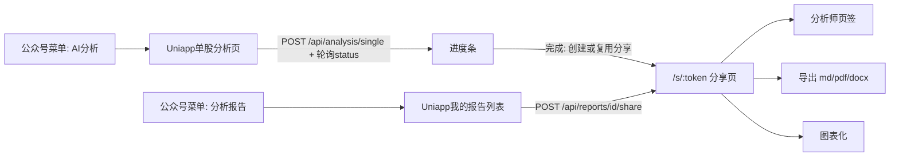
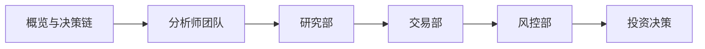

# HunterAgent 1.0 需求说明书

| 项 | 说明 |
|----|------|
| 产品名 | **HunterAgent** |
| 版本 | 1.0 |
| 文档状态 | 草案（待评审） |
| 关联文档 | [tech.md](./tech.md)（技术与合规决策纪要） |
| 修订日期 | 2026-10-22（v1.4） |

### 修订记录

| 版本 | 日期 | 说明 |
|------|------|------|
| 0.1 | — | 原始需求草稿（非 Markdown） |
| 1.0 | 2026-10-20 | 结构化完善；标注「（补充）」内容供评审 |
| 1.1 | 2026-10-20 | 代码核查与评审修订：纠正情绪/风险默认值；新增权限与数据隔离（5.4）；新增忘记密码；补充成本风险 |
| 1.2 | 2026-10-20 | 分享页页签方案定稿（部门 - 岗位两级 + 结论卡）；分享有效期 30 天；历史报告归属确认 |
| 1.3 | 2026-10-22 | 发短信前 SpecCaptcha 图形验证；短信冷却维度改为 `(端, 场景, 手机号)` 60 秒 |
| 1.4 | 2026-10-22 | 短信通道确认腾讯云；签名与模板 ID 环境变量预留（审核通过后填入） |

> 说明：文中标注 **（补充）** 的条目为在原始需求基础上补齐的约定，评审时可逐条确认或调整。

---

## 1. 背景与目标

### 1.1 背景

本项目基于 TradingAgents-CN 进行二次开发。受微信小程序金融类目资质限制，手机端不走小程序，采用 **Web / H5** 路线（详见 [tech.md](./tech.md)）。产品对外品牌为 **HunterAgent**。

### 1.2 1.0 目标

在 **不收费** 前提下，完成移动端核心闭环：

1. 用户可通过手机号注册 / 登录；
2. 在手机端发起单股智能分析并查看进度；
3. 通过分享链接在手机端阅读分析报告（页签、导出、图表化）；
4. 管理端（PC）与手机端同步支持上述能力，页面风格与 PC 端基本一致。

---

## 2. 范围

### 2.1 本期包含

| 模块 | 说明 |
|------|------|
| 单股分析（H5） | Uniapp 新建工程；字段默认值与 PC 对齐，管理端高级选项在 H5 隐藏 |
| 分析报告（H5） | 「我的报告」列表 + 复用现有 `/s/:token` 分享页并增强 |
| 用户权限体系 | 手机号注册 / 登录 / 忘记密码；短信验证码；协议与隐私政策 |
| 权限与数据隔离 | 管理员接口收紧；报告按用户隔离（见 5.4） |
| PC 端同步 | 登录 / 注册能力与用户手机号字段在管理端同步 |

### 2.2 本期不考虑

1. 付费充值功能；
2. 分享转发、邀请码、赠与积分功能；
3. 微信小程序完整分析能力（无金融资质）；
4. 原生 App 上架。

---

## 3. 技术选型与架构

### 3.1 技术选型（原始需求）

响应式 Web / H5；采用 **Uniapp** 架构。

### 3.2 架构约定（补充）

| 端 | 技术 | 说明 |
|----|------|------|
| PC / 管理端 | 现有 `frontend/`（Vue3 + Element Plus + PWA） | 继续维护，同步用户体系改造 |
| 手机端 H5 | **新建** Uniapp 工程（建议目录 `mobile/`，Vue3 + TypeScript + Vite） | 仅输出 H5；只复用现有 FastAPI 后端 API，不复制专有前端业务逻辑为独立后端 |
| 后端 | 现有 `app/`（FastAPI + JWT + MongoDB） | 扩展认证、短信、分享导出等接口 |
| 报告阅读 | 现有 `/s/:token`（`ReportShare.vue`） | 免登录公开页；1.0 在此页增强页签 / 导出 / 图表 |

**（补充）部署建议：**

- Uniapp H5 与 PC 前端尽量部署在 **同一备案域名** 下（例如 PC 根路径，H5 使用 `/m/`），避免跨域与 Cookie / 鉴权问题；
- 正式环境必须 **HTTPS**；裸 IP + HTTP 仅作内测；
- 接口前缀沿用 `/api`；JWT 沿用现有 `auth_db` 体系；
- UI 主色、圆角、字号层级尽量与 Element Plus 管理端保持视觉一致（H5 可用 Vant / uni-ui，但色板对齐）。

---

## 4. 公众号菜单规划（补充）

微信自定义菜单最多 **3 个一级 × 每级 5 个二级**。1.0 建议：

| 一级菜单 | 二级 / 直链 | 落地 URL（示例） | 说明 |
|----------|-------------|------------------|------|
| AI分析 | （直链） | `https://域名/m/#/pages/analysis/single` | 单股分析页 |
| 分析报告 | （直链） | `https://域名/m/#/pages/reports/list` | 「我的报告」列表（需登录） |
| 我的 | 登录 / 注册 | `https://域名/m/#/pages/auth/login` | 账号入口 |
| 我的 | 用户协议 | `https://域名/m/#/pages/legal/agreement` | 静态页 |
| 我的 | 隐私政策 | `https://域名/m/#/pages/legal/privacy` | 静态页 |

> 菜单跳转须使用备案域名 + HTTPS；勿使用裸 IP 与非标准端口作为正式入口。

---

## 5. 功能需求

### 5.1 单股分析页面

**菜单名称：** AI分析  
**端：** Uniapp H5（新建）+ PC 现有 `SingleAnalysis.vue`（管理端高级选项逻辑对齐）

#### 5.1.1 步骤一：填写分析参数

按顺序输入 / 选择：

| 字段 | 必填 | 默认值 | 说明 |
|------|------|--------|------|
| 股票代码 | 是 | 无 | 按市场类型校验格式 |
| 市场类型 | 是 | A股（建议） | 选项：A股 / 美股 / 港股 |
| 分析日期 | 否 | 当前日期 | 不可选未来日期 |
| 分析深度 | 否 | **3 级：标准分析** | 见下表 |
| 分析师团队 | 否 | H5：市场分析师、基本面分析师、新闻分析师 | 见下表；A 股不可选社媒分析师（与现网一致）。PC 沿用现有默认（市场+基本面，或用户偏好），本期不改 |
| AI 模型配置 | 否 | 系统默认模型 | 快速分析模型 + 深度决策模型（与现网一致） |

**分析深度档位（补充，与现网对齐）：**

| 级别 | 名称 |
|------|------|
| 1 | 快速 |
| 2 | 基础 |
| 3 | 标准（默认） |
| 4 | 深度 |
| 5 | 全面 |

**分析师选项（补充）：** 市场分析师、基本面分析师、新闻分析师、社媒分析师。

#### 5.1.2 管理端隐藏选项（原始需求）

以下选项在 **Web/H5 手机端不可选，只能使用默认值**；仅在 **PC 管理端** 可调整：

| 选项 | 默认 | 端差异 |
|------|------|--------|
| 情绪心理（情绪分析） | **开**（与 PC `SingleAnalysis.vue` 默认一致） | H5 隐藏，按「开」提交 |
| 风险评估 | **开**（与 PC 默认一致） | H5 隐藏，按「开」提交 |
| 语言选项 | 中文（`zh-CN`） | H5 隐藏，固定中文 |

> **（补充）现状说明：** 请求参数 `include_sentiment` / `include_risk` 在当前后端（`app/`、`tradingagents/`）中**未被使用**，开关不影响分析结果；分析内容实际由「分析师团队」决定。1.0 保持现状，不做改造。

#### 5.1.3 步骤二：开始分析与进度

1. 点击 **「开始智能分析」**；
2. 调用 `POST /api/analysis/single`，获得 `task_id`；
3. 轮询 `GET /api/analysis/tasks/{id}/status`，展示进度条（百分比、当前步骤、耗时等，与 PC 体验对齐）；
4. 分析完成后：
   - 提示：**「可以查看分析报告」**；
   - （补充）为该报告调用 `POST /api/reports/{report_id}/share` 创建或复用分享链接；
   - 跳转到分享页：`/s/{token}`（完整 URL 使用配置的 `PUBLIC_APP_URL`）。

#### 5.1.4 接口依赖（补充）

| 方法 | 路径 | 说明 |
|------|------|------|
| POST | `/api/analysis/single` | 提交单股分析（需登录） |
| GET | `/api/analysis/tasks/{id}/status` | 任务进度 |
| GET | `/api/analysis/tasks/{id}/result` | 任务结果 |
| POST | `/api/reports/{report_id}/share` | 创建 / 复用分享链接 |
| GET | `/api/config/settings` | 拉取默认模型（取 `quick_analysis_model` / `deep_analysis_model`） |

> **（补充）** 配置类接口按 5.4 收紧为管理员后，普通用户仍需能**只读**获取默认模型与可选模型列表（不得返回 API Key），可通过脱敏只读接口实现。

#### 5.1.5 验收标准（补充）

- [ ] H5 表单字段顺序与默认值符合本节；管理端三项高级选项在 H5 不可见且提交值为默认；
- [ ] 进度条可反映分析过程；失败时有明确错误提示；
- [ ] 成功后出现「可以查看分析报告」并可跳转到有效 `/s/{token}`；
- [ ] 未登录用户点击「开始智能分析」时引导至登录 / 注册。

---

### 5.2 分析报告页面

**菜单名称：** 分析报告

#### 5.2.1 复用分享链接方案评估（补充）

现网已具备：

- 公开阅读：`GET /api/reports/share/{token}` + 前端 `/s/:token`（`ReportShare.vue`，已做手机端宽度适配）；
- 创建 / 复用：`POST /api/reports/{report_id}/share`（现网默认有效期 7 天，1.0 调整为 **30 天**）。

**结论：复用分享链接作为手机端报告阅读载体是合理的**，可显著降低开发量。但需注意：

| 问题 | 处理 |
|------|------|
| 公众号菜单只能配置 **固定 URL**，而每份报告 token 不同 | 菜单落地到 Uniapp **「我的报告」列表**；点击某条后再生成 / 复用 token 并跳转 `/s/{token}` |
| 分享链接有效期 | 默认有效期调整为 **30 天**（评审已确认）；列表页点击时若已过期则自动重建 |
| 现有下载接口 `GET /api/reports/{id}/download` 需登录，分享页免登录 | **新增** 免登录导出：`GET /api/reports/share/{token}/download?format=...` |
| 微信内置浏览器下载受限 | UA 检测；引导「在浏览器中打开」或复制链接后导出 |

#### 5.2.2 「我的报告」列表（Uniapp，补充）

- 需登录；
- 数据来源：当前用户已完成的分析任务 / 报告（按 `user_id` 过滤，见 5.4）；
- **实现前提：** 现有 `analysis_reports` 文档**没有** `user_id` 字段（仅 `analysis_tasks` 有）。需在报告写入时补充 `user_id`，历史报告通过 `analysis_tasks.user_id` 回填；无法回填的历史报告仅管理员可见；
- 列表项展示：股票代码、名称、分析日期、状态、创建时间；
- 点击：确保存在有效分享链接 → 跳转 `/s/{token}`（可使用 WebView 或整页跳转至 PC 前端公开页）。

#### 5.2.3 分享页增强（在现有 `ReportShare.vue` / 等价公开页上改造）

**2.1 页签（原始需求）**

每个页签对应一个分析师 / 报告模块，切换阅读。

**（补充，评审已确认）页签方案：「部门 - 岗位」两级导航 + 岗位结论卡**

**设计原则：** 页签保持证券公司「部门 - 岗位」的组织结构，每个岗位对应一个可识别的角色，便于用户理解；同时通过结论卡与折叠正文提升手机端可读性。

**一级页签（部门）与二级页签（岗位）映射：**

| 一级页签（部门） | 二级页签（岗位） | `reports` 字段 |
|------------------|------------------|----------------|
| 概览 | —（无二级） | 决策条、`summary`、`key_points`，以及「决策链」 |
| 分析师团队 | 市场分析师 | `market_report` |
| | 基本面分析师 | `fundamentals_report` |
| | 新闻分析师 | `news_report` |
| | 社媒 / 情绪分析师 | `sentiment_report` |
| 研究部 | 多头研究员 | `bull_researcher` |
| | 空头研究员 | `bear_researcher` |
| | 研究经理 | `research_team_decision` / `investment_plan` |
| 交易部 | 交易员 | `trader_investment_plan` |
| 风控部 | 激进风控分析师 | `risky_analyst` |
| | 保守风控分析师 | `safe_analyst` |
| | 中性风控分析师 | `neutral_analyst` |
| | 风险经理 | `risk_management_decision` |
| 投资决策 | —（无二级） | `final_trade_decision` |

**显示规则：**

- 无内容的岗位不显示；
- 部门下所有岗位均无内容时，该一级页签不显示；
- 部门下仅有一个岗位有内容时，不显示二级页签。

**岗位页结构：**

1. **结论卡**（置顶）：岗位名称、观点标签（看多 / 看空 / 中性 / 未识别）、一句话结论；
2. **正文**：Markdown 渲染；正文较长时默认折叠，可展开阅读。

**结论提取规则（1.0，前端规则提取，不改分析流程、不增加 Token）：**

| 项 | 规则 |
|----|------|
| 观点标签 | 关键词识别：买入 / 增持 / 看多 → 看多；卖出 / 减持 / 看空 → 看空；持有 / 观望 → 中性；均未命中 → 未识别 |
| 一句话结论 | 取「结论 / 建议」小节首句，否则取正文首段首句；截断约 60 字 |
| 识别失败 | 观点显示「未识别」，隐藏一句话结论，仅显示岗位名称 |

**交互：**

- 一级页签吸顶；切换页签时回到顶部；
- 支持 URL 参数定位到指定页签 / 岗位（用于「决策链」点击跳转与转发定位）。

**2.2 导出（原始需求）**

支持导出：**Markdown、PDF、Word（docx）**。

**（补充）实现要点：**

- 新增接口：`GET /api/reports/share/{token}/download?format=markdown|pdf|docx`；
- 复用 `app/utils/report_exporter.py`；
- 分享页提供导出按钮；微信内引导外置浏览器。

**2.3 图表化（原始需求）**

文字适当转化为图表，提高手机端可读性。

**（补充）1.0 建议图表范围（可裁剪）：**

| 图表 | 数据来源 | 形式建议 |
|------|----------|----------|
| 置信度 | `confidence_score` | 仪表盘 / 进度环 |
| 风险等级 | `risk_level` | 色块标签 + 简单条形 |
| 投资建议 | `recommendation` | 醒目结论卡 |
| 多空对比 | 研究部多头 / 空头研究员两张结论卡 | 左右对比卡 |
| 决策链 | 各岗位结论卡的观点标签 | 按部门顺序串联的标签条，点击跳转到对应岗位 |
| Markdown 表格 | 各模块内表格 | 尽量渲染为可横滑表格；复杂表可选简易柱状图（二期可再增强） |

#### 5.2.4 验收标准（补充）

- [ ] 公众号「分析报告」进入后为「我的报告」列表，而非 404 / 固定失效 token；
- [ ] 点击报告可打开有效分享页；过期链接可自动续期或重建；
- [ ] 一级页签按部门、二级页签按岗位展示；空岗位与空部门不显示；
- [ ] 每个岗位有结论卡，识别不到观点时显示「未识别」；长正文可折叠 / 展开；
- [ ] 概览页「决策链」可点击跳转到对应岗位；
- [ ] 分享页可导出 md / pdf / docx（至少在系统浏览器中可用）；
- [ ] 概览区具备至少一种图表化展示（置信度或风险等级）。

---

### 5.3 用户权限体系

**端要求（原始需求）：** 管理端与手机端同步开发；风格与 PC 对应页面基本一致。

#### 5.3.1 手机号注册

流程：

1. 输入手机号；
2. 完成随机图形验证码校验后，获取短信验证码（对接短信通道；场景 `register`）；
3. 默认勾选同意 **《用户协议》** 与 **《隐私政策》**（可取消；未勾选不可注册）；
4. 注册成功后进入 **设置密码**（输入密码 + 二次确认）。

**（补充）密码规则建议：** 长度 ≥ 6；前后端一致校验。

**（补充）关于「默认密码 admin123」的澄清（已确认）：**

- `admin123` **仅指** 系统预置管理员账号 `admin` 的默认密码（现网 `app/main.py` 初始化逻辑）；
- **普通用户** 注册时 **自行设置密码**，不使用 `admin123` 作为初始密码；
- 用户可在设置中修改自己的密码。

#### 5.3.2 登录

以 **手机号作为用户名（登录标识）**：

| 方式 | 说明 |
|------|------|
| 手机号 + 密码 | 密码登录 |
| 手机号 + 短信验证码 | 验证码登录；获取短信前须先完成图形验证码校验（场景 `login`） |

#### 5.3.2.1 忘记密码（补充，评审已确认）

H5 与 PC 登录页均提供「忘记密码」入口：

1. 输入已注册手机号；
2. 完成随机图形验证码校验后，获取短信验证码（场景 `reset`）；
3. 输入新密码 + 二次确认；
4. 重置成功后返回登录页，使用新密码登录。

> 现网 `POST /api/auth/reset-password` 为**管理员重置他人密码**接口（参数 `username`、`new_password`），保留不动；前端 `frontend/src/api/auth.ts` 中以 `{email}` 调用该接口的代码与后端不匹配，需一并修正。

#### 5.3.3 数据模型与接口（补充）

**用户模型扩展：**

| 字段 | 说明 |
|------|------|
| `phone` | 手机号，唯一索引；可与 `username` 并存（兼容旧 admin 用户名登录） |
| 现有字段 | `hashed_password`、`is_admin`、`is_active` 等保持不变 |

**新增 / 改造接口：**

| 方法 | 路径 | 说明 |
|------|------|------|
| GET | `/api/auth/captcha` | 获取图形验证码；返回 `captcha_id` + Base64 图片（SpecCaptcha）；明文答案仅存服务端 |
| POST | `/api/auth/sms/send` | 发送验证码；必填：`phone`、`scene`、`platform`、`captcha_id`、`captcha_code`；场景：`register` / `login` / `reset`；平台：`h5` / `pc` |
| POST | `/api/auth/register` | 手机号 + 验证码注册（可同时设密或注册后设密） |
| POST | `/api/auth/login` | 支持手机号 + 密码（兼容原 username 登录） |
| POST | `/api/auth/login/sms` | 手机号 + 验证码登录 |
| POST | `/api/auth/password/reset-by-sms` | 忘记密码：手机号 + 验证码 + 新密码 |
| PUT | `/api/auth/me` 或现有改密接口 | 设置 / 修改密码 |

**短信通道（已确认，1.4）：**

- 做成 **可插拔** Provider；
- **首选 / 1.0 落地：腾讯云短信**；开发环境使用 **Mock**（固定验证码写日志，不真实发送）；
- 生产密钥、签名、模板 ID 通过环境变量注入，禁止写入仓库；
- 配置项预留（审核通过后由运维 / 产品填入 `.env`，文档不写真实值）：
  - `SMS_SIGN_NAME`：短信签名（预留）
  - `SMS_TEMPLATE_ID`：验证码模板 ID（预留；注册 / 登录 / 重置可共用同一模板，或按场景拆分时另增变量）
  - 另需：`SMS_SECRET_ID`、`SMS_SECRET_KEY`、`SMS_SDK_APP_ID`（腾讯云控制台获取）。

**安全策略（补充，1.3 已确认）：**

| 项 | 约定 |
|----|------|
| 图形验证码 | 发送短信前必须通过；库：`easy-captcha-python` 的 `SpecCaptcha`（字符型 PNG）；一次性凭证，短时有效（建议 5 分钟），校验成功即作废；错误可刷新重取；图形验证失败则不发送短信 |
| 短信重发冷却 | 维度 **`(platform, scene, phone)`**；同端、同场景、同号 **60 秒内**不可重复发送；不同端或不同场景互不影响；冷却命中返回频率限制（如 429） |
| 平台取值 | `h5` / `pc`（客户端在发短信请求中声明，后端校验合法枚举） |
| 场景取值 | `register` / `login` / `reset` |
| 短信验证码有效期 | 5 分钟 |
| 同一手机号每日上限 | 如 10 次（可配置；仍按手机号日计，不按端拆分） |
| IP 限流 | 防刷 |

#### 5.3.4 协议与隐私（补充）

- 提供静态页：《用户协议》《隐私政策》（H5 + PC 均可访问）；
- 文案由业务方提供；上线前必须可点击查看全文。

#### 5.3.5 PC 端同步（补充）

- `Login.vue` 增加：手机号注册、手机号+密码、手机号+验证码登录；
- 管理端用户列表展示手机号；
- 管理员账号 `admin` / `admin123` 行为保持不变（可提示修改默认密码）。

#### 5.3.6 验收标准（补充）

- [ ] Mock 环境下可用固定验证码完成注册 / 登录全流程；
- [ ] 未勾选协议无法注册；
- [ ] 注册后可设置密码并用密码登录；
- [ ] 验证码登录可用；
- [ ] 管理员仍可用原账号登录；用户列表可见手机号；
- [ ] 未通过或未携带图形验证码时，发送短信失败；
- [ ] 图形验证码一次性、可刷新；校验成功即作废；
- [ ] 同 `(platform, scene, phone)` 60 秒内第二次发送被拒绝；换端或换场景可发；
- [ ] Mock 环境同样走图形验证流程（不豁免）；
- [ ] 短信日上限与 IP 限流生效；
- [ ] 忘记密码可通过短信验证码重置，并可用新密码登录。

---

### 5.4 权限与数据隔离（补充，评审已确认）

**背景：** 现网大量系统接口只校验「已登录」而不校验管理员，报告接口也无所有权校验。1.0 开放手机号注册后，任何注册用户都可访问模型 API Key、数据库备份 / 恢复、系统日志及他人报告，**必须在 1.0 收紧**。

#### 5.4.1 角色

| 角色 | 标识 | 能力 |
|------|------|------|
| 管理员 | `is_admin = true`（JWT roles 含 `admin`） | 全部业务功能 + 系统管理 + 查看全部报告 |
| 普通用户 | `is_admin = false` | 分析、报告、自选等业务页；仅能访问自己的数据 |

#### 5.4.2 仅管理员可用的接口

| 模块 | 文件 | 范围 |
|------|------|------|
| 系统配置 | `app/routers/config.py` | 全部写操作；含 API Key 的读取（普通用户仅保留脱敏只读的默认模型 / 可选模型） |
| 数据库管理 | `app/routers/database.py` | 全部（备份 / 恢复 / 导入 / 导出） |
| 系统日志 | `app/routers/logs.py`、`app/routers/operation_logs.py` | 全部 |
| 系统设置 | `app/routers/system_config.py` | 全部（含当前无鉴权的 `/config/validate`） |
| 定时任务 | `app/routers/scheduler.py` | 写操作已是管理员；列表 / 详情也收紧为管理员 |
| 数据同步 | `app/routers/sync.py` 及其他同步路由 | 全部（当前**完全无鉴权**） |
| 全量任务 | `GET /api/analysis/tasks/all` | 仅管理员 |

普通用户访问以上接口返回 **403**。

#### 5.4.3 报告所有权校验

涉及 `app/routers/reports.py` 与 `app/services/report_share_service.py`：

| 接口 | 规则 |
|------|------|
| 报告列表 | 普通用户只返回本人报告；管理员返回全部 |
| 报告详情 / 模块内容 / 下载 / 删除 | 非本人且非管理员 → 404（避免暴露报告是否存在） |
| 分享创建 / 查询 / 撤销 | 同上 |
| 公开分享页 `GET /api/reports/share/{token}` 及 token 导出 | 仍免登录，持有链接即可读 |

#### 5.4.4 PC 前端

- 非管理员隐藏「设置 / 系统管理」相关菜单；
- 路由守卫：非管理员访问系统管理路由时跳转首页或 403 页。

#### 5.4.5 验收标准

- [ ] 普通用户调用 5.4.2 中任一接口返回 403；
- [ ] 普通用户报告列表仅含本人报告，按 id 访问他人报告返回 404；
- [ ] 普通用户 PC 端看不到系统管理菜单，直接输入 URL 被拦截；
- [ ] 管理员所有原有功能不受影响；
- [ ] 分享链接免登录访问不受影响。

---

## 6. 非功能需求（补充）

| 类别 | 要求 |
|------|------|
| 兼容性 | 微信内置浏览器、iOS Safari、Android Chrome 主流版本 |
| 安全 | HTTPS；短信密钥等敏感配置环境变量注入；图形验证码 + 短信冷却 / 日上限 / IP 限流防刷（见 5.3.3）；管理员接口与报告所有权校验（见 5.4） |
| 成本风险 | 1.0 **不做**分析次数配额（评审已确认），开放注册后大模型 Token 成本无上限。上线后需监控用量（复用现有 usage 统计）；必要时在 1.x 启用用户模型中已有但未生效的 `daily_quota` / `concurrent_limit` 字段 |
| 性能 | 进度轮询间隔合理（如 2–3s），避免压垮后端；列表分页 |
| 可观测 | 关键链路英文 `console.info` / 后端日志埋点（登录、发短信、提交分析、生成分享、导出） |
| 合规 | 对外文案避免违规荐股与收益承诺；许可风险遵循 [tech.md](./tech.md) |
| 风格 | 手机端与 PC 对应页面风格基本一致（色板、术语、空态文案） |

---

## 7. 接口改造清单（补充）

### 7.1 新增

| 接口 | 用途 |
|------|------|
| `GET /api/auth/captcha` | 获取 SpecCaptcha 图形验证码（`captcha_id` + Base64 图） |
| `POST /api/auth/sms/send` | 发送短信验证码（须先过图形验证；含 `platform` / `scene`） |
| `POST /api/auth/register` | 公开注册 |
| `POST /api/auth/login/sms` | 验证码登录 |
| `POST /api/auth/password/reset-by-sms` | 忘记密码（短信重置） |
| `GET /api/reports/share/{token}/download` | 免登录按分享 token 导出 |
| 默认模型脱敏只读接口（如现有接口无法拆分则新开） | 普通用户获取默认模型 / 可选模型，不含 API Key |

### 7.2 改造

| 接口 / 组件 | 变更 |
|-------------|------|
| `POST /api/auth/sms/send` | 必填 `platform`、`captcha_id`、`captcha_code`；冷却按 `(platform, scene, phone)` |
| `POST /api/auth/login` | 支持手机号作为登录名 |
| 用户模型 / Mongo `users` | 增加 `phone` 唯一索引 |
| `ReportShare.vue`（及样式） | 部门 - 岗位两级页签、岗位结论卡、决策链、导出入口、图表化、微信 UA 引导 |
| `app/services/report_share_service.py` | `DEFAULT_EXPIRES_DAYS` 由 7 改为 30 |
| PC `Login.vue` | 注册、双登录方式、忘记密码入口 |
| `frontend/src/api/auth.ts` | 修正与后端不匹配的重置密码调用 |
| Uniapp `mobile/` | 单股分析、我的报告、登录注册、忘记密码、协议页 |
| 管理员校验 | `config.py`、`database.py`、`logs.py`、`operation_logs.py`、`system_config.py`、`scheduler.py`、`sync.py`、`GET /api/analysis/tasks/all`（见 5.4.2） |
| 报告所有权校验 | `reports.py` 列表 / 详情 / 模块 / 下载 / 删除 / 分享（见 5.4.3） |
| `analysis_reports` | 写入 `user_id`；历史数据按 `analysis_tasks.user_id` 回填 |
| PC 菜单与路由守卫 | 非管理员隐藏并拦截系统管理页面 |

### 7.3 复用（无需新造业务含义）

| 接口 | 用途 |
|------|------|
| `POST /api/analysis/single` | 发起分析 |
| `GET /api/analysis/tasks/{id}/status` | 进度 |
| `GET /api/analysis/tasks/{id}/result` | 结果 |
| `GET /api/reports/share/{token}` | 公开读报告 |
| `POST /api/reports/{id}/share` | 创建 / 复用分享 |
| `GET /api/reports/{id}/download` | PC 登录态导出（保留） |

---

## 8. 待确认事项

评审时请拍板：

| # | 事项 | 可选方案 | 当前建议 |
|---|------|----------|----------|
| 1 | ~~分享页页签分组粒度~~ | — | **已确认**：「部门 - 岗位」两级页签 + 岗位结论卡（见 5.2.3） |
| 2 | ~~图表范围~~ | — | **已确认**：置信度、风险、建议保底，加决策链与多空对比卡；表格可视化有余力再做 |
| 3 | ~~分享链接默认有效期~~ | — | **已确认**：30 天 |
| 4 | ~~短信首选供应商~~ | — | **已确认**：腾讯云；签名与模板 ID 预留环境变量，审核通过后填入 |
| 5 | 《用户协议》《隐私政策》文案 | 法务 / 产品提供 | 开发先放占位模板，上线前替换 |
| 6 | ~~H5「情绪分析 / 风险评估」默认开关具体值~~ | — | **已确认**：按「开」提交（见 5.1.2） |
| 7 | Uniapp 工程目录名 | `mobile/` / `h5/` / 独立仓库 | 建议本仓 `mobile/`，便于联调 |
| 8 | ~~无法回填用户的历史报告归属~~ | — | **已确认**：仅管理员可见 |

### 8.1 已确认决策

| 议题 | 结论 |
|------|------|
| 手机端技术 | 新建独立 Uniapp 工程（H5），复用现有后端 API |
| 默认密码 `admin123` | 仅指管理员账号；普通用户注册时自设密码 |
| 短信通道 | 可插拔 Provider；1.0 落地腾讯云 + 开发环境 Mock；签名 / 模板 ID 预留 |
| 分析报告阅读 | 复用 `/s/:token` 分享页，经「我的报告」列表中转 |
| PC 端普通用户 | 可用业务页；系统设置、模型与 API Key、数据库、日志仅管理员 |
| 报告隔离 | 普通用户仅本人报告；管理员可看全部 |
| 分析次数配额 | 1.0 不做，风险见第 6 节 |
| 情绪 / 风险开关 | H5 隐藏并按「开」提交；后端当前未使用，1.0 不改 |
| 忘记密码 | 纳入 1.0，短信验证码重置 |
| H5 模型选择 | 保持可选（与原始需求一致） |
| PC 默认分析师 | 不改 |
| 飞书完成通知 | 不改 |
| 分享页页签 | 「部门 - 岗位」两级页签；岗位页置顶结论卡，正文可折叠 |
| 结论卡数据来源 | 1.0 前端规则提取（关键词 + 首句），不增加 Token |
| 分享链接有效期 | 默认 30 天 |
| 无法回填用户的历史报告 | 仅管理员可见 |
| 发短信前图形验证 | 必须通过；采用 `easy-captcha-python` 的 `SpecCaptcha` |
| 短信重发冷却 | 维度 `(platform, scene, phone)`，间隔 60 秒；不同端或不同场景互不影响 |
| 短信供应商 | 腾讯云；`SMS_SIGN_NAME` / `SMS_TEMPLATE_ID` 等预留，审核通过后注入 |

---

## 9. 里程碑建议（补充）

| 阶段 | 内容 | 产出 |
|------|------|------|
| M1 | 后端：手机号字段、图形验证码（SpecCaptcha）、短信 Mock、注册 / 双登录 / 忘记密码；权限收紧 + 报告隔离 | 接口可用；PC 登录页与菜单同步 |
| M2 | Uniapp：登录注册、单股分析、进度、跳转分享 | 主路径闭环 |
| M3 | 我的报告列表 + 分享页页签 / 导出 / 基础图表 | 报告可读可导 |
| M4 | 短信真实通道、协议正文、微信菜单、HTTPS 域名联调 | 可内测放量 |

---

## 10. 附录：原始需求原文对照

以下为完善前的核心条目，便于追溯：

1. 单股分析：按序填写股票代码、市场、日期、深度、分析师、模型；H5 隐藏情绪 / 风险 / 语言；开始分析 → 进度条 → 提示查看报告并跳转分享链接。
2. 分析报告：分享链接手机端阅读；页签按分析师；导出 md/pdf/word；文字图表化。
3. 用户体系：手机号+短信注册；协议默认同意；设密；手机号+密码 / 验证码登录；系统默认密码 admin123（本版已澄清为仅管理员）。
4. 1.0 不做：付费充值；分享转发、邀请码、赠与积分。
