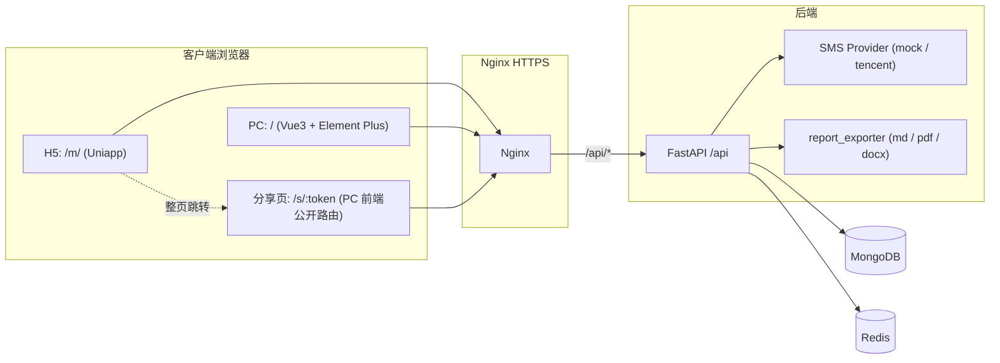
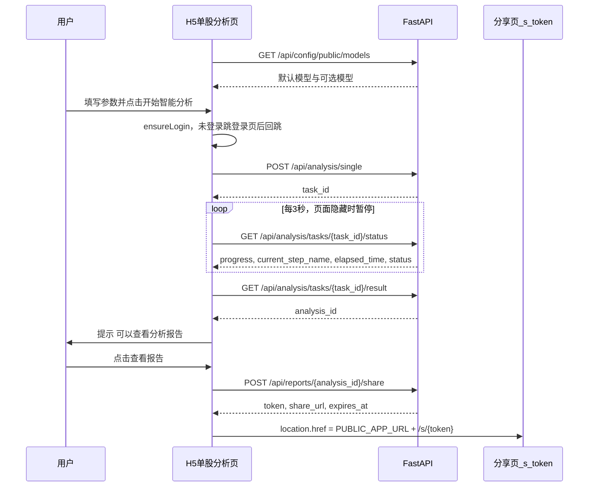
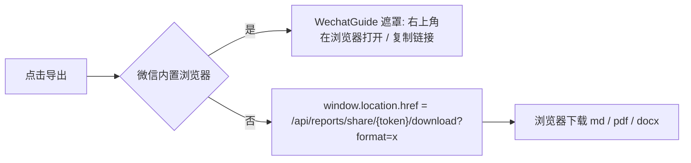
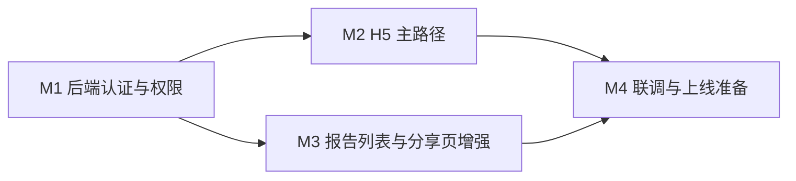

# HunterAgent 1.0 H5 / Web 技术方案

| 项 | 说明 |
|----|------|
| 产品名 | **HunterAgent** |
| 版本 | 1.0 |
| 文档状态 | 评审中（0.4 已确认腾讯云短信） |
| 关联文档 | [requirement.md](./requirement.md)（需求说明书 v1.4）、[tech.md](./tech.md)（技术与合规决策纪要） |
| 编制日期 | 2026-10-21 |

### 修订记录

| 版本 | 日期 | 说明 |
|------|------|------|
| 0.1 | 2026-10-21 | 初稿：H5 工程、分享页增强、PC 同步、后端支撑改造 |
| 0.2 | 2026-10-21 | 首轮评审决策：注册页一次填完密码；`usage_statistics` 仅管理员；分析任务进度 / 结果校验归属；短信供应商待定（见第 13 节） |
| 0.3 | 2026-10-22 | 对齐需求 1.3：发短信前 SpecCaptcha（表单内联）；短信冷却维度改为 `(platform, scene, phone)`；Mock 不豁免图形验证 |
| 0.4 | 2026-10-22 | 短信通道确认腾讯云；补充 tencent Provider 与配置项；签名 / 模板 ID 环境变量预留 |

---

## 1. 概述

### 1.1 目标

在现有 TradingAgents-CN（FastAPI 后端 + Vue3 PC 前端）基础上，交付 HunterAgent 1.0 的 H5 / Web 能力，满足需求说明书第 5 章：

1. 手机号注册 / 登录 / 忘记密码（H5 + PC 同步）；
2. H5 单股分析：填写参数、提交、进度、完成后跳转报告分享页；
3. H5「我的报告」列表，经分享链接阅读报告；
4. 分享页增强：部门 - 岗位两级页签、岗位结论卡、决策链、图表化、免登录导出；
5. 权限收紧与报告按用户隔离。

### 1.2 范围

| 本方案包含 | 本方案不包含 |
|------------|--------------|
| Uniapp H5 新工程 `mobile/`（仅编译 H5） | 微信公众号菜单配置、JSSDK、网页授权（OAuth） |
| PC 前端 `frontend/` 同步改造（登录注册、菜单权限、分享页增强） | 微信小程序、原生 App |
| 后端 `app/` 支撑改造（认证、短信、权限、报告隔离、分享导出） | 付费充值、邀请码、积分 |
| Nginx 部署配置（`/m/` 路径） | 分析引擎 `tradingagents/` 的逻辑改动 |

> H5 在微信内置浏览器中打开时仅作为普通网页处理（UA 识别 + 引导外部浏览器下载），不依赖任何微信开放能力。

### 1.3 现状核查结论（与本方案相关）

| 现状 | 位置 | 影响 |
|------|------|------|
| 无统一 `require_admin` 依赖，管理员判断散落为 `user.get("is_admin")` | `app/routers/auth_db.py` | 需新增依赖并批量套用 |
| `get_current_user` 以 JWT `sub` = `username` 查询用户 | `app/routers/auth_db.py` L69-114 | 手机号用户注册时令 `username = phone`，JWT 体系不变 |
| `users` 索引仅在部署脚本中创建（`username`、`email` 唯一） | `scripts/docker_deployment_init.py` L129-130 | `phone` 索引需在应用启动时创建 |
| `analysis_reports` 无 `user_id` | `app/services/simple_analysis_service.py` L2696-2736 | 写入补字段 + 历史回填 |
| 报告列表无用户过滤，详情 / 下载无所有权校验 | `app/routers/reports.py` | 增加所有权校验 |
| 分享默认有效期 7 天 | `app/services/report_share_service.py` L16 | 改为 30 天 |
| 公开序列化不含 `decision`、`analysts`、`research_depth` | `serialize_public_report` L153-165 | 按需补充只读字段 |
| `/api/config/settings`、`/api/config/models` 仅校验登录、已脱敏 | `app/routers/config.py` L1673、L1951 | 新增独立只读接口，原接口收紧为管理员 |
| Redis 限流中间件存在但未注册 | `app/middleware/rate_limit.py` | 短信限流单独实现，不依赖该中间件 |
| PC `resetPassword({email})` 与后端 `username + new_password` 不匹配 | `frontend/src/api/auth.ts` L52-53 | 修正 |
| PC 登录后硬编码 `roles: ['admin']` | `frontend/src/stores/auth.ts` L201-203 | 改为以 `/api/auth/me` 返回为准 |
| 侧边栏菜单硬编码，无权限过滤 | `frontend/src/components/Layout/SidebarMenu.vue` | 按 `isAdmin` 隐藏 |
| 分享页 `ReportShare.vue` 417 行，无页签 / 导出 | `frontend/src/views/Reports/ReportShare.vue` | 组件化重构 |

---

## 2. 总体架构

### 2.1 逻辑架构



### 2.2 部署约定

| 路径 | 承载 | 产物 |
|------|------|------|
| `/` | PC 前端（含 `/s/:token` 分享页） | `frontend/dist` |
| `/m/` | H5（Uniapp） | `mobile/dist/build/h5` |
| `/api/` | FastAPI | 反向代理至 `backend:8000` |

- H5 与 PC **同域部署**：无跨域；`localStorage` 同源共享，H5 登录后跳转分享页、或用户切到 PC 时登录态天然互通；
- H5 使用 **hash 路由**（`/m/#/pages/...`），Nginx 无需为 H5 配置 history fallback；
- 正式环境必须 HTTPS；裸 IP + HTTP 仅限内测。

Nginx 增量配置（在 [nginx/nginx.conf](../nginx/nginx.conf) / `nginx.render.conf` 中追加）：

```nginx
# H5 (Uniapp) static files
location /m/ {
    alias /usr/share/nginx/html-mobile/;
    index index.html;
    try_files $uri $uri/ /m/index.html;
    # index.html 不缓存，静态资源长缓存
    location ~* \.(js|css|png|jpg|svg|woff2?)$ {
        expires 30d;
        add_header Cache-Control "public, immutable";
    }
}
```

Docker：`Dockerfile.frontend` 增加一个构建阶段编译 `mobile/`，产物拷贝至 `/usr/share/nginx/html-mobile/`（或新增 `Dockerfile.mobile`，由评审决定）。

### 2.3 关键约定

| 项 | 约定 |
|----|------|
| 接口前缀 | `/api` |
| 统一响应 | `{ success: boolean, data: T, message: string, code?: string }`（与现网 `ApiResponse` 一致） |
| 鉴权 | `Authorization: Bearer <access_token>`；access 60 分钟，refresh 7 天（沿用 `AuthService`） |
| 前端存储键 | `auth-token`、`refresh-token`、`user-info`（H5 与 PC 共用，见 3.4） |
| 日志埋点 | 前端关键链路 `console.info('[Module] english message', payload)`；后端 `logger.info` |
| 公开地址 | 后端 `settings.PUBLIC_APP_URL`；H5 用 `VITE_PUBLIC_APP_URL`，缺省为 `window.location.origin` |

---

## 3. H5 工程设计（Uniapp）

### 3.1 技术栈

| 类别 | 选型 | 说明 |
|------|------|------|
| 框架 | Uniapp（Vue3 + `<script setup>` + TypeScript） | 官方 `vite-ts` 模板初始化，仅使用 `build:h5` |
| 构建 | Vite（`@dcloudio/vite-plugin-uni`） | 与 PC 工具链一致 |
| UI | uni-ui（`@dcloudio/uni-ui`，easycom 按需） | 表单、弹层、分段器、进度条、列表 |
| 状态 | Pinia | `auth`、`analysis` 两个 store |
| 样式 | SCSS + CSS 变量 | 主色 `#409EFF`，与 PC `frontend/src/styles/variables.scss` 对齐 |
| 日期 | dayjs | 与 PC 一致 |
| 质量 | ESLint + Prettier + `vue-tsc` | 复用 PC 规则 |

初始化命令：

```bash
npx degit dcloudio/uni-preset-vue#vite-ts mobile
cd mobile && npm i && npm i pinia dayjs @dcloudio/uni-ui
```

### 3.2 目录结构

```text
mobile/
├── index.html
├── package.json
├── vite.config.ts                # dev proxy /api -> http://localhost:8000
├── .env.development / .env.production
└── src/
    ├── main.ts                   # createSSRApp + Pinia
    ├── App.vue                   # 全局样式、启动埋点
    ├── manifest.json             # h5.router.mode=hash, h5.router.base=/m/, h5.publicPath=/m/
    ├── pages.json                # 页面清单 + tabBar
    ├── pages/
    │   ├── analysis/single.vue   # 单股分析（tab）
    │   ├── reports/list.vue      # 我的报告（tab）
    │   ├── mine/index.vue        # 我的（tab：登录态、退出、协议入口、修改密码）
    │   ├── auth/login.vue        # 密码登录 / 验证码登录
    │   ├── auth/register.vue     # 手机号 + 验证码 + 协议
    │   ├── auth/change-password.vue # 修改密码（旧密码 + 新密码）
    │   ├── auth/forgot.vue       # 忘记密码
    │   ├── legal/agreement.vue   # 用户协议（静态）
    │   └── legal/privacy.vue     # 隐私政策（静态）
    ├── components/
    │   ├── CaptchaImage.vue      # SpecCaptcha 图：拉取 / 展示 / 点击刷新
    │   ├── SmsCodeButton.vue     # 60s 倒计时；发短信时携带 captcha + platform
    │   ├── AgreementCheck.vue    # 协议勾选
    │   ├── AnalysisProgress.vue  # 进度条 + 当前步骤 + 耗时
    │   └── EmptyState.vue
    ├── api/
    │   ├── request.ts            # uni.request 封装
    │   ├── auth.ts
    │   ├── analysis.ts
    │   ├── reports.ts
    │   └── config.ts
    ├── stores/
    │   ├── auth.ts
    │   └── analysis.ts
    ├── utils/
    │   ├── storage.ts            # 直接读写 window.localStorage（见 3.4）
    │   ├── validators.ts         # 手机号、密码、股票代码校验
    │   ├── guard.ts              # 登录拦截
    │   └── env.ts                # 微信 UA、公开地址
    └── styles/
        ├── variables.scss        # 色板、圆角、字号层级
        └── common.scss
```

`pages.json` 关键配置：

```json
{
  "pages": [
    { "path": "pages/analysis/single", "style": { "navigationBarTitleText": "AI分析" } },
    { "path": "pages/reports/list", "style": { "navigationBarTitleText": "分析报告", "enablePullDownRefresh": true } },
    { "path": "pages/mine/index", "style": { "navigationBarTitleText": "我的" } },
    { "path": "pages/auth/login", "style": { "navigationBarTitleText": "登录" } },
    { "path": "pages/auth/register", "style": { "navigationBarTitleText": "注册" } },
    { "path": "pages/auth/change-password", "style": { "navigationBarTitleText": "修改密码" } },
    { "path": "pages/auth/forgot", "style": { "navigationBarTitleText": "忘记密码" } },
    { "path": "pages/legal/agreement", "style": { "navigationBarTitleText": "用户协议" } },
    { "path": "pages/legal/privacy", "style": { "navigationBarTitleText": "隐私政策" } }
  ],
  "tabBar": {
    "color": "#909399",
    "selectedColor": "#409EFF",
    "list": [
      { "pagePath": "pages/analysis/single", "text": "AI分析" },
      { "pagePath": "pages/reports/list", "text": "分析报告" },
      { "pagePath": "pages/mine/index", "text": "我的" }
    ]
  },
  "easycom": { "autoscan": true, "custom": { "^uni-(.*)": "@dcloudio/uni-ui/lib/uni-$1/uni-$1.vue" } }
}
```

`manifest.json` H5 段：

```json
{
  "h5": {
    "title": "HunterAgent",
    "publicPath": "/m/",
    "router": { "mode": "hash", "base": "/m/" },
    "devServer": { "port": 3100 }
  }
}
```

### 3.3 视觉规范（与 PC 对齐）

| Token | 值 | 来源 |
|-------|-----|------|
| `--ha-color-primary` | `#409EFF` | PC `$primary-color` |
| `--ha-color-success / warning / danger` | `#67C23A / #E6A23C / #F56C6C` | Element Plus 默认色板 |
| `--ha-text-primary / regular / secondary` | `#303133 / #606266 / #909399` | 同上 |
| `--ha-radius` | `8px`（卡片）/ `4px`（输入框） | 与 PC 卡片一致 |
| 字号层级 | 18 / 16 / 14 / 12 px | 标题 / 正文强调 / 正文 / 辅助 |

术语、空态文案、按钮文案与 PC `SingleAnalysis.vue`、`Login.vue` 保持一致（如「开始智能分析」「可以查看分析报告」）。

### 3.4 登录态与存储

- Uniapp H5 的 `uni.setStorageSync` 会把值包成 `{"type":"string","data":...}` 存入 `localStorage`，与 PC 直接存原始字符串**不兼容**；
- 因此 H5 的 `utils/storage.ts` **直接使用 `window.localStorage`**，键名与格式与 PC 完全一致：

```ts
// mobile/src/utils/storage.ts
const TOKEN_KEY = 'auth-token'
const REFRESH_KEY = 'refresh-token'
const USER_KEY = 'user-info'

export const tokenStorage = {
  getToken: (): string => localStorage.getItem(TOKEN_KEY) || '',
  getRefreshToken: (): string => localStorage.getItem(REFRESH_KEY) || '',
  setTokens(access: string, refresh: string): void {
    localStorage.setItem(TOKEN_KEY, access)
    localStorage.setItem(REFRESH_KEY, refresh)
  },
  clear(): void {
    ;[TOKEN_KEY, REFRESH_KEY, USER_KEY].forEach((k) => localStorage.removeItem(k))
  },
}
```

> 前提：H5 与 PC 同域部署。若未来拆域，则改为各自登录，不影响接口设计。

### 3.5 请求封装

`api/request.ts` 职责：

1. 拼接 `baseURL`（默认空串，走同域 `/api`）；
2. 注入 `Authorization`；
3. 统一解析 `{ success, data, message }`，`success=false` 时 `uni.showToast` 并 `reject`；
4. 401：用 `refresh-token` 调 `POST /api/auth/refresh`，成功后重放原请求（并发请求排队，只刷新一次）；刷新失败清空登录态，跳转登录页并带 `redirect`；
5. 超时 30s；网络错误统一提示「网络异常，请稍后重试」。

```ts
export function request<T>(opt: UniApp.RequestOptions): Promise<T> {
  return new Promise((resolve, reject) => {
    uni.request({
      ...opt,
      url: `${BASE_URL}${opt.url}`,
      header: { ...opt.header, Authorization: `Bearer ${tokenStorage.getToken()}` },
      timeout: 30000,
      success: async (res) => {
        if (res.statusCode === 401) return resolve(await retryAfterRefresh<T>(opt))
        const body = res.data as ApiResponse<T>
        if (res.statusCode >= 400 || body?.success === false) {
          return reject(new ApiError(body?.message || '请求失败', res.statusCode))
        }
        resolve(body.data)
      },
      fail: (err) => reject(new ApiError('网络异常，请稍后重试', 0, err)),
    })
  })
}
```

### 3.6 登录拦截

- 公开页：`analysis/single`（可浏览填写）、`auth/*`、`legal/*`；
- 需登录：`reports/list`、`auth/change-password`；
- 实现：`utils/guard.ts` 中 `ensureLogin(redirect)`；在需登录页面的 `onShow` 调用，在单股分析点击「开始智能分析」时调用；未登录则 `uni.navigateTo('/pages/auth/login?redirect=...')`，登录成功后 `uni.reLaunch` / `switchTab` 回跳；
- 额外用 `uni.addInterceptor('navigateTo' | 'switchTab')` 兜底拦截需登录页面。

---

## 4. H5 功能模块设计

### 4.1 单股分析（`pages/analysis/single.vue`）

#### 4.1.1 表单字段

| 顺序 | 字段 | 组件 | 默认值 | 校验 / 规则 |
|------|------|------|--------|-------------|
| 1 | 股票代码 | `uni-easyinput` | 空 | 必填；A 股 `^\d{6}$`，港股 `^\d{4,5}$`，美股 `^[A-Za-z.]{1,10}$`；提交前转大写 |
| 2 | 市场类型 | `uni-segmented-control` | A股 | A股 / 美股 / 港股；切换时重新校验代码 |
| 3 | 分析日期 | `uni-datetime-picker` | 今天 | `end` 设为今天，禁止未来日期 |
| 4 | 分析深度 | 5 档滑块 / 分段 | 3（标准） | 1 快速、2 基础、3 标准、4 深度、5 全面 |
| 5 | 分析师团队 | `uni-data-checkbox`（多选） | 市场、基本面、新闻 | 至少 1 个；A 股时「社媒分析师」禁用并自动剔除 |
| 6 | AI 模型配置 | 两个 `uni-data-select` | 系统默认 | 快速分析模型 / 深度决策模型，选项来自只读接口 |

隐藏项（不渲染，提交时固定）：`include_sentiment: true`、`include_risk: true`、`language: 'zh-CN'`。

#### 4.1.2 提交载荷

```json
{
  "symbol": "000001",
  "stock_code": "000001",
  "parameters": {
    "market_type": "A股",
    "analysis_date": "2026-10-21",
    "research_depth": "标准",
    "selected_analysts": ["market", "fundamentals", "news"],
    "include_sentiment": true,
    "include_risk": true,
    "language": "zh-CN",
    "quick_analysis_model": "qwen-turbo",
    "deep_analysis_model": "qwen-max"
  }
}
```

> 与 PC `SingleAnalysis.vue` 保持一致：界面档位 1-5 提交时映射为中文档位名（`快速/基础/标准/深度/全面`，见 `getDepthDescription`）；分析师中文名映射为 ID（`market/fundamentals/news/social`，见 `frontend/src/constants/analysts.ts`）。H5 在 `mobile/src/constants/` 中复制这两份映射常量。

#### 4.1.3 主流程时序



#### 4.1.4 进度与状态机

| 状态 | 展示 | 处理 |
|------|------|------|
| `idle` | 表单可编辑 | — |
| `submitting` | 按钮 loading | 防重复提交 |
| `running`（`pending`/`processing`/`running`） | `AnalysisProgress`：百分比、当前步骤名、已耗时、预计剩余 | 3s 轮询；`onHide` / `visibilitychange` 暂停，`onShow` 恢复并立即查询一次 |
| `completed` | 成功卡片 +「可以查看分析报告」按钮 | 停止轮询；先拉 `/result` 取 `analysis_id`，生成分享后跳转 |
| `failed` | 错误卡片（后端 `error_message`）+「重新分析」 | 停止轮询 |
| `timeout` | 连续 5 次网络失败 | 提示「网络异常」，保留 `task_id`，提供「继续查询」 |

- 当前任务 `task_id` 写入 `sessionStorage`（键 `ha-current-task`），刷新页面后可恢复进度；
- 轮询总时长上限 30 分钟，超过提示用户稍后到「分析报告」查看；
- 埋点：`console.info('[Analysis] submit', {...})`、`'[Analysis] completed'`、`'[Analysis] failed'`、`'[Share] redirect'`。

### 4.2 我的报告（`pages/reports/list.vue`）

| 项 | 设计 |
|----|------|
| 接口 | `GET /api/reports/list?page=&page_size=20`（后端按 `user_id` 过滤，见 7.4） |
| 列表项 | 股票名称 + 代码、市场、分析日期、状态标签、创建时间（`YYYY-MM-DD HH:mm`） |
| 交互 | 下拉刷新、上拉加载（`uni-load-more`）；空态「暂无报告，去发起一次 AI 分析」按钮跳 `analysis/single` |
| 点击 | `POST /api/reports/{id}/share`（后端自动复用有效分享，过期则新建）→ 跳转 `/s/{token}` |
| 未完成报告 | 状态非 `completed` 时禁用点击，显示「分析中」 |

```ts
async function openReport(item: ReportItem): Promise<void> {
  console.info('[Reports] open', { id: item.id })
  const share = await reportsApi.createOrReuseShare(item.id)
  window.location.href = buildShareUrl(share.token)
}
```

### 4.3 账号模块

#### 4.3.0 图形验证码（表单内联，H5 / PC 共用交互）

注册、验证码登录、忘记密码页在手机号下方**常驻**图形验证码区（不弹层）：

1. 进入页面或点击图片 → `GET /api/auth/captcha`，展示 Base64 PNG，本地保存 `captcha_id`；
2. 用户输入图形码（4 位，忽略大小写由后端处理）；
3. 点「获取短信验证码」→ `POST /api/auth/sms/send`，必填：`phone`、`scene`、`platform: 'h5'`（PC 为 `'pc'`）、`captcha_id`、`captcha_code`；
4. 成功：短信按钮 60s 倒计时（前端倒计时与后端冷却独立；冷却维度见 7.2）；失败：toast 提示并**自动刷新**图形码（图形码校验成功即作废，命中冷却后也须重新取图）。

`CaptchaImage.vue` 负责拉取 / 展示 / 点击刷新；`SmsCodeButton.vue` 负责倒计时与发短信请求组装。

#### 4.3.1 注册（`auth/register.vue`）

1. 输入手机号（`^1[3-9]\d{9}$`）；
2. 完成内联图形验证码（见 4.3.0）；
3. 点「获取验证码」→ `POST /api/auth/sms/send { phone, scene: 'register', platform: 'h5', captcha_id, captcha_code }`，按钮 60s 倒计时；
4. 输入 6 位短信验证码；
5. 输入密码 + 确认密码（长度 6-64，两次一致，前后端同规则校验）；
6. 协议勾选默认 **选中**，可取消；未勾选时「注册」按钮禁用并提示；协议名称可点击跳 `legal/*`；
7. 点「注册」→ `POST /api/auth/register { phone, code, password, agreed: true }`，返回 token（直接处于登录态）；
8. 回到 `redirect` 或 `analysis/single`。

> 已确认（0.2）：注册页一次填完手机号、验证码、密码，不再拆分「注册后设密」步骤。用户不存在「无密码」中间态，后端无需 `password_set` 标记与单独的设密接口。

#### 4.3.2 登录（`auth/login.vue`）

- 顶部分段：「密码登录」/「验证码登录」；
- 密码登录：`POST /api/auth/login { username: phone, password }`（后端兼容手机号）；无需图形验证码；
- 验证码登录：手机号 + 内联图形码（4.3.0）+ 短信码 → `POST /api/auth/login/sms { phone, code }`；发短信时 `scene: 'login'`、`platform: 'h5'`；
- 底部入口：「注册账号」「忘记密码」；
- 登录成功：写 token → `GET /api/auth/me` 写 `user-info` → 回跳。

#### 4.3.3 忘记密码（`auth/forgot.vue`）

手机号 → 内联图形码（4.3.0）→ 短信验证码（`scene: 'reset'`、`platform: 'h5'`）→ 新密码 + 确认 → `POST /api/auth/password/reset-by-sms` → 提示成功并 `redirectTo` 登录页。

#### 4.3.4 我的（`mine/index.vue`）

- 已登录：显示脱敏手机号（`138****0000`）、「修改密码」（跳 `auth/change-password`，调现有 `POST /api/auth/change-password`）、「退出登录」（调 `/api/auth/logout` 后清本地）；
- 未登录：「登录 / 注册」按钮；
- 固定入口：《用户协议》《隐私政策》、版本号、来源与许可说明（遵循 [tech.md](./tech.md) 5.4）。

### 4.4 协议页

- `legal/agreement.vue`、`legal/privacy.vue` 为静态页，正文以 Markdown 常量维护在 `mobile/src/static/legal/*.md`，渲染使用轻量 Markdown 解析；
- PC 端同样提供 `/legal/agreement`、`/legal/privacy` 公开路由，两端引用同一份文案源（建议放 `frontend/public/legal/*.md`，H5 构建时拷贝），避免文案分叉；
- 1.0 开发阶段为占位模板，上线前由业务方替换。

---

## 5. 分享页增强设计（`frontend/src/views/Reports/ReportShare.vue`）

分享页仍由 PC 前端承载（公开路由 `/s/:token`，`requiresAuth: false`），H5 与 PC 共用；本期重点是移动端可读性。

### 5.1 组件拆分

现有单文件 417 行，改造后按职责拆分，主文件控制在 200 行以内：

```text
frontend/src/views/Reports/
├── ReportShare.vue                 # 容器：拉数据、组装、URL 定位
└── share/
    ├── shareConfig.ts              # 部门 - 岗位映射表（配置化）
    ├── useShareReport.ts           # 数据获取 + 派生（可见部门、岗位、结论）
    ├── ShareHeader.vue             # 股票信息、分析日期、有效期
    ├── OverviewPanel.vue           # 概览：决策条、置信度、风险、要点、摘要、决策链、多空对比
    ├── ConfidenceGauge.vue         # ECharts 仪表盘
    ├── RiskBadge.vue               # 风险色块 + 简单条形
    ├── DecisionChain.vue           # 决策链标签条（可点击跳岗位）
    ├── BullBearCompare.vue         # 多空左右对比卡
    ├── DeptTabs.vue                # 一级页签（吸顶）+ 二级页签
    ├── RolePanel.vue               # 岗位页：结论卡 + 折叠正文
    ├── RoleConclusionCard.vue      # 结论卡
    ├── MarkdownBody.vue            # marked + DOMPurify，表格横滑
    ├── ExportBar.vue               # 导出按钮组
    └── WechatGuide.vue             # 微信内引导遮罩
frontend/src/utils/reportConclusion.ts   # 结论提取（纯函数，可单测）
```

### 5.2 部门 - 岗位映射（配置化）

```ts
// share/shareConfig.ts
export interface RoleDef { key: string; name: string; fields: string[] }
export interface DeptDef { key: string; name: string; roles: RoleDef[] }

export const DEPARTMENTS: DeptDef[] = [
  { key: 'overview', name: '概览', roles: [] },
  {
    key: 'analysts', name: '分析师团队', roles: [
      { key: 'market', name: '市场分析师', fields: ['market_report'] },
      { key: 'fundamentals', name: '基本面分析师', fields: ['fundamentals_report'] },
      { key: 'news', name: '新闻分析师', fields: ['news_report'] },
      { key: 'sentiment', name: '社媒 / 情绪分析师', fields: ['sentiment_report'] },
    ],
  },
  {
    key: 'research', name: '研究部', roles: [
      { key: 'bull', name: '多头研究员', fields: ['bull_researcher'] },
      { key: 'bear', name: '空头研究员', fields: ['bear_researcher'] },
      { key: 'manager', name: '研究经理', fields: ['research_team_decision', 'investment_plan'] },
    ],
  },
  { key: 'trading', name: '交易部', roles: [{ key: 'trader', name: '交易员', fields: ['trader_investment_plan'] }] },
  {
    key: 'risk', name: '风控部', roles: [
      { key: 'risky', name: '激进风控分析师', fields: ['risky_analyst'] },
      { key: 'safe', name: '保守风控分析师', fields: ['safe_analyst'] },
      { key: 'neutral', name: '中性风控分析师', fields: ['neutral_analyst'] },
      { key: 'riskManager', name: '风险经理', fields: ['risk_management_decision'] },
    ],
  },
  { key: 'decision', name: '投资决策', roles: [{ key: 'final', name: '投资决策', fields: ['final_trade_decision'] }] },
]
```

- `fields` 多个时取第一个非空字段；
- 显示规则在 `useShareReport.ts` 中派生：岗位内容为空则剔除；部门无岗位则剔除（概览除外）；部门只剩 1 个岗位时 `showSubTabs = false`；
- `reports` 中出现映射表外的字段时，追加到「其他」部门，避免内容丢失。

### 5.3 结论提取规则（`utils/reportConclusion.ts`）

```ts
export type Stance = 'bullish' | 'bearish' | 'neutral' | 'unknown'
export interface Conclusion { stance: Stance; sentence: string }

const STANCE_RULES: Array<{ stance: Stance; words: string[] }> = [
  { stance: 'bearish', words: ['卖出', '减持', '看空'] },
  { stance: 'bullish', words: ['买入', '增持', '看多'] },
  { stance: 'neutral', words: ['持有', '观望'] },
]
const CONCLUSION_HEADING = /^#{1,6}\s*.*(结论|建议).*$/m
const MAX_LEN = 60

export function extractConclusion(markdown: string): Conclusion { /* ... */ }
```

| 步骤 | 规则 |
|------|------|
| 1. 定位结论段 | 找第一个标题含「结论 / 建议」的小节，取其正文；未找到则取全文第一个非标题、非表格段落 |
| 2. 观点判定 | 在结论段（无则全文前 500 字）中统计各组关键词**最后一次出现**位置，取最靠后的组（结论通常在末尾）；全部未命中为 `unknown` |
| 3. 一句话结论 | 结论段去除 Markdown 标记后按 `。！？；\n` 切首句，超过 60 字截断加「…」 |
| 4. 失败处理 | `unknown` 时观点标签显示「未识别」，隐藏一句话结论 |

> 关键词存在否定语境（如「不建议买入」）的误判风险，1.0 接受；规则集中在一个文件，便于后续调整或替换为后端结构化输出。

### 5.4 交互设计

| 交互 | 实现 |
|------|------|
| 一级页签吸顶 | `position: sticky; top: 0; z-index: 10`；页签横向可滚动 |
| 切换回顶 | 切换时 `window.scrollTo({ top: 0 })` |
| URL 定位 | `?tab=research&role=bull`；`router.replace({ query })` 同步，不产生历史记录堆积；非法参数回落到概览 |
| 长文折叠 | 正文渲染后测量高度，超过 `60vh` 默认折叠，底部渐隐 +「展开全文」/「收起」 |
| 表格 | `MarkdownBody` 用 `marked` 自定义 renderer 包裹 `<div class="table-scroll">`，`overflow-x: auto` |
| 安全 | 所有 Markdown 经 `DOMPurify.sanitize`（沿用现状） |

### 5.5 图表化

| 图表 | 数据 | 实现 |
|------|------|------|
| 置信度 | `confidence_score`（0-1 或 0-100，前端归一化） | `ConfidenceGauge`：ECharts `gauge`，按需引入 `GaugeChart` + `CanvasRenderer`，复用已有 `echarts`/`vue-echarts` 依赖 |
| 风险等级 | `risk_level`（低 / 中等 / 高） | `RiskBadge`：色块（绿 / 橙 / 红）+ 三段条形，纯 CSS |
| 投资建议 | `recommendation` | 概览顶部醒目结论卡（买入绿、卖出红、持有灰） |
| 多空对比 | 多头 / 空头研究员结论 | `BullBearCompare`：左右双卡，各显示观点标签与一句话结论，点击跳对应岗位 |
| 决策链 | 各岗位结论 `stance` | `DecisionChain`：按部门顺序的标签条（岗位名 + 观点色），点击设置 `tab/role` |

ECharts 采用异步组件加载，避免拖慢首屏；首屏只渲染概览。

### 5.6 导出



- 微信 UA 判断：`/MicroMessenger/i.test(navigator.userAgent)`；
- 「复制链接」使用 `navigator.clipboard`，非安全上下文回退 `document.execCommand('copy')`（与当前 `ReportDetail.vue` 未提交改动的写法一致）；
- 导出按钮位于页面底部固定栏（移动端）/ 头部右侧（PC 宽屏）；
- PDF 生成较慢时按钮显示 loading，使用隐藏 `<a download>` 触发，失败时 toast。

### 5.7 数据获取

- 沿用 `fetch('/api/reports/share/{token}')`（公开接口，不走鉴权拦截器，避免 401 刷新逻辑干扰）；
- 新增使用字段：`decision`（`action`、`target_price`、`reasoning` 摘要，可选）、`analysts`、`research_depth`、`expires_at`，见 7.6；
- 410 / 404：显示「链接已失效，请返回报告列表重新打开」。

---

## 6. PC 前端同步改造（`frontend/`）

| 文件 | 改造 |
|------|------|
| `src/views/Auth/Login.vue` | 分段：「密码登录」（账号 / 手机号 + 密码）、「验证码登录」；验证码登录含内联 SpecCaptcha；入口「注册」「忘记密码」；保留 `admin` 用户名登录 |
| `src/views/Auth/Register.vue`（新增） | 手机号 + 内联图形码 + 短信验证码 + 密码 / 确认密码 + 协议勾选，一次提交；与 H5 流程一致（`platform: 'pc'`） |
| `src/views/Auth/ForgotPassword.vue`（新增） | 手机号 + 内联图形码 + 短信验证码 + 新密码 |
| `src/views/Legal/Agreement.vue`、`Privacy.vue`（新增） | 公开路由，读取 `public/legal/*.md` |
| `src/components/Auth/CaptchaImage.vue`（新增） | SpecCaptcha 图：拉取 / 展示 / 点击刷新，与 H5 同逻辑 |
| `src/components/Auth/SmsCodeButton.vue`（新增） | 60s 倒计时；发短信携带 `platform: 'pc'`、`captcha_id`、`captcha_code` |
| `src/api/auth.ts` | 新增 `getCaptcha`、`sendSmsCode`（入参含 `platform` / `captcha_id` / `captcha_code`）、`register`、`loginBySms`、`resetPasswordBySms`；**修正** `resetPassword`：管理员重置改为 `{ username, new_password }`，忘记密码改走 `resetPasswordBySms` |
| `src/types/auth.ts` | `ResetPasswordForm` 改为 `{ phone, code, new_password }`；`UserInfo` 增 `phone` |
| `src/stores/auth.ts` | 删除硬编码 `roles: ['admin']`、`permissions: ['*']`，以 `/api/auth/me` 的 `is_admin`、`roles` 为准；`isAdmin` getter 基于 `is_admin` |
| `src/types/router.d.ts` | `RouteMeta` 增 `requiresAdmin?: boolean` |
| `src/router/index.ts` | 设置 / 系统管理类路由（配置管理、数据库、日志、同步、调度、用量统计、用户管理等）加 `requiresAdmin: true`；`beforeEach` 中非管理员访问则 `ElMessage.warning('无权限访问')` 并跳 `/dashboard`；`/analysis` 路由补 `requiresAuth: true`；新增 `/register`、`/forgot-password`、`/legal/*` 公开路由 |
| `src/components/Layout/SidebarMenu.vue` | 「系统管理」等子菜单用 `v-if="authStore.isAdmin"` 包裹 |
| 用户管理页 | 列表增加「手机号」列（脱敏显示，管理员可悬停查看完整） |
| `src/views/Analysis/SingleAnalysis.vue` | 默认模型改调只读接口 `/api/config/public/models`（普通用户无法再访问 `/api/config/settings`）；其余默认值不改 |

路由守卫示意：

```ts
router.beforeEach(async (to) => {
  const authStore = useAuthStore()
  if (to.meta.requiresAuth && !authStore.isAuthenticated) {
    authStore.setRedirectPath(to.fullPath)
    return '/login'
  }
  if (to.meta.requiresAdmin && !authStore.isAdmin) {
    console.info('[Router] admin route blocked', { path: to.path })
    ElMessage.warning('无权限访问该页面')
    return '/dashboard'
  }
})
```

> 前端隐藏仅为体验优化，真正的权限边界在后端（第 7.3 节）。

---

## 7. 后端支撑改造（`app/`）

### 7.1 用户模型与索引

`app/models/user.py`：

```python
class User(BaseModel):
    # ... 现有字段保持不变
    phone: Optional[str] = None            # 手机号，唯一（稀疏）
    phone_verified_at: Optional[datetime] = None
    agreed_terms_at: Optional[datetime] = None   # 同意协议时间（合规留痕）
```

- 手机号注册用户：`username = phone`，不写 `email`，`hashed_password` 为注册时提交密码的 bcrypt 哈希；这样 `get_current_user` 依旧以 `sub = username` 查询，JWT 与刷新逻辑零改动；
- 索引在 `app/main.py` 的 lifespan 启动阶段幂等创建：

```python
await db.users.create_index("phone", unique=True, sparse=True, name="uniq_phone")
await db.analysis_reports.create_index([("user_id", 1), ("created_at", -1)], name="user_reports")
```

- `email` 现有唯一索引（`scripts/docker_deployment_init.py` L130）**非 sparse**，多个手机号用户 `email` 为空会冲突。处理：手机号注册时不写入 `email` 字段，并在迁移中将该索引重建为 `partialFilterExpression: { email: { $type: "string" } }`（唯一约束仅作用于有值的邮箱）。

### 7.2 认证与短信

#### 7.2.1 接口契约

| 方法 | 路径 | 鉴权 | 请求 | 响应 `data` |
|------|------|------|------|-------------|
| GET | `/api/auth/captcha` | 公开 | — | `{ captcha_id, image_base64 }`（SpecCaptcha PNG，Base64；可不含 `data:` 前缀，前端自行拼接） |
| POST | `/api/auth/sms/send` | 公开 | `{ phone, scene: 'register'\|'login'\|'reset', platform: 'h5'\|'pc', captcha_id, captcha_code }` | `{ expires_in: 300, resend_after: 60 }` |
| POST | `/api/auth/register` | 公开 | `{ phone, code, password, agreed: true }` | 同登录响应 `{ access_token, refresh_token, expires_in, user }` |
| POST | `/api/auth/login` | 公开 | `{ username, password }`，`username` 可为手机号 | 不变 |
| POST | `/api/auth/login/sms` | 公开 | `{ phone, code }` | 同登录响应 |
| POST | `/api/auth/change-password` | 登录 | 不变 | 不变 |
| POST | `/api/auth/password/reset-by-sms` | 公开 | `{ phone, code, new_password }` | `{}` |
| GET | `/api/auth/me` | 登录 | — | 增加 `phone`（脱敏） |
| POST | `/api/auth/reset-password` | 管理员 | 不变（`username`、`new_password`） | 不变 |

`POST /api/auth/sms/send` 校验顺序（任一步失败即中止，不发短信）：

1. 校验 `platform` 枚举（`h5` / `pc`），非法 → `PLATFORM_INVALID`；
2. 核销图形验证码（忽略大小写；成功即作废）；失败 / 过期 / 缺失 → `CAPTCHA_INVALID` 或 `CAPTCHA_EXPIRED`；
3. 冷却：维度 `(platform, scene, phone)`，同三元组 60 秒内不可重发 → `SMS_TOO_FREQUENT`（不同端或不同场景互不影响）；
4. 日上限：仍按手机号计（不按端拆分）→ `SMS_DAILY_LIMIT`；
5. IP 限流 → `IP_RATE_LIMITED`；
6. 通过后生成短信码并调用 Provider 发送。

> Mock Provider **不豁免**图形验证：开发环境同样走完整 captcha 流程；Mock 仅跳过真实短信通道。

业务规则：

| 场景 | 规则 |
|------|------|
| `scene=register` | 手机号已注册 → `PHONE_REGISTERED`（在 captcha 通过之后、发送之前检查；已消耗的 captcha 需前端刷新重取） |
| `scene=login` / `reset` | 手机号未注册 → 为防枚举，接口仍返回成功但不发送（日志记录）；登录 / 重置时校验失败统一提示「验证码错误或已过期」 |
| `register` | `agreed` 必须为 `true`，否则 `TERMS_NOT_AGREED`；`password` 不合规返回 `PASSWORD_INVALID`，此时**不消耗**短信验证码（先校验密码再核销验证码），用户可修正后重提 |
| 图形验证码 | `easy-captcha-python` 的 `SpecCaptcha(130, 48, 4)`；明文答案仅存服务端（Redis 存 SHA256）；TTL 建议 300s；一次性；错误可刷新重取 |
| 短信验证码校验 | 校验成功立即删除（一次性）；错误 5 次后作废该码 |
| 密码 | 长度 ≥ 6、≤ 64；bcrypt（沿用 `user_service` 现有哈希） |
| 登录兼容 | `authenticate_user` 先按 `username` 查，未命中且符合手机号格式时按 `phone` 查 |

错误码（`code` 字段）：

| code | HTTP | 含义 |
|------|------|------|
| `PLATFORM_INVALID` | 400 | `platform` 非 `h5` / `pc` |
| `CAPTCHA_INVALID` | 400 | 图形验证码错误或未携带 |
| `CAPTCHA_EXPIRED` | 400 | 图形验证码不存在或已过期 |
| `SMS_TOO_FREQUENT` | 429 | 同 `(platform, scene, phone)` 60 秒内重复发送 |
| `SMS_DAILY_LIMIT` | 429 | 超过每日上限 |
| `IP_RATE_LIMITED` | 429 | IP 维度限流 |
| `SMS_CODE_INVALID` | 400 | 短信验证码错误或已过期 |
| `PHONE_REGISTERED` | 409 | 手机号已注册 |
| `TERMS_NOT_AGREED` | 400 | 未同意协议 |
| `PASSWORD_INVALID` | 400 | 密码不符合规则 |
| `FORBIDDEN` | 403 | 非管理员访问管理接口 |

#### 7.2.2 短信 Provider（可插拔）

```text
app/services/
├── captcha_service.py       # SpecCaptcha 生成 / Redis 存哈希 / 校验作废
└── sms/
    ├── __init__.py          # get_sms_provider()：按 settings.SMS_PROVIDER 返回实例（单例）
    ├── base.py              # SmsProvider(ABC): async send_code(phone, code, scene) -> None
    ├── mock_provider.py     # 不真实发送；logger.info 输出验证码；固定码 settings.SMS_MOCK_CODE
    └── tencent_provider.py  # 腾讯云短信（1.0 落地通道）
app/services/sms_code_service.py   # 生成 / 存储 / 校验 / 限流（冷却按 platform+scene+phone）
```

依赖：`requirements.txt`（或等价依赖文件）增加 `easy-captcha-python`（其依赖 `Pillow`）；腾讯云短信 SDK 使用官方 `tencentcloud-sdk-python`（或仅 sms 子包，实现时选定并注明版本）。

`captcha_service` 要点：

```python
from easy_captcha import SpecCaptcha
# SpecCaptcha(130, 48, length) → text() + PNG Base64
# captcha_id = uuid4；Redis SET captcha:{id} = sha256(answer.lower()) EX CAPTCHA_TTL_SECONDS
# verify(captcha_id, code)：比对后 DEL；缺失 / 过期 → CAPTCHA_EXPIRED；不匹配 → CAPTCHA_INVALID
```

**腾讯云 Provider（`tencent_provider.py`）约定：**

- 调用腾讯云短信 `SendSms`；国内号段；模板参数传入验证码字符串（模板内占位与控制台一致，通常为 `{1}`）；
- `register` / `login` / `reset` **默认共用**同一 `SMS_TEMPLATE_ID`；若日后按场景拆分，再增 `SMS_TEMPLATE_ID_REGISTER` 等，本期不拆；
- 签名、模板未审核或环境变量为空时：`SMS_PROVIDER=tencent` 启动应告警；发送接口返回明确错误（如 503 / 配置缺失），不静默失败；
- 开发默认 `SMS_PROVIDER=mock`，不依赖腾讯云网络与密钥。

配置项（`app/core/config.py`，全部来自环境变量，不入库；签名与模板 ID **预留占位**，审核通过后填入）：

| 变量 | 默认 | 说明 |
|------|------|------|
| `SMS_PROVIDER` | `mock` | `mock` / `tencent`（1.0 生产用 `tencent`） |
| `SMS_MOCK_CODE` | `123456` | 仅 mock 生效；生产环境启动时若 `SMS_PROVIDER=mock` 且 `DEBUG=false` 打印告警 |
| `SMS_SECRET_ID` | 空 | 腾讯云 API 密钥 SecretId |
| `SMS_SECRET_KEY` | 空 | 腾讯云 API 密钥 SecretKey |
| `SMS_SDK_APP_ID` | 空 | 短信应用 SdkAppId |
| `SMS_SIGN_NAME` | 空（**预留**） | 短信签名，控制台审核通过后填入 |
| `SMS_TEMPLATE_ID` | 空（**预留**） | 验证码模板 ID，控制台审核通过后填入 |
| `SMS_REGION` | `ap-guangzhou` | 腾讯云地域 |
| `SMS_CODE_TTL_SECONDS` | 300 | 短信验证码有效期 |
| `SMS_RESEND_INTERVAL_SECONDS` | 60 | 同 `(platform, scene, phone)` 重发间隔 |
| `SMS_DAILY_LIMIT_PER_PHONE` | 10 | 每号每日上限（不按端拆分） |
| `SMS_HOURLY_LIMIT_PER_IP` | 20 | 每 IP 每小时上限 |
| `CAPTCHA_TTL_SECONDS` | 300 | 图形验证码有效期 |
| `CAPTCHA_LENGTH` | 4 | SpecCaptcha 字符数 |

`.env.example` 中对应预留行示例（值为空字符串，**勿提交真实密钥**）：

```bash
SMS_PROVIDER=mock
SMS_SECRET_ID=
SMS_SECRET_KEY=
SMS_SDK_APP_ID=
SMS_SIGN_NAME=
SMS_TEMPLATE_ID=
SMS_REGION=ap-guangzhou
```

#### 7.2.3 Redis Key 设计

| Key | 类型 | TTL | 用途 |
|-----|------|-----|------|
| `captcha:{captcha_id}` | String（答案 SHA256） | 300s | 图形验证码；校验成功或过期后删除 |
| `sms:code:{scene}:{phone}` | Hash `{code_hash, attempts}` | 300s | 短信验证码（存 SHA256，不存明文） |
| `sms:cooldown:{platform}:{scene}:{phone}` | String | 60s | 重发间隔（`SET NX EX`）；不同端或不同场景互不影响 |
| `sms:daily:{yyyyMMdd}:{phone}` | Counter | 至当日结束 | 每号每日计数 |
| `sms:ip:{yyyyMMddHH}:{ip}` | Counter | 3600s | IP 限流 |

计数复用 `app/core/redis_client.py` 的 `RedisService.increment_with_ttl`。客户端 IP 取 `X-Forwarded-For` 首段（Nginx 需透传 `X-Real-IP` / `X-Forwarded-For`）。Redis 不可用时图形验证码与短信接口直接返回 503，不降级为无限流发送。

### 7.3 权限收紧

新增统一依赖（`app/routers/auth_db.py` 或新建 `app/core/deps.py`，推荐后者避免循环引用）：

```python
async def require_admin(user: dict = Depends(get_current_user)) -> dict:
    """Allow admin users only."""
    if not user.get("is_admin"):
        logger.info("admin_required_denied user=%s", user.get("username"))
        raise HTTPException(status_code=403, detail="FORBIDDEN")
    return user
```

套用范围（对应需求 5.4.2）：

| 文件 | 方式 |
|------|------|
| `app/routers/config.py` | 路由级 `dependencies=[Depends(require_admin)]`；只读模型信息迁到新接口（见下） |
| `app/routers/database.py` | 路由级 |
| `app/routers/logs.py`、`app/routers/operation_logs.py` | 路由级 |
| `app/routers/system_config.py` | 路由级（含 `/config/validate`） |
| `app/routers/scheduler.py` | 路由级（读写全部） |
| `app/routers/sync.py`、`multi_source_sync.py`、`multi_period_sync.py`、`stock_sync.py`、`*_init.py` | 路由级 |
| `app/routers/usage_statistics.py` | 路由级（用量含全站成本信息；0.2 已确认仅管理员） |
| `app/routers/analysis.py` `GET /tasks/all` 及僵尸任务管理接口 | 接口级；替换现有 `username == "admin"` 判断 |

新增脱敏只读接口（普通用户可用）：

| 方法 | 路径 | 响应 `data` |
|------|------|-------------|
| GET | `/api/config/public/models` | `{ default_quick_model, default_deep_model, models: [{ name, display_name, provider, capability_level, roles }] }` |

- 独立定义在新路由文件 `app/routers/public_config.py`，避免被 `config.py` 路由级 admin 依赖覆盖；
- 只白名单输出上述字段，不包含任何 key、base_url、secret。

### 7.4 报告用户隔离

1. **写入**：`simple_analysis_service._save_analysis_result_web_style` 构造文档时增加 `user_id`（来自任务上下文，即 `analysis_tasks.user_id`，统一存字符串）；
2. **历史回填**：新增脚本 `scripts/migrations/backfill_report_user_id.py`：

```text
for report in analysis_reports where user_id missing:
    task = analysis_tasks.find_one({task_id: report.task_id}) 或按 analysis_id 关联
    if task and task.user_id: set report.user_id = str(task.user_id)
    else: set report.user_id = null, report.owner_unknown = true   # 仅管理员可见
输出统计：总数 / 回填成功 / 无法回填
```

   脚本幂等、支持 `--dry-run`，上线前执行一次。

3. **查询与校验**（`app/routers/reports.py`）：

```python
def build_owner_filter(user: dict) -> dict:
    return {} if user.get("is_admin") else {"user_id": str(user["id"])}

async def ensure_report_access(report_id: str, user: dict) -> dict:
    query = {**_build_report_query(report_id), **build_owner_filter(user)}
    report = await db.analysis_reports.find_one(query)
    if not report:
        raise HTTPException(status_code=404, detail="报告不存在")
    return report
```

| 接口 | 处理 |
|------|------|
| `GET /list` | 查询条件合并 `build_owner_filter` |
| `GET /{id}/detail`、`/content/{module}`、`/download`、`DELETE /{id}` | 先 `ensure_report_access` |
| `POST/GET/DELETE /{id}/share` | 先 `ensure_report_access`；`report_share_service` 内部的报告查询同步加 owner 条件 |
| `GET /share/{token}`、`/share/{token}/download` | 不变，免登录 |

> 报告数据来源存在 `analysis_reports` 与 `analysis_tasks` 双路径回退（`report_share_service.py` L120-150），回退查询 `analysis_tasks` 时同样需加 `user_id` 条件。

### 7.5 分析接口

**任务归属校验（0.2 已确认）**：防止通过猜测 `task_id` 读取他人进度与结果。

现状：`GET /tasks/{task_id}/status`（`app/routers/analysis.py` L105-219）与 `GET /tasks/{task_id}/result`（L221 起）只校验登录，先查内存任务，再依次回退 `analysis_tasks`、`analysis_reports`，全程不比对 `user_id`。

方案：在两个接口入口处、读取任何数据**之前**统一调用归属校验，以 Mongo 中持久化的归属为准（`analysis_tasks.user_id` 在任务创建时写入，`simple_analysis_service.py` L814-818），不依赖内存结构：

```python
async def ensure_task_access(task_id: str, user: dict) -> None:
    """Raise 404 when the task does not belong to the current user (admins bypass)."""
    if user.get("is_admin"):
        return
    db = get_mongo_db()
    uid = str(user["id"])
    task = await db.analysis_tasks.find_one({"task_id": task_id}, {"user_id": 1})
    if task is not None:
        if str(task.get("user_id")) == uid:
            return
    else:
        report = await db.analysis_reports.find_one({"task_id": task_id}, {"user_id": 1})
        if report is not None and str(report.get("user_id")) == uid:
            return
    logger.info("task_access_denied task_id=%s user=%s", task_id, uid)
    raise HTTPException(status_code=404, detail="任务不存在")
```

| 接口 | 处理 |
|------|------|
| `GET /tasks/{id}/status`、`GET /tasks/{id}/result` | 入口先 `ensure_task_access` |
| 同文件其他按 `task_id` 操作的接口（取消、删除、重试、详情等） | 同样套用 |
| `GET /tasks`（我的任务列表） | 保持按当前用户过滤，核对现有实现 |
| `GET /tasks/all` 及僵尸任务管理 | `require_admin`（7.3） |

- 越权统一返回 404，与报告隔离策略一致，不暴露任务是否存在；
- 校验为两次带投影的主键级查询（`analysis_tasks.task_id` 需有索引，迁移时确认），对 3s 轮询的开销可忽略；
- 刚提交、Mongo 尚未落库的极短窗口内：`POST /single` 返回前已完成 `analysis_tasks` upsert，实现时需确认该顺序，否则首轮轮询可能误报 404（H5 端对首次 404 做一次 2s 后重试兜底）。

其他：

- H5 获取 `analysis_id` 的方式：任务完成后调用 `/tasks/{id}/result`，读取 `data.analysis_id`；若为空则直接用 `task_id` 调分享接口（`_build_report_query` 已支持 `task_id` 匹配）。

### 7.6 分享改造

| 项 | 改造 |
|----|------|
| 有效期 | `DEFAULT_EXPIRES_DAYS = 30` |
| 复用逻辑 | `create_or_reuse_share`：存在未撤销且未过期的分享则复用；已过期则新建（现有逻辑已满足，补充测试） |
| 公开字段 | `serialize_public_report` 增加 `analysts`、`research_depth`、`decision`（白名单：`action`、`target_price`、`confidence`、`risk_score`），以及 `expires_at`；不输出 `model_info`、`tokens_used`、`user_id` |
| 访问统计 | 沿用 `view_count`；导出时另记 `download_count` |

新增免登录导出接口：

| 方法 | 路径 | 参数 | 响应 |
|------|------|------|------|
| GET | `/api/reports/share/{token}/download` | `format=markdown\|pdf\|docx` | 文件流，`Content-Disposition: attachment; filename*=UTF-8''{股票代码}_{日期}_HunterAgent.{ext}` |

- 实现：`get_public_report_by_token` 校验 token（无效 / 过期 / 撤销 → 404）→ 复用 `report_exporter.generate_markdown_report / generate_pdf_report / generate_docx_report`；
- 导出内容与公开页一致（使用公开序列化后的数据），不包含内部字段；
- 限流：同一 token 每分钟 ≤ 10 次（Redis 计数 `share:dl:{token}:{yyyyMMddHHmm}`），PDF 生成放线程池执行（`run_in_threadpool`），避免阻塞事件循环；
- 依赖：PDF 依赖 WeasyPrint / wkhtmltopdf / fpdf2 之一，docx 依赖 pandoc / python-docx；Docker 镜像需确认已安装中文字体（如 `fonts-noto-cjk`），否则 PDF 中文乱码。

### 7.7 日志埋点

| 事件 | 日志 |
|------|------|
| 获取图形验证码 | `captcha_issued id=...`（不记录明文答案） |
| 发送验证码 | `sms_send phone=138****0000 scene=register platform=h5 provider=mock result=ok`（含 captcha 校验结果） |
| 注册 / 登录 / 重置 | `auth_register` / `auth_login method=password\|sms` / `auth_reset_by_sms`，手机号脱敏 |
| 权限拒绝 | `admin_required_denied` |
| 提交分析 | 沿用现有日志，补充 `user_id` |
| 创建分享 / 导出 | `share_create report_id=... reused=true`、`share_download token=abc*** format=pdf` |

---

## 8. 数据模型变更汇总

| 集合 | 变更 | 索引 |
|------|------|------|
| `users` | 新增 `phone`、`phone_verified_at`、`agreed_terms_at` | `phone` 唯一稀疏；`email` 唯一索引改为部分索引（仅字符串） |
| `analysis_reports` | 新增 `user_id`（字符串）、`owner_unknown`（回填失败标记） | `{ user_id: 1, created_at: -1 }` |
| `analysis_tasks` | 无结构变更 | 确认存在 `{ user_id: 1, created_at: -1 }`；补充 `task_id` 唯一索引（归属校验按 `task_id` 查询） |
| `report_shares` | 新增 `download_count` | 已有 `token` 唯一；补充 `expires_at` 普通索引便于清理 |

迁移步骤（上线顺序）：

1. 部署后端新版本（启动时自动建 `phone`、`user_reports` 索引）；
2. 执行 `backfill_report_user_id.py --dry-run` 核对统计，再正式执行；
3. 若 `email` 索引需重建：低峰期 `dropIndex` + 建部分索引；
4. 部署 PC 前端与 H5；
5. 冒烟：管理员登录、普通用户注册、分析、分享、导出。

---

## 9. 安全与非功能

| 类别 | 措施 |
|------|------|
| 传输 | 全站 HTTPS；HSTS（正式环境）；Cookie 不承载鉴权 |
| 密钥 | 短信密钥、JWT 密钥仅通过环境变量 / `.env` 注入，`.env` 不入库 |
| 验证码 | 图形码（SpecCaptcha）：哈希存储、一次性、TTL 300s、校验成功即作废；短信码：哈希存储、一次性、错误次数上限；重发冷却维度 `(platform, scene, phone)` 60 秒；每日上限按手机号；IP 限流；Mock 不豁免图形验证；手机号不存在不暴露 |
| 越权 | 管理接口统一 `require_admin`；报告 / 任务所有权校验，越权返回 404 |
| XSS | Markdown 统一 `DOMPurify.sanitize`；协议页同样处理 |
| 日志 | 手机号脱敏（`138****0000`）；不记录图形码明文；短信码明文仅 mock 打日志；不记录密码 |
| 兼容性 | 微信内置浏览器（iOS / Android）、iOS Safari 15+、Android Chrome 100+；H5 使用 `viewport-fit=cover` 与 `env(safe-area-inset-bottom)` 适配刘海屏 |
| 性能 | H5 首屏 JS（gzip）目标 ≤ 200KB；轮询 3s 且页面隐藏暂停；列表分页 20 条；ECharts 按需 + 异步加载；分享页 LCP 目标 4G 下 ≤ 2.5s |
| 成本 | 1.0 不做配额；复用 `usage_statistics` 观察 Token 用量，设置日报；必要时启用 `daily_quota` / `concurrent_limit` |
| 合规 | 页面文案避免荐股与收益承诺；分享页与 H5「我的」保留免责声明与来源说明 |

---

## 10. 测试方案

### 10.1 后端（pytest，`tests/`）

| 用例集 | 关键用例 |
|--------|----------|
| `test_auth_sms.py` | 无 captcha / 错误 captcha / 过期 captcha 不发短信；校验成功即作废；Mock 不豁免图形验证；同 `(platform, scene, phone)` 60s 内重发 429；换 `platform` 或 `scene` 可发；超日上限 429；IP 限流；短信码错误 / 过期 / 一次性；错误 5 次作废 |
| `test_auth_register_login.py` | 注册未同意协议 400；重复注册 409；密码不合规 400 且验证码未被核销；注册（含密码）后可用密码登录；验证码登录；`admin` 用户名登录不受影响；忘记密码后新密码可登录、旧密码失效 |
| `test_admin_guard.py` | 普通用户访问需求 5.4.2 列表中各接口及 `usage_statistics` 返回 403；管理员 200；`/api/config/public/models` 普通用户 200 且不含敏感字段 |
| `test_report_isolation.py` | 列表仅含本人；访问他人报告详情 / 下载 / 删除 / 分享返回 404；管理员可看全部；`owner_unknown` 报告仅管理员可见 |
| `test_task_access.py` | 本人查询 `/tasks/{id}/status`、`/result` 正常；他人 `task_id` 返回 404（内存命中、`analysis_tasks` 回退、`analysis_reports` 回退三条路径均覆盖）；管理员可查任意任务；取消 / 删除等任务操作同样 404 |
| `test_share_download.py` | 有效 token 三种格式均返回文件且 `Content-Disposition` 正确；过期 / 撤销 token 404；默认有效期 30 天；过期后重新创建得到新 token |
| `test_backfill_script.py` | 回填正确、幂等、dry-run 不写库 |

### 10.2 前端

| 范围 | 方式 |
|------|------|
| `reportConclusion.ts` | Vitest 单测：看多 / 看空 / 中性 / 未识别、结论小节优先、60 字截断 |
| `useShareReport.ts` | 单测：空岗位剔除、空部门剔除、单岗位不显示二级页签、未知字段归入「其他」 |
| H5 校验工具 | 单测：手机号、各市场股票代码、密码规则 |
| E2E | Playwright（移动端视口 iPhone 13 / Pixel 7）：注册（含图形码 + 短信码 + 密码）→ 提交分析（mock 小模型）→ 进度 → 分享页 → 切换页签 → 导出 |
| 真机 | 微信内置浏览器（iOS / Android）、iOS Safari、Android Chrome 各走一遍主流程 |

### 10.3 验收对照

以 [requirement.md](./requirement.md) 5.1.5、5.2.4、5.3.6、5.4.5 的验收清单为准逐项打勾；其中「公众号进入」类条目本方案以「直接访问 `/m/#/pages/...` URL」替代验证。

---

## 11. 里程碑与任务拆分



| 阶段 | 内容 | 主要文件 | 估算（人日） |
|------|------|----------|--------------|
| M1 | 用户 `phone` 字段与索引；图形验证码 SpecCaptcha（`captcha_service` + `GET /captcha`）；短信 Provider + mock + 冷却 `(platform, scene, phone)`；注册（含密码）/ 双登录 / 忘记密码；`require_admin` 套用（含 `usage_statistics`）；公开模型接口；报告 `user_id` 写入、回填脚本、所有权校验；分析任务归属校验；分享 30 天 + 公开字段 + token 导出；PC 登录注册（内联 captcha）、菜单与路由守卫、`auth.ts` 修正 | `app/models/user.py`、`app/services/captcha_service.py`、`app/services/sms/*`、`app/services/sms_code_service.py`、`app/routers/auth_db.py`、`app/core/deps.py`、`app/routers/public_config.py`、各管理路由、`app/routers/reports.py`、`app/services/report_share_service.py`、`app/services/simple_analysis_service.py`、`scripts/migrations/backfill_report_user_id.py`、`frontend/src/views/Auth/*`、`frontend/src/components/Auth/CaptchaImage.vue`、`frontend/src/router/index.ts`、`frontend/src/stores/auth.ts`、`SidebarMenu.vue` | 后端 6 + PC 3 |
| M2 | `mobile/` 工程初始化、请求封装、登录态、登录 / 注册 / 修改密码 / 忘记密码（含内联 SpecCaptcha）/ 我的 / 协议页；单股分析表单、提交、进度、跳转分享 | `mobile/src/**` | 6 |
| M3 | H5「我的报告」；分享页组件化重构、两级页签、结论卡、决策链、多空对比、置信度 / 风险图表、导出栏、微信引导 | `mobile/src/pages/reports/list.vue`、`frontend/src/views/Reports/share/*`、`frontend/src/utils/reportConclusion.ts` | 6 |
| M4 | 腾讯云真实短信接入（填入已审核的签名 / 模板 ID）；协议正文替换；Nginx `/m/` 与 HTTPS；Docker 构建；全量测试与真机验证 | `app/services/sms/tencent_provider.py`、`nginx/*.conf`、`Dockerfile.frontend`、`.env` | 3（不含签名 / 模板审核等待，见下） |

合计约 24 人日（单人串行）；M2 与 M3 中分享页部分可并行，两人并行约 2.5-3 周。

> **短信报备**：供应商已定为腾讯云；签名与模板审核周期未计入 M4 人日。开发与联调使用 mock；审核通过后将 `SMS_SIGN_NAME`、`SMS_TEMPLATE_ID`（及密钥 / SdkAppId）写入 `.env`，再切 `SMS_PROVIDER=tencent` 做真机收信验收。

---

## 12. 风险与待定事项

| # | 风险 / 待定 | 影响 | 应对 |
|---|-------------|------|------|
| 1 | 腾讯云短信签名 / 模板审核周期 | M4 真实发信与内测放量 | 开发期 mock；配置项已预留；审核通过后填入 `.env` 再切 `tencent` |
| 2 | 协议 / 隐私文案未提供 | 上线阻塞项 | 占位模板先行，单一文案源两端共用 |
| 3 | H5 与 PC 同域共享 `localStorage` 登录态 | 若拆域则需各自登录 | 方案已统一键名与格式；拆域时仅需调整部署 |
| 4 | Uniapp `uni.setStorage` 存储格式与 PC 不兼容 | 登录态互通失败 | H5 直接使用 `window.localStorage`（3.4） |
| 5 | 微信内置浏览器限制文件下载 | 导出不可用 | UA 识别 + 引导外部浏览器 / 复制链接 |
| 6 | PDF 中文字体缺失、生成耗时 | 导出乱码或超时 | 镜像安装 CJK 字体；线程池执行；导出限流 |
| 7 | 关键词结论提取误判（否定语境） | 结论卡观点不准 | 1.0 接受；规则集中可调；二期考虑后端结构化输出 |
| 8 | 管理接口收紧可能影响 PC 普通用户页面依赖的只读接口 | 页面报 403 | 联调时全量巡检 PC 普通用户可访问页面的接口调用；改走公开只读接口 |
| 9 | `email` 唯一索引非稀疏导致手机号用户插入冲突（已核实） | 注册失败 | 迁移时改为部分索引（7.1、8 节） |
| 10 | 开放注册后 Token 成本无上限 | 费用风险 | 用量监控 + 预留配额字段（需求第 6 节） |
| 11 | 专有许可风险（`app/`、`frontend/`） | 合规 | 遵循 [tech.md](./tech.md)：不收费、保留来源说明、按触发条件启动路径 A |

---

## 13. 评审决策记录

| # | 议题 | 结论 | 状态 | 影响章节 |
|---|------|------|------|----------|
| 1 | 注册与设密是否拆两步 | 注册页一次填完手机号、验证码、密码；去掉独立设密页与 `password/set` 接口、`password_set` 字段；修改密码沿用现有 `change-password` | 已确认 | 3.2、4.3、6、7.1、7.2、8、10、11 |
| 2 | `usage_statistics` 是否仅管理员 | 仅管理员可用（含全站成本信息） | 已确认 | 7.3、10 |
| 3 | 分析任务进度 / 结果是否校验归属 | 校验；非本人且非管理员返回 404 | 已确认 | 7.5、8、10 |
| 4 | 短信供应商 | **腾讯云**；可插拔保留 mock；签名 `SMS_SIGN_NAME`、模板 `SMS_TEMPLATE_ID` 预留，审核通过后注入 | 已确认 | 7.2.2、11、12 |
| 5 | 发短信前图形验证 | 必须通过；`easy-captcha-python` SpecCaptcha；前端表单内联展示（常驻图 + 输入框）；Mock 不豁免 | 已确认 | 4.3、6、7.2、9、10、11 |
| 6 | 短信重发冷却维度 | `(platform, scene, phone)`，间隔 60 秒；不同端或不同场景互不影响；日上限仍按手机号 | 已确认 | 7.2、9、10 |
